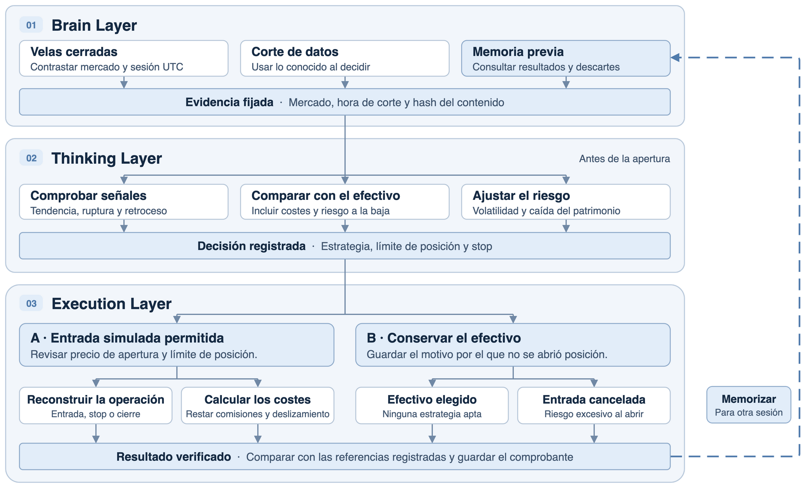
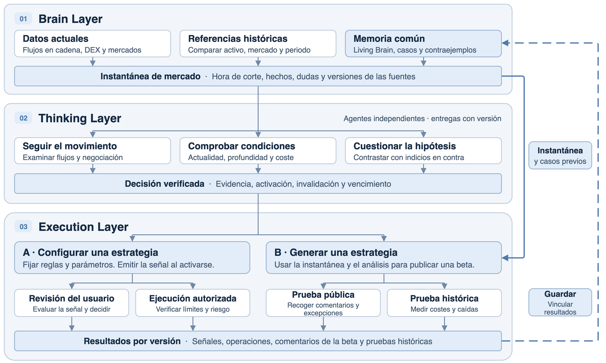

# Astarter en BNB Bangkok

**Solo tienes una oportunidad de dejar constancia de una decisión antes de que el mercado la ponga a prueba.**

[English](README.md) · [简体中文](README.zh-CN.md) · [日本語](README.ja.md) · [한국어](README.ko.md) · [Tiếng Việt](README.vi.md) · **Español** · [Français](README.fr.md) · [Русский](README.ru.md)

Astarter es un sistema operativo de trading con IA. Antes de que abra la siguiente sesión UTC, su motor de simulación al contado registra los datos disponibles, la estrategia elegida y la posición máxima permitida. Al cierre puedes comprobar si respetó la decisión y cuánto ganó o perdió después de costes. También queda constancia de los días en efectivo.

[Ver la demo del producto (2:57)](https://brunopike.github.io/astarter-bnb-bangkok/) · [Abrir Deep Brain](https://dapp.ipfund.art/?page=brain&lang=es) · [Verificar en local](src/deep-brain) · [BNB Bangkok](https://www.hackquest.io/hackathons/BNB-Bangkok)

**Guías técnicas en inglés**

[36 agentes y la CLI](AI-AGENTS-AND-CLI/README.md) · [Binance Agent OS y su billetera](BINANCE-AGENT-OS/README.md) · [Living Brain de ChatAndBuild](CHATANDBUILD-LIVING-BRAIN/README.md) · [BNB Chain y RWA](BNB-CHAIN-RWA/README.md) · [CoinMarketCap × Atlas](COINMARKETCAP-ATLAS/README.md) · [Plan de créditos de AWS](AWS-CREDITS-PLAN/README.md)

## Cómo investigan los agentes un activo del mundo real (RWA)

Los **18 Team agents** se reparten la investigación. A05 examina la liquidez, A10 busca indicios que contradigan la tesis y A15 revisa el capital en riesgo. Los **18 Strategy agents** definen el mercado y las reglas de entrada, salida y riesgo de cada estrategia. El motor de simulación al contado compara tendencia, ruptura y retroceso con mantener efectivo. Con **Living Brain**, otro agente puede recuperar un plan o una lección y rastrear el origen de un registro. Para explicar un resultado, el modelo lee el registro verificado. La respuesta conserva el identificador del registro y el hash de la entrada.

Para la acción tokenizada NVDAB, la **Astarter CLI** devuelve en JSON la cotización de Atlas en USD y su hora de actualización. El asistente ofrece investigación de mercado y consultas de cuenta autorizadas mediante sus herramientas de **Binance Agent OS**. En la configuración, **Binance Agentic Wallet** verifica el control de una dirección con una firma de corta duración en BNB Chain. Gastar fondos requiere una autorización independiente.

[Team agents](src/astarter-frontend/simulation.mjs) · [Strategy agents](https://dapp.ipfund.art/agents) · [Astarter CLI](https://demo.astarter.io/cli/astarter.mjs) · [Agentic Wallet](https://demo.astarter.io/settings#ux-local-agent) · [Binance Agent OS](https://www.binance.com/en-ZA/agent-os) · [Living Brain](src/astarter-frontend/living-brain.mjs)

## BNB Bangkok · Evidencia técnica

| Categoría | Qué se puede comprobar |
| --- | --- |
| **Developer Track** | Lee la cotización de una acción tokenizada en BNB Smart Chain y examina las pruebas, el límite de posición y el veto de entrada de una decisión simulada al contado. Se pueden rastrear tanto el motivo de la elección como los límites del riesgo. [Fuente en cadena](https://atlasoracle.io/feeds/1005) · [Informe de decisión](https://dapp.ipfund.art/api/brain/proof?brief=1&asset=coin:bitcoin) |
| **CoinMarketCap × Atlas Challenge** | Market Hub muestra la dimensión y el sentimiento del mercado de CoinMarketCap junto a cotizaciones Atlas con hora de origen. Consulta la respuesta Pull de NVDAB/USD (#934) y lee por separado la fuente Push de BNB Chain (#1005). [Market Hub](https://dapp.ipfund.art/?page=markets&lang=es) · [Respuesta CMC](https://dapp.ipfund.art/api/market-hub?resource=global) · [Respuesta Atlas](https://dapp.ipfund.art/api/atlas/prices?symbol=NVDAB) · [Ficha técnica en inglés](docs/bnb-bangkok-technical-brief.md) |
| **ChatAndBuild — Build Memory-Powered Agents with Living Brain** | Un agente posterior puede recuperar reglas, planes por cartera y lecciones de la estrategia. La vía de comprobantes guarda la decisión simulada por la API de Living Brain y verifica el hash al recuperarla antes de pedir al modelo que la explique. [API de memoria](src/astarter-frontend/living-brain.mjs) · [Verificación del comprobante](src/deep-brain/paper-replay/connections.mjs) |
| **AWS Credits** | El plan para los créditos es ejecutar en la nube la recogida y conciliación diaria, conservar pruebas fechadas en almacenamiento de objetos y medir el coste por sesión verificada. Es la propuesta de ampliación para la presentación de la empresa. [Proceso diario](src/deep-brain/scripts/brain-proof-forward.mjs) · [Criterios oficiales](https://www.hackquest.io/hackathons/BNB-Bangkok) |

## ¿Qué justifica una operación?

| Capa | Pregunta | Pruebas que puedes consultar |
| --- | --- | --- |
| **[Brain Layer](src/deep-brain/brain-agent-recall.mjs)** | ¿Qué podía saber el agente en ese momento? | Contrasta las velas cerradas con el mercado de origen y fija la fuente, la hora de corte UTC y el hash del contenido. Para el mismo activo puede recuperar hasta tres recuerdos pertinentes de los siete días UTC anteriores, incluidos los descartes. Un comprobante que llegó más tarde solo se incorpora a revisiones posteriores. |
| **[Thinking Layer](src/deep-brain/brain-strategy-witness.mjs)** | ¿Por qué esta estrategia y este tamaño hoy? | Las estrategias de tendencia, ruptura y retroceso compiten con la opción de conservar efectivo. Para ser elegible, una estrategia necesita una señal vigente, suficientes observaciones y una puntuación positiva tras considerar costes simulados y riesgo a la baja. Se fijan un límite de posición y un stop. Una volatilidad elevada o una caída del patrimonio activa la política conservadora. Manteniendo fija la señal actual, el motor excluye por turnos cada uno de los 60 días de calibración y muestra qué exclusiones alteran la elección. |
| **[Execution Layer](src/deep-brain/brain-execution-invariants.mjs)** | ¿La operación simulada respetó la decisión? | La instrucción lleva el identificador de la decisión. Un salto de precio en la apertura puede impedir la entrada y los controles de riesgo pueden reducir la posición. Tras contrastar de forma independiente la vela cerrada, el verificador reconstruye entrada, salida, deslizamiento, comisiones y patrimonio final. La rentabilidad queda sin valor mientras no haya liquidación. |

[](docs/images/es/decision-proof.drawio.png)

**¿Cómo saber si ayuda?** Sigue las decisiones registradas por adelantado, incluidas las sesiones sin operación. Cuando hay un plan de comparación, se registran antes de la apertura dos referencias. Una conserva el efectivo. La otra invierte el 10% del capital entre apertura y cierre, con comisiones y deslizamiento. Compara rendimientos netos, pérdidas y caídas desde máximos en las mismas sesiones. Así puedes evaluar el riesgo asumido durante ese periodo. La próxima sesión sigue abierta. [Consultar el informe de solo lectura](https://dapp.ipfund.art/api/brain/proof?brief=1&asset=coin:bitcoin) · [Cálculo de las referencias](src/deep-brain/brain-forward-comparison.mjs)

### Arquitectura de la memoria compartida

Los agentes investigan a partir de la misma instantánea y se transmiten las pruebas y las preguntas abiertas. Una estrategia existente puede emitir señales según su política. Una propuesta pasa a pruebas con sus parámetros y su justificación. Cada resultado conserva la versión para que el siguiente agente pueda rastrear los cambios de reglas.

[](docs/images/es/shared-brain-flow.drawio.png)

## Qué se puede verificar

- **CoinMarketCap.** Los [adaptadores de mercado](src/astarter-frontend/market-source-adapters.mjs) normalizan datos de mercados, categorías y sentimiento de la Pro API para Market Hub.

- **Atlas en BNB Chain.** El [catálogo](src/astarter-frontend/atlas-feed-master.mjs) vincula NVDAB con sus fuentes de precios. El adaptador configurado lee cotizaciones Pull con marca de tiempo. La [fuente #1005](https://atlasoracle.io/feeds/1005) ofrece también una referencia Push pública verificable en la cadena.

- **Living Brain.** El [adaptador de memoria](src/astarter-frontend/living-brain.mjs) guarda y recupera planes por cartera. Las [pruebas](src/astarter-frontend/living-brain.test.mjs) cubren el hash de los identificadores y la ocultación de datos sensibles.

- **Simulación y riesgo.** Las [guías del motor](src/astarter-backend/README.en.md) documentan los controles previos, las ejecuciones simuladas y la reconstrucción de operaciones.

La demo local funciona en simulación. La coordinación continua entre agentes, la publicación de betas públicas y la incorporación automática de comentarios son objetivos de diseño.

## Verificar una decisión en local

Con Node.js 24, ejecuta estos comandos desde la raíz del repositorio. El verificador lee el archivo de mercado y comprueba la decisión y sus registros de ejecución.

```sh
cd src/deep-brain
npm run verify
npm test
```

[Recoger datos nuevos, registrar sesiones simuladas por adelantado o consultar la memoria de un agente](src/deep-brain/paper-replay/README.md).

## Interfaz y paquetes de datos

La interfaz predeterminada sigue la rama HACKATHON desplegada. Deep Brain permite elegir un activo e inspeccionar las pruebas detrás de cada nodo. La [demo alojada](https://dapp.ipfund.art/?page=brain&lang=es) incluye un retrato de partículas con licencia. Esta rama incluye su propio retrato de partículas. Pulsa **Explore** para abrir el grafo o entra en la [mesa Lite](https://demo.astarter.io/lite?lang=es) para consultar señales. Selecciona una operación simulada en Backtest Review y consulta en Agent Learning su comprobante, las puntuaciones y la decisión siguiente.

Historical Blocks cubre Bitcoin y Ethereum desde enero de 2016, BNB Smart Chain desde su primer bloque posterior al génesis y muestras fechadas de Solana y HyperCore. Selecciona una cadena y una fecha UTC para ver alturas o slots, tiempos y recuentos de transacciones. El visor distingue días completos de muestras. [Cobertura](src/astarter-frontend/brain-evidence/archive/summary.json) · [Fuentes y hashes SHA-256](src/astarter-frontend/brain-evidence/archive/manifest.json)

Traditional Markets v0.8.1 contiene 219.069.823 observaciones verificadas en 5.170 series de acciones, índices, metales preciosos, divisas, crudo y otras materias primas desde 2016. Cada precio conserva editor, unidad, fecha y frecuencia. Las series de Chainlink en Ethereum, Arbitrum y Avalanche identifican fuente, ronda, hora de actualización y bloque de lectura. El WTI al contado y su referencia de futuros son instrumentos distintos. [Fuentes y derechos](src/astarter-frontend/docs/brain-tradfi-sources.md) · [Catálogo](src/astarter-frontend/brain-evidence/tradfi/catalog.json) · [Actualizaciones diarias](https://github.com/brunopike/astarter-bnb-bangkok/actions/workflows/brain-history.yml)

La [versión de la interfaz](https://github.com/brunopike/astarter-bnb-bangkok/releases/tag/v0.8.1-frontend) incluye el código probado y sus sumas de verificación. La rama main recibe datos verificados a diario. También está disponible la [versión histórica de la funcionalidad](https://github.com/brunopike/astarter-bnb-bangkok/releases/tag/v0.5.0-frontend).

## Ejecutar en local

Node.js 24 · npm

```sh
cd src/astarter-frontend
npm ci
npm start
```

Abre [Astarter en localhost](http://127.0.0.1:4188/). El catálogo público de Atlas funciona sin clave API.

```sh
curl -fsS 'http://127.0.0.1:4188/api/atlas/feeds?symbol=NVDAB'
```

Los adaptadores opcionales leen en el servidor `COINMARKETCAP_API_KEY`, `ATLAS_API_KEY` y, para Living Brain, `LIVING_BRAIN_API_KEY`, `LIVING_BRAIN_SUBJECT_ID` y `LIVING_BRAIN_BRAIN_ID`.

<details>
<summary>Reproducir la lectura de precios en BNB Chain y ejecutar pruebas específicas</summary>

Con Foundry, consulta en modo de solo lectura la referencia Atlas Push de NVDAB. El segundo valor devuelto es el precio con 18 decimales y el cuarto es el momento de actualización en la cadena.

```sh
cast call 0xf25af12920d408baf6211e9e90eda89df3d8ccda \
  'latestRoundData()(uint80,int256,uint256,uint256,uint80)' \
  --rpc-url https://bsc-dataseed.bnbchain.org
```

Desde `src/astarter-frontend`, ejecuta las pruebas del catálogo, adaptadores, memoria y pago simulado.

```sh
node --check atlas-feed-master.mjs
node --check market-source-adapters.mjs
node --import ./test-locale.mjs --test living-brain.test.mjs commerce.test.mjs
```

La [versión v0.1.0](https://github.com/brunopike/astarter-bnb-bangkok/releases/tag/v0.1.0) contiene una instantánea conjunta del código de la interfaz y del servidor.

</details>
