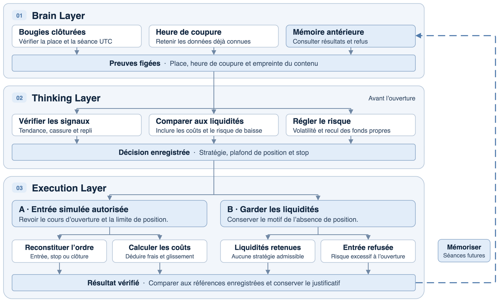
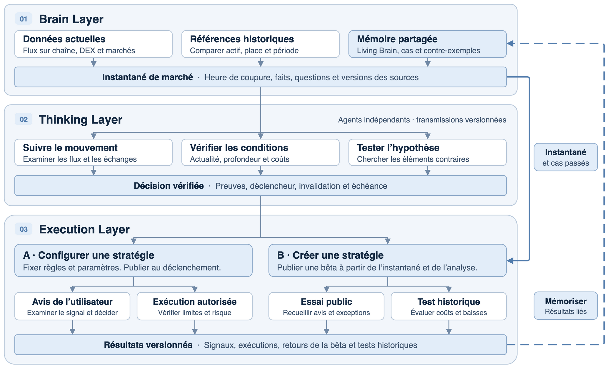

# Astarter à BNB Bangkok

**Vous n’avez qu’une occasion de consigner une décision avant que le marché la mette à l’épreuve.**

[English](README.md) · [简体中文](README.zh-CN.md) · [日本語](README.ja.md) · [한국어](README.ko.md) · [Tiếng Việt](README.vi.md) · [Español](README.es.md) · **Français** · [Русский](README.ru.md)

Astarter est un système d’exploitation de trading fondé sur l’IA. Avant l’ouverture de la prochaine séance UTC, son moteur de simulation au comptant enregistre les données de marché, la stratégie retenue et la taille maximale de la position. À la clôture, vous pouvez vérifier si la décision a été respectée et calculer le gain ou la perte après frais. Les séances passées en liquidités figurent aussi au registre.

[Ouvrir Deep Brain](https://dapp.ipfund.art/?page=brain&lang=fr) · [Vérifier en local](src/deep-brain) · [BNB Bangkok](https://www.hackquest.io/hackathons/BNB-Bangkok)

**Guides techniques en anglais**

[36 agents et la CLI](AI-AGENTS-AND-CLI/README.md) · [Binance Agent OS et son portefeuille](BINANCE-AGENT-OS/README.md) · [Living Brain de ChatAndBuild](CHATANDBUILD-LIVING-BRAIN/README.md) · [BNB Chain et RWA](BNB-CHAIN-RWA/README.md) · [CoinMarketCap × Atlas](COINMARKETCAP-ATLAS/README.md) · [Utilisation prévue des crédits AWS](AWS-CREDITS-PLAN/README.md)

## Comment les agents étudient un actif du monde réel (RWA)

Les **18 Team agents** se partagent la recherche. A05 examine la liquidité, A10 cherche des éléments qui contredisent la thèse et A15 évalue le capital exposé. Les **18 Strategy agents** définissent le marché et les règles d’entrée, de sortie et de risque de chaque stratégie. Le moteur de simulation au comptant compare le suivi de tendance, la cassure et le repli avec la conservation de liquidités. Grâce à **Living Brain**, l’agent suivant peut retrouver un plan ou un enseignement et remonter à la source d’un reçu. Pour expliquer un résultat, le modèle lit le reçu vérifié. Sa réponse conserve l’identifiant du reçu et l’empreinte des données fournies.

Pour l’action tokenisée NVDAB, l’**Astarter CLI** renvoie le cours en dollars fourni par Atlas et son heure de mise à jour au format JSON. L’assistant propose des outils **Binance Agent OS** pour étudier le marché et consulter les données de compte autorisées. Dans les réglages, **Binance Agentic Wallet** vérifie le contrôle d’une adresse à l’aide d’une signature de courte durée sur BNB Chain. Dépenser des fonds demande une autorisation distincte.

[Team agents](src/astarter-frontend/simulation.mjs) · [Strategy agents](https://dapp.ipfund.art/agents) · [Astarter CLI](https://demo.astarter.io/cli/astarter.mjs) · [Agentic Wallet](https://demo.astarter.io/settings#ux-local-agent) · [Binance Agent OS](https://www.binance.com/en-ZA/agent-os) · [Living Brain](src/astarter-frontend/living-brain.mjs)

## BNB Bangkok · Éléments techniques

| Catégorie | Ce que le jury peut vérifier |
| --- | --- |
| **Developer Track** | Lisez le cours d’une action tokenisée sur BNB Smart Chain, puis examinez les preuves, le plafond de position et le veto à l’entrée d’une décision simulée au comptant. On peut retracer la justification de l’ordre et la limite de risque. [Flux sur chaîne](https://atlasoracle.io/feeds/1005) · [Synthèse de décision](https://dapp.ipfund.art/api/brain/proof?brief=1&asset=coin:bitcoin) |
| **CoinMarketCap × Atlas Challenge** | Market Hub présente la taille du marché et le sentiment fournis par CoinMarketCap ainsi que les cotations horodatées d’Atlas. Consultez la réponse Pull NVDAB/USD (nº 934) et lisez séparément le flux Push sur BNB Chain (nº 1005). [Market Hub](https://dapp.ipfund.art/?page=markets&lang=fr) · [Réponse CMC](https://dapp.ipfund.art/api/market-hub?resource=global) · [Réponse Atlas](https://dapp.ipfund.art/api/atlas/prices?symbol=NVDAB) · [Fiche technique en anglais](docs/bnb-bangkok-technical-brief.md) |
| **ChatAndBuild — Build Memory-Powered Agents with Living Brain** | Un autre agent peut retrouver les règles, les plans par portefeuille et les enseignements d’une stratégie. La décision simulée est conservée via l’API Living Brain. L’empreinte du contenu relu est contrôlée avant son examen par le modèle. [API mémoire](src/astarter-frontend/living-brain.mjs) · [Contrôle du justificatif](src/deep-brain/paper-replay/connections.mjs) |
| **AWS Credits** | Le projet prévoit d’utiliser les crédits pour la collecte et le rapprochement quotidiens dans le cloud, l’archivage des preuves datées dans un stockage objet et la mesure du coût par séance vérifiée. C’est le plan de montée en charge proposé pour le pitch. [Traitement quotidien](src/deep-brain/scripts/brain-proof-forward.mjs) · [Critères officiels](https://www.hackquest.io/hackathons/BNB-Bangkok) |

## Qu’est-ce qui justifie une prise de position ?

| Couche | Question | Éléments vérifiables |
| --- | --- | --- |
| **[Brain Layer](src/deep-brain/brain-agent-recall.mjs)** | Que pouvait savoir l’agent à cet instant ? | Le moteur vérifie les bougies clôturées auprès de la plateforme d’origine, puis fige la source, l’heure limite en UTC et l’empreinte du contenu. Pour un même actif, il peut retrouver jusqu’à trois éléments pertinents parmi les sept jours UTC précédents, y compris des refus. Un justificatif arrivé plus tard sert uniquement à une analyse ultérieure. |
| **[Thinking Layer](src/deep-brain/brain-strategy-witness.mjs)** | Pourquoi cette stratégie et cette taille aujourd’hui ? | Les stratégies de suivi de tendance, de cassure et de repli sont comparées au maintien en liquidités. Il faut un signal actuel, assez d’observations et un score positif après prise en compte des coûts simulés et du risque de baisse. Le moteur fixe un plafond de position et un seuil de sortie. Une volatilité élevée ou un recul des fonds propres déclenche la politique prudente. À signal constant, il retire tour à tour chacun des 60 jours de calibrage et identifie ceux dont le retrait modifie le classement. |
| **[Execution Layer](src/deep-brain/brain-execution-invariants.mjs)** | L’exécution simulée a-t-elle respecté la décision ? | L’instruction est rattachée à l’identifiant de la décision. Un écart de cours à l’ouverture peut empêcher l’entrée, et le contrôle du risque peut réduire la position. Après vérification indépendante de la bougie clôturée, le vérificateur recalcule les cours d’entrée et de sortie, le glissement, les frais et le capital final. Le rendement reste vide tant que le résultat n’est pas liquidé. |

[](docs/images/fr/decision-proof.drawio.png)

**Comment savoir si cela apporte un avantage ?** Suivez les décisions enregistrées à l’avance, même les jours sans opération. Lorsqu’une comparaison est prévue, le moteur enregistre deux références avant l’ouverture. L’une conserve les liquidités. L’autre investit 10 % du capital de l’ouverture à la clôture, frais et glissement compris. Comparez les résultats nets, les pertes et les replis depuis les plus hauts sur les mêmes séances. Vous pouvez ainsi juger si le risque a été rémunéré sur la période. La séance suivante reste à évaluer. [Consulter la synthèse en lecture seule](https://dapp.ipfund.art/api/brain/proof?brief=1&asset=coin:bitcoin) · [Calcul des références](src/deep-brain/brain-forward-comparison.mjs)

### Architecture de la mémoire partagée

Les agents travaillent sur le même instantané et se transmettent les éléments probants et les questions en suspens. Une stratégie existante peut émettre un signal selon sa politique. Une stratégie proposée passe en test avec ses paramètres et ses justificatifs. Les résultats sont versionnés afin de retracer les changements de règles.

[](docs/images/fr/shared-brain-flow.drawio.png)

## Ce que vous pouvez vérifier

- **CoinMarketCap.** Les [adaptateurs](src/astarter-frontend/market-source-adapters.mjs) harmonisent les données de marché, de catégorie et de sentiment de la Pro API pour Market Hub.

- **Atlas sur BNB Chain.** Le [catalogue](src/astarter-frontend/atlas-feed-master.mjs) associe NVDAB aux flux Atlas. Une fois configuré, l’adaptateur lit les cotations Pull horodatées. Le [flux nº 1005](https://atlasoracle.io/feeds/1005) fournit aussi une référence Push publique vérifiable sur la chaîne.

- **Living Brain.** L’[adaptateur mémoire](src/astarter-frontend/living-brain.mjs) conserve et restitue les plans par portefeuille. Les [tests](src/astarter-frontend/living-brain.test.mjs) vérifient le hachage des identifiants et le masquage des informations sensibles.

- **Simulation et risque.** Les [guides du moteur](src/astarter-backend/README.en.md) présentent les contrôles préalables, les exécutions simulées et leur reconstitution.

La démonstration locale fonctionne en simulation. L’ordonnancement continu entre agents, la publication de bêtas publiques et la collecte automatique des retours figurent parmi les objectifs de conception.

## Vérifier une décision en local

Avec Node.js 24, exécutez ces commandes à la racine du dépôt. Le vérificateur lit l’archive de marché et contrôle la décision ainsi que ses justificatifs d’exécution.

```sh
cd src/deep-brain
npm run verify
npm test
```

[Collecter des observations, enregistrer de futures séances simulées ou consulter la mémoire d’un agent](src/deep-brain/paper-replay/README.md).

## Interface et jeux de données

L’interface par défaut suit la branche HACKATHON déployée. Dans Deep Brain, sélectionnez un actif pour examiner les sources de chaque nœud. La [démo hébergée](https://dapp.ipfund.art/?page=brain&lang=fr) comprend également un portrait en particules sous licence. La version ouverte s’ouvre sur le graphe interactif. Dans Backtest Review, sélectionnez une opération simulée, puis consultez dans Agent Learning son justificatif, les scores des stratégies et la décision suivante.

Historical Blocks couvre Bitcoin et Ethereum depuis janvier 2016, BNB Smart Chain depuis le premier bloc après la genèse et des échantillons datés de Solana et HyperCore. Sélectionnez une chaîne et une date UTC pour consulter hauteurs ou slots, horaires et nombre de transactions. Les journées complètes sont distinguées des échantillons. [Couverture](src/astarter-frontend/brain-evidence/archive/summary.json) · [Sources et empreintes SHA-256](src/astarter-frontend/brain-evidence/archive/manifest.json)

Traditional Markets v0.8.1 compte 219 069 823 observations vérifiées dans 5 170 séries depuis 2016, dont actions, indices, métaux précieux, devises, pétrole brut et autres matières premières. Chaque prix conserve son éditeur, son unité, sa date et sa fréquence. Les séries Chainlink sur Ethereum, Arbitrum et Avalanche indiquent aussi le flux, le tour, l’heure de mise à jour et le bloc consulté. Le WTI au comptant et sa référence à terme sont distincts. [Sources et droits](src/astarter-frontend/docs/brain-tradfi-sources.md) · [Catalogue](src/astarter-frontend/brain-evidence/tradfi/catalog.json) · [Mises à jour quotidiennes](https://github.com/brunopike/astarter-bnb-bangkok/actions/workflows/brain-history.yml)

La [version de l’interface](https://github.com/brunopike/astarter-bnb-bangkok/releases/tag/v0.8.1-frontend) contient les sources testées et leurs sommes de contrôle. La branche main reçoit chaque jour les données vérifiées. L’[ancienne version fonctionnelle](https://github.com/brunopike/astarter-bnb-bangkok/releases/tag/v0.5.0-frontend) reste disponible.

## Exécuter en local

Node.js 24 · npm

```sh
cd src/astarter-frontend
npm ci
npm start
```

Ouvrez [Astarter sur localhost](http://127.0.0.1:4188/). Le catalogue public Atlas fonctionne sans clé API.

```sh
curl -fsS 'http://127.0.0.1:4188/api/atlas/feeds?symbol=NVDAB'
```

Les connecteurs temps réel facultatifs lisent la configuration du serveur via `COINMARKETCAP_API_KEY`, `ATLAS_API_KEY` et, pour Living Brain, `LIVING_BRAIN_API_KEY`, `LIVING_BRAIN_SUBJECT_ID` et `LIVING_BRAIN_BRAIN_ID`.

<details>
<summary>Reproduire la lecture du prix sur BNB Chain et les tests ciblés</summary>

Avec Foundry, interrogez en lecture seule la référence Atlas Push de NVDAB. La deuxième valeur renvoyée est le prix exprimé avec 18 décimales. La quatrième est l’horodatage de la mise à jour sur la chaîne.

```sh
cast call 0xf25af12920d408baf6211e9e90eda89df3d8ccda \
  'latestRoundData()(uint80,int256,uint256,uint256,uint80)' \
  --rpc-url https://bsc-dataseed.bnbchain.org
```

Depuis `src/astarter-frontend`, exécutez les tests du catalogue, des adaptateurs, de la mémoire et du paiement simulé.

```sh
node --check atlas-feed-master.mjs
node --check market-source-adapters.mjs
node --import ./test-locale.mjs --test living-brain.test.mjs commerce.test.mjs
```

La [version v0.1.0](https://github.com/brunopike/astarter-bnb-bangkok/releases/tag/v0.1.0) regroupe les sources de l’interface et du serveur.

</details>
