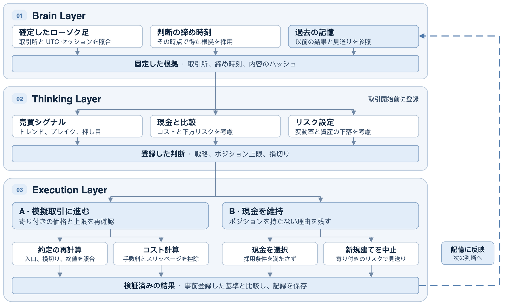
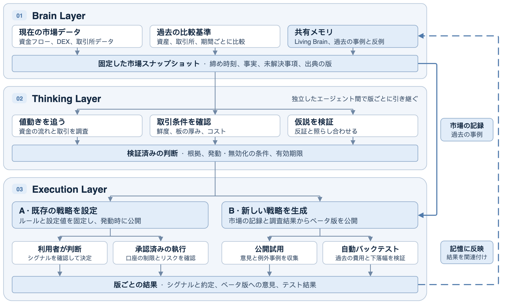

# Astarter — BNB Bangkok

**相場が答えを出す前に、売買判断を記録できる機会は一度しかありません。**

[English](README.md) · [简体中文](README.zh-CN.md) · **日本語** · [한국어](README.ko.md) · [Tiếng Việt](README.vi.md) · [Español](README.es.md) · [Français](README.fr.md) · [Русский](README.ru.md)

Astarter は AI トレーディング OS です。現物の模擬取引エンジンは、翌 UTC 取引日の開始前に、市場データ、選んだ戦略、許容する最大ポジションを記録します。取引終了後には、判断どおりに執行したか、コストを差し引いていくら残ったかを照合できます。現金を維持した日も記録に残ります。

[Deep Brain を開く](https://dapp.ipfund.art/?page=brain&lang=ja) · [手元で検証する](src/deep-brain) · [BNB Bangkok](https://www.hackquest.io/hackathons/BNB-Bangkok)

## エージェントが RWA を調査する仕組み

**18 の Team agents** が調査を分担します。A05 は流動性、A10 は仮説に対する反証、A15 は資本リスクを検討します。**18 の Strategy agents** にはそれぞれ対象市場、売買条件、リスク管理ルールがあります。現物の模擬取引では、トレンド、ブレイクアウト、押し目と現金保有を比較します。**Living Brain** から次の担当が過去の計画や教訓を取り出し、記録の出所を確かめられます。損益の理由を説明するとき、モデルは検証済みの取引記録を読み、回答には記録 ID と入力のハッシュが付きます。

株式をトークン化した NVDAB の場合、**Astarter CLI** で Atlas のドル建て価格と更新時刻を JSON で取得できます。アシスタントの **Binance Agent OS** では市場調査と、許可された口座情報の照会ができます。設定画面の **Binance Agentic Wallet** は有効期限の短い BNB Chain の署名でアドレスの管理権を確認します。資金を動かすには別途承認が必要です。

[Team agents](src/astarter-frontend/simulation.mjs) · [Strategy agents](https://dapp.ipfund.art/agents) · [Astarter CLI](https://demo.astarter.io/cli/astarter.mjs) · [Agentic Wallet](https://demo.astarter.io/settings#ux-local-agent) · [Binance Agent OS](https://www.binance.com/en-ZA/agent-os) · [Living Brain](src/astarter-frontend/living-brain.mjs)

## BNB Bangkok · 技術審査の確認先

| 部門・賞 | 検証できる項目 |
| --- | --- |
| **Developer Track** | BNB Smart Chain 上でトークン化株式の価格を読み、現物の模擬取引で使う根拠、ポジション上限、見送り条件を確認できます。エージェントが取引を選んだ理由とリスクの限界を追えます。 [オンチェーン価格](https://atlasoracle.io/feeds/1005) · [判断の概要](https://dapp.ipfund.art/api/brain/proof?brief=1&asset=coin:bitcoin) |
| **CoinMarketCap × Atlas Challenge** | Market Hub は CoinMarketCap の市場規模・センチメントと時刻付きの Atlas 価格を表示します。NVDAB/USD の Pull 応答（#934）と BNB Chain の独立した Push フィード（#1005）を確認できます。 [Market Hub](https://dapp.ipfund.art/?page=markets&lang=ja) · [CMC 応答](https://dapp.ipfund.art/api/market-hub?resource=global) · [Atlas 応答](https://dapp.ipfund.art/api/atlas/prices?symbol=NVDAB) · [技術概要（英語）](docs/bnb-bangkok-technical-brief.md) |
| **ChatAndBuild — Build Memory-Powered Agents with Living Brain** | 後続のエージェントは戦略ルール、ウォレット単位の計画、過去の教訓を検索できます。模擬取引の記録を Living Brain API に保存し、取得内容のハッシュを検証してからモデルで分析します。 [記憶 API](src/astarter-frontend/living-brain.mjs) · [記録の検証](src/deep-brain/paper-replay/connections.mjs) |
| **AWS Credits** | クレジットの活用案は日次の観測・照合処理をクラウドで実行し、日付付きの根拠をオブジェクトストレージに保存して、検証済みセッション当たりの費用を測ることです。ピッチで示す本番向け拡張計画です。 [日次ワーカー](src/deep-brain/scripts/brain-proof-forward.mjs) · [公式基準](https://www.hackquest.io/hackathons/BNB-Bangkok) |

## どんな条件なら取引に踏み切れるか

| レイヤー | 判断の焦点 | 確認できる記録 |
| --- | --- | --- |
| **[Brain Layer](src/deep-brain/brain-agent-recall.mjs)** | その時点で何が分かっていたか | 確定足を取引所の記録と照合し、出典、UTC の締め時刻、内容のハッシュを固定します。同じ資産について、過去 7 UTC 日から見送りを含む関連記録を最大 3 件取得できます。後から届いた執行記録は、それ以降の検証に使います。 |
| **[Thinking Layer](src/deep-brain/brain-strategy-witness.mjs)** | なぜ今日、この戦略と数量なのか | トレンド、ブレイクアウト、押し目買いを現金保有と比較します。現在のシグナル、十分な観測数、想定コストと下方リスクを考慮した正のスコアが採用条件です。採用時にポジション上限と損切りを設定し、高ボラティリティや資産額の下落時は保守的なルールに切り替えます。現在のシグナルを固定して較正期間の 60 日を 1 日ずつ除き、順位が逆転する日を確認できます。 |
| **[Execution Layer](src/deep-brain/brain-execution-invariants.mjs)** | 模擬取引は事前の判断に従ったか | 執行指示は判断 ID に紐づきます。寄り付きのギャップで見送りになる場合や、リスク検査で数量を減らす場合があります。確定足を独立に照合した後、検証器が売買価格、スリッページ、手数料、期末資産を再計算します。未決済の損益は空欄です。 |

[](docs/images/ja/decision-proof.drawio.png)

**役に立ったか、どう確かめるか** 事前に登録された判断を、見送りの日も含めて追跡します。比較可能な日には、終日現金を保有する場合と、資金の 10% で寄りから引けまで保有し手数料とスリッページを負担する場合を事前登録します。同じ期間で純損益、損失、ドローダウンを比較すれば、その期間に取ったリスクが報われたかを評価できます。次の取引日の結果はまだ分かりません。[読み取り専用の判断概要](https://dapp.ipfund.art/api/brain/proof?brief=1&asset=coin:bitcoin) · [比較基準の計算](src/deep-brain/brain-forward-comparison.mjs)

### 共有メモリの構成

各エージェントは同じスナップショットを調べ、根拠と未解決事項を引き継ぎます。既存の戦略は設定済みの条件でシグナルを出します。新しい戦略はパラメーターと根拠を添えてテストへ進みます。結果にはバージョンが付き、変更理由を後から追えます。

[](docs/images/ja/shared-brain-flow.drawio.png)

## このリリースで検証できること

- **CoinMarketCap** の[アダプター](src/astarter-frontend/market-source-adapters.mjs)は、Pro API の市場・カテゴリー・センチメントデータを Market Hub に取り込みます。

- **BNB Chain の Atlas** は[フィード一覧](src/astarter-frontend/atlas-feed-master.mjs)で NVDAB を対応付けます。設定後は時刻付きの Pull 価格を取得でき、[フィード #1005](https://atlasoracle.io/feeds/1005) のオンチェーン Push 価格も別途照合できます。

- **Living Brain** の[アダプター](src/astarter-frontend/living-brain.mjs)はウォレット単位で取引計画を保存・取得します。[テスト](src/astarter-frontend/living-brain.test.mjs)で識別子のハッシュ化と情報のマスキングを確認できます。

- **模擬取引とリスク管理**の[エンジンガイド](src/astarter-backend/README.en.md)で、執行前の検査、模擬約定、執行結果の再検証を確認できます。

ローカルデモは模擬取引です。エージェント間の継続的なスケジューリング、公開ベータの配信、フィードバックの自動収集は今後の設計目標です。

## 判断を手元で検証する

Node.js 24 を使い、リポジトリのルートから実行します。検証器は相場アーカイブから判断と執行記録を照合します。

```sh
cd src/deep-brain
npm run verify
npm test
```

[新しい観測の収集、将来日の模擬取引の登録、エージェントの記憶の照会](src/deep-brain/paper-replay/README.md)。

## フロントエンドとデータ

標準のフロントエンドはデプロイ済みの HACKATHON ブランチに対応します。Deep Brain で資産を選ぶとノードの根拠が見られます。[公開デモ](https://dapp.ipfund.art/?page=brain&lang=ja)にはライセンス付きの粒子ポートレートもあります。公開ソース版の開始画面は対話型グラフです。Backtest Review で模擬約定を選ぶと、Agent Learning で執行記録、戦略スコア、次の判断を比較できます。

Historical Blocks は 2016 年 1 月以降の Bitcoin と Ethereum、BNB Smart Chain の創世ブロック直後からの記録、Solana と HyperCore の日付付きサンプルを収録しています。チェーンと UTC 日付を選ぶと、高さまたはスロット、時刻、取引数を確認できます。日次の全件と標本を区別して表示します。[収録範囲](src/astarter-frontend/brain-evidence/archive/summary.json) · [出典と SHA-256](src/astarter-frontend/brain-evidence/archive/manifest.json)

Traditional Markets の v0.8.1 は 2016 年以降の株式、指数、貴金属、為替、原油などを収録し、5,170 系列、219,069,823 件の検証済み観測を含みます。各価格に公表元、単位、日付、頻度が付きます。Ethereum、Arbitrum、Avalanche の Chainlink 系列ではフィード、ラウンド、更新時刻、参照ブロックも追跡できます。WTI 現物と先物指標は別系列です。[出典と利用条件](src/astarter-frontend/docs/brain-tradfi-sources.md) · [一覧](src/astarter-frontend/brain-evidence/tradfi/catalog.json) · [日次更新](https://github.com/brunopike/astarter-bnb-bangkok/actions/workflows/brain-history.yml)

[フロントエンド配布版](https://github.com/brunopike/astarter-bnb-bangkok/releases/tag/v0.8.1-frontend)にはテスト済みのソースとチェックサムが含まれます。main の検証済みデータは毎日更新されます。[過去の機能別スナップショット](https://github.com/brunopike/astarter-bnb-bangkok/releases/tag/v0.5.0-frontend)も参照できます。

## ローカルで起動する

Node.js 24 · npm

```sh
cd src/astarter-frontend
npm ci
npm start
```

[ローカルの Astarter](http://127.0.0.1:4188/) を開きます。公開 Atlas カタログは API キーなしで利用できます。

```sh
curl -fsS 'http://127.0.0.1:4188/api/atlas/feeds?symbol=NVDAB'
```

任意のライブ接続ではサーバー側に `COINMARKETCAP_API_KEY`、`ATLAS_API_KEY` を設定します。Living Brain は `LIVING_BRAIN_API_KEY`、`LIVING_BRAIN_SUBJECT_ID`、`LIVING_BRAIN_BRAIN_ID` を使います。

<details>
<summary>BNB Chain の価格取得と個別テストを再現する</summary>

Foundry で NVDAB の Atlas Push フィードを読み取ります。2 番目の値は小数 18 桁で表した価格、4 番目はオンチェーンの更新時刻です。

```sh
cast call 0xf25af12920d408baf6211e9e90eda89df3d8ccda \
  'latestRoundData()(uint80,int256,uint256,uint256,uint80)' \
  --rpc-url https://bsc-dataseed.bnbchain.org
```

`src/astarter-frontend` でカタログ、アダプター、記憶、模擬決済のテストを実行します。

```sh
node --check atlas-feed-master.mjs
node --check market-source-adapters.mjs
node --import ./test-locale.mjs --test living-brain.test.mjs commerce.test.mjs
```

[v0.1.0](https://github.com/brunopike/astarter-bnb-bangkok/releases/tag/v0.1.0) にはフロントエンドとバックエンドのソース一式が含まれています。

</details>
