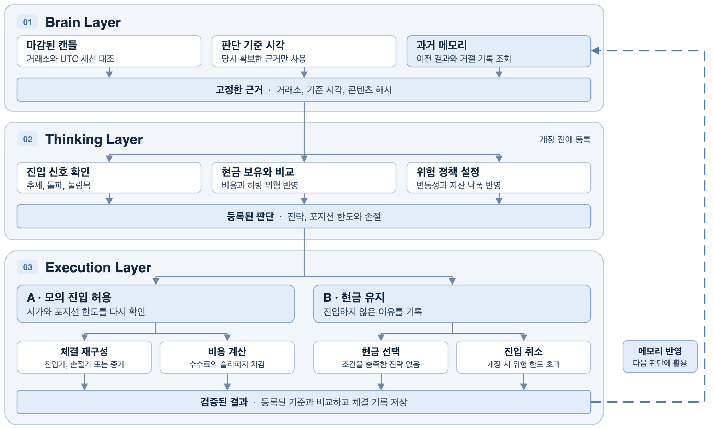
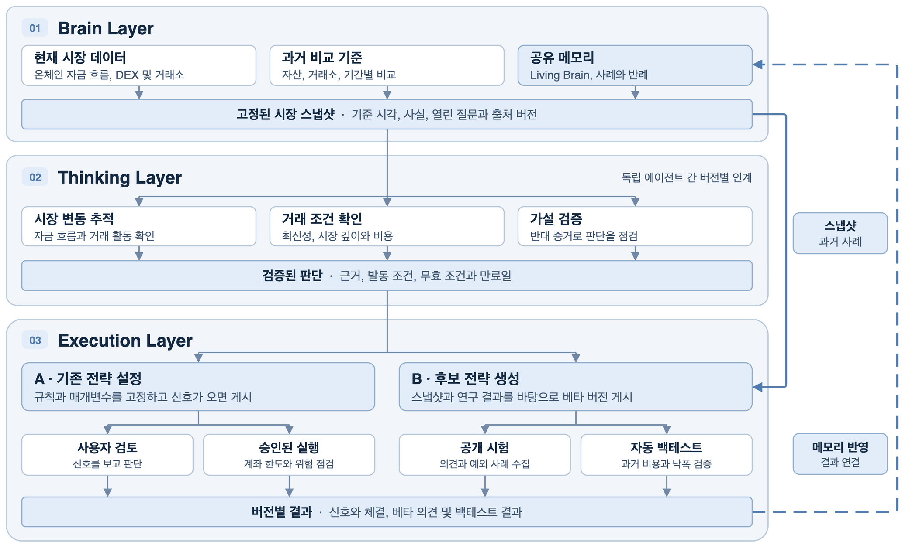

# Astarter · BNB Bangkok

**시장이 답을 보여주기 전에 거래 판단을 기록할 기회는 한 번뿐입니다.**

[English](README.md) · [简体中文](README.zh-CN.md) · [日本語](README.ja.md) · **한국어** · [Tiếng Việt](README.vi.md) · [Español](README.es.md) · [Français](README.fr.md) · [Русский](README.ru.md)

Astarter는 AI 트레이딩 OS입니다. 현물 모의거래 엔진은 다음 UTC 거래일이 열리기 전에 시장 근거, 선택한 전략, 허용할 최대 포지션을 기록합니다. 장이 끝나면 계획대로 실행했는지, 비용을 빼고 얼마를 벌거나 잃었는지 확인할 수 있습니다. 현금 보유를 택한 날도 기록합니다.

[Deep Brain 열기](https://dapp.ipfund.art/?page=brain&lang=ko) · [로컬에서 검증하기](src/deep-brain) · [BNB Bangkok](https://www.hackquest.io/hackathons/BNB-Bangkok)

**기술 문서(영문)**

[에이전트 36개와 CLI](AI-AGENTS-AND-CLI/README.md) · [Binance Agent OS와 지갑](BINANCE-AGENT-OS/README.md) · [ChatAndBuild의 Living Brain](CHATANDBUILD-LIVING-BRAIN/README.md) · [BNB Chain과 RWA](BNB-CHAIN-RWA/README.md) · [CoinMarketCap × Atlas](COINMARKETCAP-ATLAS/README.md) · [AWS 크레딧 활용 계획](AWS-CREDITS-PLAN/README.md)

## 에이전트가 RWA를 조사하는 방법

**Team agents 18개**가 조사를 나눠 맡습니다. A05는 유동성, A10은 가설에 반하는 증거, A15는 원금 손실 위험을 검토합니다. **Strategy agents 18개**는 전략별 시장과 진입·청산·위험 관리 규칙을 정의합니다. 현재 현물 모의 거래 엔진은 추세, 돌파, 눌림목 전략을 현금 보유와 비교합니다. 다음 담당자는 **Living Brain**에서 저장된 계획과 교훈을 검색하고 처리 기록의 출처를 확인할 수 있습니다. 손익을 설명할 때 모델은 검증된 기록을 읽고, 응답에는 기록 ID와 모델 입력의 해시가 함께 남습니다.

토큰화 주식 NVDAB를 예로 들면, **Astarter CLI**는 Atlas의 달러 시세와 갱신 시각을 JSON으로 반환합니다. 어시스턴트의 **Binance Agent OS** 도구로 시장을 조사하고 허가된 계정 정보를 조회할 수 있습니다. 설정의 **Binance Agentic Wallet**은 유효 시간이 짧은 BNB Chain 서명으로 주소 제어권을 확인합니다. 자금 사용에는 별도 승인이 필요합니다.

[Team agents](src/astarter-frontend/simulation.mjs) · [Strategy agents](https://dapp.ipfund.art/agents) · [Astarter CLI](https://demo.astarter.io/cli/astarter.mjs) · [Agentic Wallet](https://demo.astarter.io/settings#ux-local-agent) · [Binance Agent OS](https://www.binance.com/en-ZA/agent-os) · [Living Brain](src/astarter-frontend/living-brain.mjs)

## BNB Bangkok · 기술 심사 안내

| 트랙 또는 상 | 확인할 수 있는 내용 |
| --- | --- |
| **Developer Track** | BNB Smart Chain에서 토큰화 주식의 가격을 읽고 현물 모의거래 판단에 쓰인 근거, 포지션 한도와 진입 거부 조건을 확인합니다. 에이전트가 왜 거래를 선택했고 위험을 어떻게 제한했는지 추적할 수 있습니다. [온체인 피드](https://atlasoracle.io/feeds/1005) · [판단 요약](https://dapp.ipfund.art/api/brain/proof?brief=1&asset=coin:bitcoin) |
| **CoinMarketCap × Atlas Challenge** | Market Hub는 CoinMarketCap의 시장 규모와 심리 지표, 시각이 포함된 Atlas 가격을 보여줍니다. NVDAB/USD Pull 응답(#934)과 BNB Chain의 별도 Push 피드(#1005)를 대조할 수 있습니다. [Market Hub](https://dapp.ipfund.art/?page=markets&lang=ko) · [CMC 응답](https://dapp.ipfund.art/api/market-hub?resource=global) · [Atlas 응답](https://dapp.ipfund.art/api/atlas/prices?symbol=NVDAB) · [기술 요약(영어)](docs/bnb-bangkok-technical-brief.md) |
| **ChatAndBuild — Build Memory-Powered Agents with Living Brain** | 다음 에이전트가 전략 규칙, 지갑별 계획 및 과거 교훈을 검색합니다. 모의 체결 기록을 Living Brain API에 저장한 뒤 조회된 내용의 해시를 검증하고 모델에 전달합니다. [메모리 API](src/astarter-frontend/living-brain.mjs) · [체결 기록 검증](src/deep-brain/paper-replay/connections.mjs) |
| **AWS Credits** | 크레딧 활용 계획은 일별 관측·대조 작업을 클라우드에서 실행하고 날짜별 근거를 객체 스토리지에 보관하며 검증 세션당 비용을 측정하는 것입니다. 스타트업 피치에서 제안하는 확장 방안입니다. [일별 작업](src/deep-brain/scripts/brain-proof-forward.mjs) · [공식 기준](https://www.hackquest.io/hackathons/BNB-Bangkok) |

## 어떤 거래가 위험을 감수할 만한가

| 계층 | 판단할 질문 | 검증할 수 있는 근거 |
| --- | --- | --- |
| **[Brain Layer](src/deep-brain/brain-agent-recall.mjs)** | 그 시점에 알 수 있었던 것은 무엇인가? | 마감된 캔들을 거래소 기록과 대조하고 출처, UTC 기준 시각, 콘텐츠 해시를 고정합니다. 같은 자산에 대해 직전 7일의 UTC 기록에서 거래 거절 사례를 포함해 관련 기억을 최대 3개 불러옵니다. 뒤늦게 도착한 체결 기록은 이후 검토에만 반영됩니다. |
| **[Thinking Layer](src/deep-brain/brain-strategy-witness.mjs)** | 왜 오늘 이 전략과 규모를 골랐는가? | 추세, 돌파, 눌림목 전략을 현금 보유와 비교합니다. 현재 신호와 충분한 관측치가 있어야 하며, 모의 비용과 하방 위험을 반영한 점수가 양수여야 합니다. 선정된 전략에는 포지션 한도와 손절 기준을 정합니다. 변동성이 높거나 계좌 가치가 하락하면 보수적인 정책을 적용합니다. 현재 신호를 고정하고 보정 기간 60일을 하루씩 제외해 어느 날이 순위를 바꾸는지 확인할 수 있습니다. |
| **[Execution Layer](src/deep-brain/brain-execution-invariants.mjs)** | 모의 체결이 판단을 따랐는가? | 지시를 판단 ID와 연결합니다. 시가 갭 때문에 진입을 취소하거나 위험 한도에 맞춰 수량을 줄일 수 있습니다. 마감 캔들을 별도로 대조한 뒤 진입·청산 가격, 슬리피지, 수수료와 기말 자산을 다시 계산합니다. 정산 전에는 손익을 비워 둡니다. |

[](docs/images/ko/decision-proof.drawio.png)

**도움이 됐는지 어떻게 알 수 있을까?** 거래를 건너뛴 날까지 사전 등록한 판단을 추적합니다. 비교 계획을 세울 수 있는 날에는 두 기준을 개장 전에 등록합니다. 하나는 현금을 유지하고, 다른 하나는 자금의 10%로 시가부터 종가까지 자산을 보유하며 수수료와 슬리피지를 부담합니다. 같은 기간의 순손익과 낙폭을 함께 보면 감수한 위험에 비해 성과가 있었는지 평가할 수 있습니다. 다음 거래일의 결과는 새로 확인해야 합니다. [읽기 전용 판단 요약](https://dapp.ipfund.art/api/brain/proof?brief=1&asset=coin:bitcoin) · [비교 기준 계산](src/deep-brain/brain-forward-comparison.mjs)

### 공유 메모리 구조

에이전트는 같은 시장 스냅샷에서 조사하고 근거와 미해결 질문을 인계합니다. 기존 전략은 설정된 정책 안에서 신호를 내고, 후보 전략은 매개변수와 근거를 갖춰 테스트에 들어갑니다. 결과에 버전이 붙으므로 다음 에이전트가 규칙 변경의 이유를 추적할 수 있습니다.

[](docs/images/ko/shared-brain-flow.drawio.png)

## 이번 릴리스에서 확인할 수 있는 기능

- **CoinMarketCap** [어댑터](src/astarter-frontend/market-source-adapters.mjs)가 Pro API의 시장, 분류, 심리 데이터를 Market Hub 형식으로 변환합니다.

- **BNB Chain의 Atlas** [피드 목록](src/astarter-frontend/atlas-feed-master.mjs)은 NVDAB를 연결합니다. 설정 후 시각이 포함된 Pull 호가를 읽고, [피드 #1005](https://atlasoracle.io/feeds/1005)에서 공개 온체인 Push 값도 독립적으로 대조할 수 있습니다.

- **Living Brain** [메모리 어댑터](src/astarter-frontend/living-brain.mjs)는 지갑별 거래 계획을 저장하고 불러옵니다. [테스트](src/astarter-frontend/living-brain.test.mjs)는 식별자 해싱과 민감 정보 가리기를 확인합니다.

- **모의 실행과 위험 관리** [엔진 안내서](src/astarter-backend/README.en.md)에는 주문 전 점검, 모의 체결, 실행 기록 검증이 담겨 있습니다.

로컬 데모는 모의 환경에서 실행합니다. 에이전트 간 상시 작업 배정, 공개 베타 배포, 피드백 자동 수집은 향후 설계 목표입니다.

## 로컬에서 판단 검증하기

Node.js 24로 저장소 루트에서 아래 명령을 실행합니다. 검증기는 시장 아카이브에서 판단과 실행 기록을 대조합니다.

```sh
cd src/deep-brain
npm run verify
npm test
```

[새 관측 수집, 다음 모의 거래일 등록, 에이전트 기억 조회](src/deep-brain/paper-replay/README.md).

## 프런트엔드 및 데이터

기본 프런트엔드는 배포된 HACKATHON 브랜치를 따릅니다. Deep Brain에서 자산을 선택하면 그래프 노드의 근거를 탐색할 수 있습니다. [온라인 데모](https://dapp.ipfund.art/?page=brain&lang=ko)에는 라이선스를 받은 입자 초상화가 있으며, 이 브랜치에는 자체 입자 초상화 렌더러가 있습니다. **Explore**를 누르면 그래프가 열리고, [Astarter Lite](https://demo.astarter.io/lite?lang=ko)에서는 신호를 확인할 수 있습니다. Backtest Review에서 모의 체결을 선택하고 Agent Learning에서 체결 기록, 전략별 점수와 다음 판단을 확인하세요.

Historical Blocks에는 2016년 1월부터의 Bitcoin과 Ethereum 기록, 제네시스 다음 블록부터의 BNB Smart Chain 기록, 날짜가 표시된 Solana와 HyperCore 표본이 있습니다. 체인과 UTC 날짜를 선택해 블록 높이 또는 슬롯, 시간과 거래 수를 확인할 수 있습니다. 하루 전체 기록과 표본을 구분해 표시합니다. [범위 요약](src/astarter-frontend/brain-evidence/archive/summary.json) · [출처와 SHA-256](src/astarter-frontend/brain-evidence/archive/manifest.json)

Traditional Markets v0.8.1은 2016년 이후 주식, 지수, 귀금속, 외환, 원유 등 5,170개 시계열의 검증된 관측값 219,069,823개를 담고 있습니다. 각 가격은 게시자, 단위, 관측일, 주기를 보존합니다. Ethereum, Arbitrum, Avalanche의 Chainlink 기록은 피드, 라운드, 갱신 시각과 조회 블록도 담습니다. WTI 현물과 선물 기준값은 별개입니다. [출처와 권리](src/astarter-frontend/docs/brain-tradfi-sources.md) · [목록](src/astarter-frontend/brain-evidence/tradfi/catalog.json) · [일일 업데이트](https://github.com/brunopike/astarter-bnb-bangkok/actions/workflows/brain-history.yml)

[프런트엔드 릴리스](https://github.com/brunopike/astarter-bnb-bangkok/releases/tag/v0.8.1-frontend)에는 테스트한 소스와 체크섬이 들어 있습니다. main은 매일 검증된 데이터를 반영하며 [이전 기능 스냅샷](https://github.com/brunopike/astarter-bnb-bangkok/releases/tag/v0.5.0-frontend)도 제공합니다.

## 로컬 실행

Node.js 24 · npm

```sh
cd src/astarter-frontend
npm ci
npm start
```

[로컬 Astarter](http://127.0.0.1:4188/)를 엽니다. 공개 Atlas 목록은 API 키 없이 이용할 수 있습니다.

```sh
curl -fsS 'http://127.0.0.1:4188/api/atlas/feeds?symbol=NVDAB'
```

선택형 실시간 어댑터는 서버 설정 `COINMARKETCAP_API_KEY`, `ATLAS_API_KEY`를 사용합니다. Living Brain 연결에는 `LIVING_BRAIN_API_KEY`, `LIVING_BRAIN_SUBJECT_ID`, `LIVING_BRAIN_BRAIN_ID`를 설정합니다.

<details>
<summary>BNB Chain 가격 조회와 개별 테스트 재현</summary>

Foundry로 NVDAB용 Atlas Push 값을 읽기 전용 호출로 조회합니다. 두 번째 반환값은 소수점 18자리 기준 가격이고 네 번째는 온체인 갱신 시각입니다.

```sh
cast call 0xf25af12920d408baf6211e9e90eda89df3d8ccda \
  'latestRoundData()(uint80,int256,uint256,uint256,uint80)' \
  --rpc-url https://bsc-dataseed.bnbchain.org
```

`src/astarter-frontend`에서 목록, 어댑터, 메모리, 모의 결제 테스트를 실행합니다.

```sh
node --check atlas-feed-master.mjs
node --check market-source-adapters.mjs
node --import ./test-locale.mjs --test living-brain.test.mjs commerce.test.mjs
```

[v0.1.0 릴리스](https://github.com/brunopike/astarter-bnb-bangkok/releases/tag/v0.1.0)는 프런트엔드와 백엔드 소스를 함께 제공합니다.

</details>
