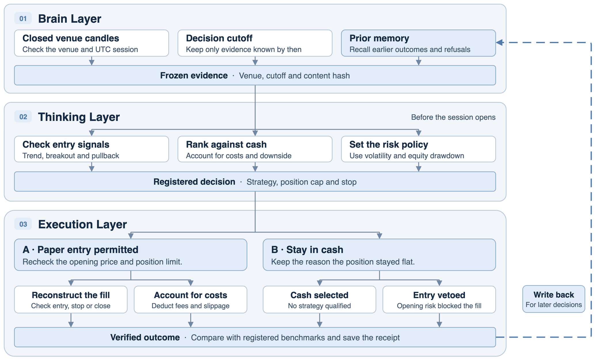
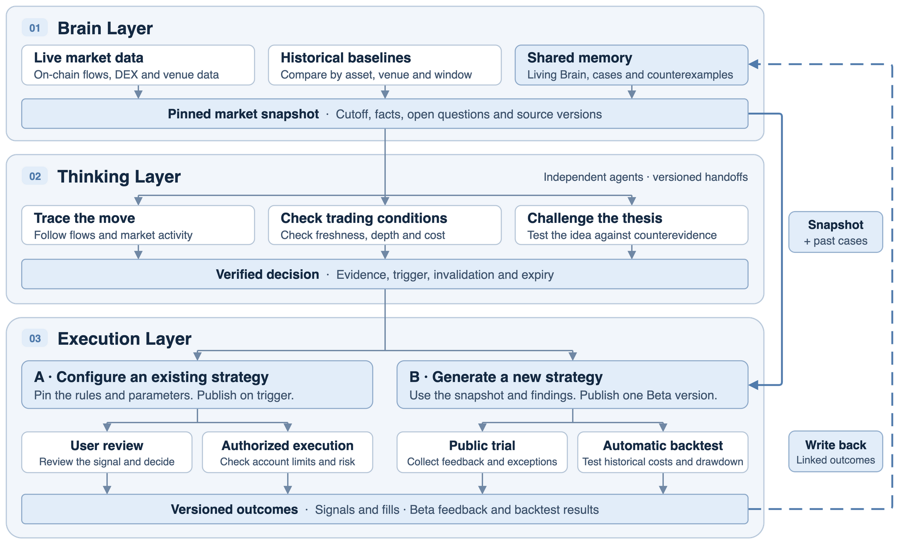

# Astarter at BNB Bangkok

**You get one chance to record a trading decision before the market tests it.**

**English** · [简体中文](README.zh-CN.md) · [日本語](README.ja.md) · [한국어](README.ko.md) · [Tiếng Việt](README.vi.md) · [Español](README.es.md) · [Français](README.fr.md) · [Русский](README.ru.md)

Astarter is an AI Trading OS. Before the next UTC session opens, its spot paper trading engine records the market evidence, the strategy it selected and the largest position it will allow. After the session closes, you can check whether it followed that decision and how it did after costs. A decision to hold cash goes on the record too.

[Watch the product demo (2:57)](https://brunopike.github.io/astarter-bnb-bangkok/) · [Open Deep Brain](https://dapp.ipfund.art/?page=brain&lang=en) · [Run the proof locally](src/deep-brain) · [BNB Bangkok](https://www.hackquest.io/hackathons/BNB-Bangkok)

**Technical guides**

[36 agents & CLI](AI-AGENTS-AND-CLI/README.md) · [Binance Agent OS & wallet](BINANCE-AGENT-OS/README.md) · [ChatAndBuild’s Living Brain](CHATANDBUILD-LIVING-BRAIN/README.md) · [BNB Chain & RWA](BNB-CHAIN-RWA/README.md) · [CoinMarketCap × Atlas](COINMARKETCAP-ATLAS/README.md) · [AWS credits plan](AWS-CREDITS-PLAN/README.md)

## How the agents research an RWA

The **18 Team agents** divide the research. A05 checks liquidity, A10 looks for evidence against a thesis, and A15 reviews capital at risk. The **18 Strategy agents** define the market, entry, exit and risk rules for individual strategies. The spot paper engine currently evaluates trend, breakout and pullback against cash. **Living Brain** lets a later agent retrieve a saved plan or lesson and trace a receipt back to its source. When asked to explain an outcome, the model receives the verified receipt. Its response records the receipt ID and the hash of the model input.

For a real-world asset (RWA), try the tokenized equity NVDAB. The **Astarter CLI** returns its Atlas USD quote and update time as JSON. In the assistant, the **Binance Agent OS** toolset offers market research and account reads where authorized. In settings, **Binance Agentic Wallet** uses a short-lived BNB Chain signature to prove control of an address. Spending requires separate authority.

[Team agents](src/astarter-frontend/simulation.mjs) · [Strategy agents](https://dapp.ipfund.art/agents) · [Astarter CLI](https://demo.astarter.io/cli/astarter.mjs) · [Agentic Wallet](https://demo.astarter.io/settings#ux-local-agent) · [Binance Agent OS](https://www.binance.com/en-ZA/agent-os) · [Living Brain](src/astarter-frontend/living-brain.mjs)

## BNB Bangkok · Technical evidence

| Track or award | What to inspect |
| --- | --- |
| **Developer Track** | Read a tokenized equity quote on BNB Smart Chain, then inspect the evidence, position limit and entry veto for a spot paper decision. Agents can explain why a trade qualified and which risk checks can reduce or veto entry. [On-chain feed](https://atlasoracle.io/feeds/1005) · [Decision brief](https://dapp.ipfund.art/api/brain/proof?brief=1&asset=coin:bitcoin) |
| **CoinMarketCap × Atlas Challenge** | Market Hub pairs CoinMarketCap market breadth and sentiment with timestamped Atlas quotes. Inspect the NVDAB/USD Pull response (#934) and independently read the BNB Chain Push feed (#1005). [Market Hub](https://dapp.ipfund.art/?page=markets&lang=en) · [CMC response](https://dapp.ipfund.art/api/market-hub?resource=global) · [Atlas response](https://dapp.ipfund.art/api/atlas/prices?symbol=NVDAB) · [One-page technical brief](docs/bnb-bangkok-technical-brief.md) |
| **ChatAndBuild — Build Memory-Powered Agents with Living Brain** | A later agent can retrieve a prior strategy’s rules, wallet-scoped plan and lessons. The receipt path saves a decision through the Living Brain API and verifies the retrieved content hash before model review. [Memory API](src/astarter-frontend/living-brain.mjs) · [Receipt verification](src/deep-brain/paper-replay/connections.mjs) |
| **AWS Credits** | We would use credits to run daily observation and reconciliation workers, retain dated evidence in object storage and measure cost per verified session. [Daily worker](src/deep-brain/scripts/brain-proof-forward.mjs) · [Official criteria](https://www.hackquest.io/hackathons/BNB-Bangkok) |

## What earns a trade?

| Layer | The question it answers | Evidence you can inspect |
| --- | --- | --- |
| **[Brain Layer](src/deep-brain/brain-agent-recall.mjs)** | What could the agent know at the time? | It checks closed candles against the venue and freezes the source, UTC cutoff and content hash. For the same asset it can recall up to three relevant memories from the preceding seven UTC days, including refusals. A receipt that arrived later belongs to a later review. |
| **[Thinking Layer](src/deep-brain/brain-strategy-witness.mjs)** | Why this strategy, at this size, today? | Trend, breakout and pullback compete with holding cash. A strategy needs a current signal, enough observations and a positive score after modeled costs and downside risk. The winner gets a position cap and a stop. Elevated volatility or an equity drawdown triggers the conservative risk policy. Keeping the current signal fixed, it omits each of 60 calibration sessions in turn and shows which omissions change the winner. |
| **[Execution Layer](src/deep-brain/brain-execution-invariants.mjs)** | Did the paper trade respect the decision? | The worker binds the instruction to its decision ID. An opening gap can veto entry, and risk checks can cut the position. After an independently checked candle closes, the verifier reconstructs entry, exit, slippage, fees and ending equity. An unsettled instruction has no reported return. |

[](docs/images/decision-proof.drawio.png)

**How would you know whether it helps?** Follow the decisions registered in advance, including the skipped sessions. The engine registers two benchmarks before the open when a comparison is available. One stays in cash. The other puts 10% into the asset from open to close and pays the modeled fees and slippage. Compare the strategy with both over the same sessions, including losses and drawdowns. That measures what the rules earned during that period. The next session is still an open question. [Inspect the current read-only agent brief](https://dapp.ipfund.art/api/brain/proof?brief=1&asset=coin:bitcoin) · [Benchmark calculation](src/deep-brain/brain-forward-comparison.mjs)

### Shared-brain architecture

The diagram below shows the wider product design. Agents research from a shared snapshot, then hand evidence and open questions to the next agent. An existing strategy can publish a signal within its configured policy. A proposed strategy can enter testing with its parameters and supporting evidence attached. Versioned results give later agents a way to trace why a rule changed.

[](docs/images/shared-brain-flow.drawio.png)

## What you can verify

| Component | Evidence in this release |
| --- | --- |
| **CoinMarketCap** | [Market adapters](src/astarter-frontend/market-source-adapters.mjs) normalize Pro API market, category, and sentiment data into the Market Hub. |
| **Atlas on BNB Chain** | [Feed catalog](src/astarter-frontend/atlas-feed-master.mjs) maps NVDAB to Atlas feeds. The packaged adapter reads Pull quotes with source timestamps when configured. [Feed #1005](https://atlasoracle.io/feeds/1005) also exposes a public BNB Chain Push reference that can be checked independently. |
| **Living Brain** | [Memory adapter](src/astarter-frontend/living-brain.mjs) captures and recalls wallet-scoped trading plans through the API. [Tests](src/astarter-frontend/living-brain.test.mjs) cover identity hashing and redaction. |
| **Simulation and risk** | [Engine and evidence guides](src/astarter-backend/README.en.md) cover preflight checks, simulated fills, and execution replay. |

The local demo runs in simulation mode. Continuous cross-agent scheduling, public beta publishing, and automatic feedback ingestion are design targets.

## Verify a decision locally

With Node.js 24, run the following from the repository root. The verifier reads the market archive and checks the decision and execution receipts.

```sh
cd src/deep-brain
npm run verify
npm test
```

[Collect new observations, register forward paper decisions or query an agent memory](src/deep-brain/paper-replay/README.md).

## Frontend packages

[Open Astarter Lite](https://demo.astarter.io/lite) to inspect live market signals, review the evidence behind a close, and try a simulated trade in practice mode.

Deep Brain opens with an animated particle portrait. Select **Explore** to open the evidence graph, then choose a node to read its research notes. Mobile WebGL draws 55,000 dust particles with four bloom levels. The public frontend includes a standalone portrait renderer. The [hosted demo](https://demo.astarter.io/?page=brain) uses the licensed 3D portrait.

In **Backtest review**, select a simulated trade and scroll to **Agent learning** to replay its receipt, compare strategy scores and inspect the subsequent decision.

Open **Historical blocks** on the [Hackathon site](https://dapp.ipfund.art/) for Bitcoin and Ethereum from January 2016, BNB Smart Chain from its first non-genesis block, and dated native Solana and HyperCore samples. Complete-day series and sampled series are identified in the viewer. Select a chain and UTC date to inspect archived heights or slots, timestamps and transaction counts. The [summary](src/astarter-frontend/brain-evidence/archive/summary.json) reports current dates and actual counts. The [manifest](src/astarter-frontend/brain-evidence/archive/manifest.json) records source evidence and SHA-256 checksums.

**Traditional markets** contains 219,069,823 verified observations across 5,170 series in the v0.8.1 snapshot. It includes listed shares, indices, precious metals, currencies, crude oil and other commodities from 2016. Each observed price retains the publisher, unit, observation date and frequency. Ethereum, Arbitrum and Avalanche Chainlink series identify the feed, round, source update time and historical read block. WTI spot and the WTI futures reference are separate instruments. [Sources, rights and date coverage](src/astarter-frontend/docs/brain-tradfi-sources.md) · [Market catalog](src/astarter-frontend/brain-evidence/tradfi/catalog.json) · [Daily update runs](https://github.com/brunopike/astarter-bnb-bangkok/actions/workflows/brain-history.yml).

The [frontend release](https://github.com/brunopike/astarter-bnb-bangkok/releases/tag/v0.8.1-frontend) contains the tested source snapshot with checksums. The main branch receives daily verified data updates. The [separate historical feature snapshot](https://github.com/brunopike/astarter-bnb-bangkok/releases/tag/v0.5.0-frontend) remains available.

## Run locally

Use Node.js 24 with npm.

```sh
cd src/astarter-frontend
npm ci
npm start
```

Open [Astarter on localhost](http://127.0.0.1:4188/). The public Atlas catalog works without an API key.

```sh
curl -fsS 'http://127.0.0.1:4188/api/atlas/feeds?symbol=NVDAB'
```

The optional live adapters read server-side configuration for CoinMarketCap (`COINMARKETCAP_API_KEY`), Atlas (`ATLAS_API_KEY`), and Living Brain (`LIVING_BRAIN_API_KEY`, `LIVING_BRAIN_SUBJECT_ID`, `LIVING_BRAIN_BRAIN_ID`).

<details>
<summary>Reproduce the BNB Chain price read and run focused checks</summary>

With Foundry, query the Atlas Push reference for NVDAB using a read-only call. The second value is the price at 18 decimals. The fourth is the on-chain update timestamp.

```sh
cast call 0xf25af12920d408baf6211e9e90eda89df3d8ccda \
  'latestRoundData()(uint80,int256,uint256,uint256,uint80)' \
  --rpc-url https://bsc-dataseed.bnbchain.org
```

From `src/astarter-frontend`, run the catalog, adapter, memory, and simulated checkout checks.

```sh
node --check atlas-feed-master.mjs
node --check market-source-adapters.mjs
node --import ./test-locale.mjs --test living-brain.test.mjs commerce.test.mjs
```

The earlier [v0.1.0 release](https://github.com/brunopike/astarter-bnb-bangkok/releases/tag/v0.1.0) contains the combined frontend and backend source snapshot.

</details>
