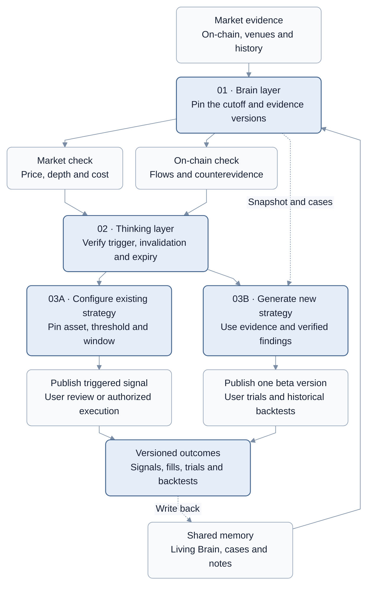

# LensWave · Astarter at BNB Bangkok

**A fresh price can still lead to a stale decision.** When agents hand off a trade idea for a tokenized stock, a price alone is of little use. The next agent needs its timestamp, the market conditions, and the rule that would invalidate the trade. LensWave is Astarter’s AI Trading OS. Its shared-brain architecture gives agents a common market snapshot and ties each decision to the evidence available at the time.

[Run the local demo](#run-locally) · [Inspect the integrations](#what-you-can-verify) · [Download v0.1.0](https://github.com/brunopike/astarter-bnb-bangkok/releases/tag/v0.1.0) · [BNB Bangkok](https://www.hackquest.io/hackathons/BNB-Bangkok)

## Two ways to turn research into a strategy

A sudden move in a BNB Chain tokenized stock is a reason to investigate. In the workflow below, the market agent checks price freshness, venue liquidity, and execution cost. The on-chain agent checks flows and looks for evidence that contradicts the trade. Both work from the same snapshot. If a source is missing or stale, the decision stays on watch and the agents request a new snapshot.

The execution layer uses a verified decision in two ways. A **configured strategy** watches for its trigger and publishes a signal for user review or execution within an existing authorization and risk policy. A **candidate strategy** draws directly on the original snapshot, past cases, and the verified decision. Its public beta and historical backtest use the same strategy and parameter versions. Both paths write outcomes back to the case library so the next agent can see why a rule changed.

### Shared-brain architecture

The diagram shows the target workflow for research, strategy generation, and execution.



Living Brain provides persistent memory for cases and plans. The architecture pairs it with an Obsidian-compatible Markdown knowledge base for research notes, rules, and reviews. Agents can use their own working context while handing off source references and open questions. New evidence creates a new snapshot. The original snapshot stays available for replay, and feedback links to the exact strategy and parameter versions that produced the result.

## What you can verify

| Component | Evidence in this release |
| --- | --- |
| **CoinMarketCap** | [Market adapters](src/astarter-frontend/market-source-adapters.mjs) normalize Pro API market, category, and sentiment data into the Market Hub. |
| **Atlas on BNB Chain** | [Feed catalog](src/astarter-frontend/atlas-feed-master.mjs) maps NVDAB to Atlas feeds. The packaged adapter reads Pull quotes with source timestamps when configured. [Feed #1005](https://atlasoracle.io/feeds/1005) also exposes a public BNB Chain Push reference that can be checked independently. |
| **Living Brain** | [Memory adapter](src/astarter-frontend/living-brain.mjs) captures and recalls wallet-scoped trading plans through the API. [Tests](src/astarter-frontend/living-brain.test.mjs) cover identity hashing and redaction. |
| **Simulation and risk** | [Engine and evidence guides](src/astarter-backend/README.en.md) cover preflight checks, simulated fills, and execution replay. |

The local demo runs in simulation mode. Continuous cross-agent scheduling, public beta publishing, and automatic feedback ingestion are design targets.

## Run locally

Use Node.js 24 with npm.

```sh
cd src/astarter-frontend
npm ci
npm start
```

Open [LensWave on localhost](http://127.0.0.1:4188/). The public Atlas catalog works without an API key.

```sh
curl -fsS 'http://127.0.0.1:4188/api/atlas/feeds?symbol=NVDAB'
```

The optional live adapters read server-side configuration for CoinMarketCap (`COINMARKETCAP_API_KEY`), Atlas (`ATLAS_API_KEY`), and Living Brain (`LIVING_BRAIN_API_KEY`, `LIVING_BRAIN_SUBJECT_ID`, `LIVING_BRAIN_BRAIN_ID`).

<details>
<summary>Reproduce the BNB Chain price read and run focused checks</summary>

With Foundry, query the Atlas Push reference for NVDAB using a read-only call. The second value is the price at 18 decimals. The fourth is the on-chain update timestamp.

```sh
cast call 0xf25af12920d408baf6211e9e90eda89df3d8ccda \
  'latestRoundData()(uint80,int256,uint256,uint256,uint80)' \
  --rpc-url https://bsc-dataseed.bnbchain.org
```

From `src/astarter-frontend`, run the catalog, adapter, memory, and simulated checkout checks.

```sh
node --import ./test-locale.mjs --test atlas-feed-master.test.mjs market-source-adapters.test.mjs living-brain.test.mjs commerce.test.mjs
```

Verify the release ZIP with `shasum -a 256 -c SHA256SUMS.txt` after downloading both release assets to the same directory.

</details>
