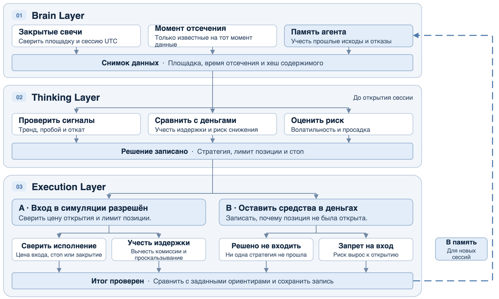
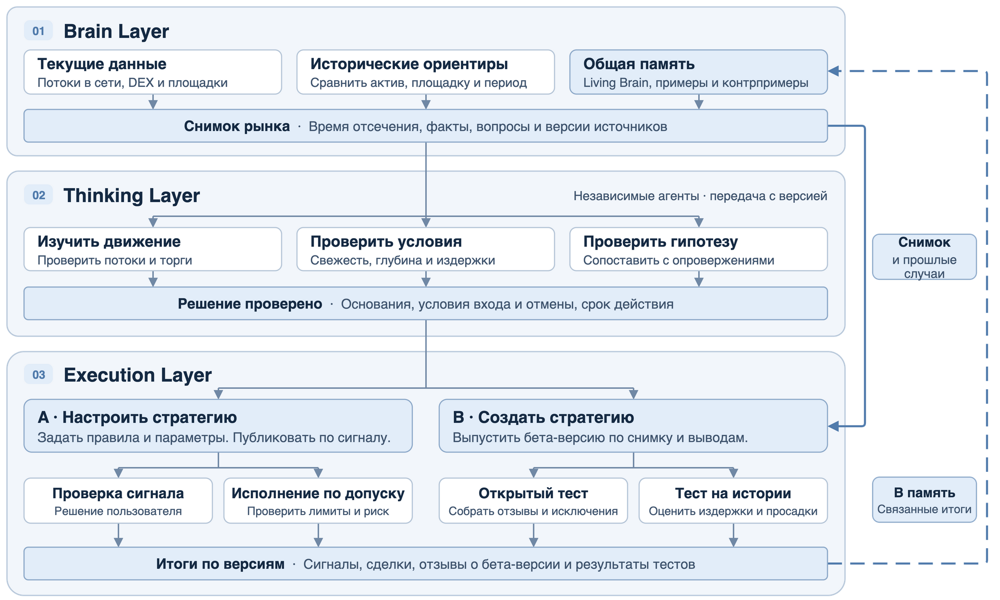

# Astarter на BNB Bangkok

**Зафиксировать торговое решение до того, как рынок его проверит, можно только один раз.**

[English](README.md) · [简体中文](README.zh-CN.md) · [日本語](README.ja.md) · [한국어](README.ko.md) · [Tiếng Việt](README.vi.md) · [Español](README.es.md) · [Français](README.fr.md) · **Русский**

Astarter — торговая операционная система с ИИ. До открытия следующей сессии по UTC движок спотовой симуляции записывает доступные рыночные данные, выбранную стратегию и предельный размер позиции. После закрытия можно проверить, соблюдался ли план и какой получилась прибыль или убыток после издержек. Решение остаться в денежных средствах тоже попадает в журнал.

[Посмотреть демо (2:57)](https://brunopike.github.io/astarter-bnb-bangkok/) · [Открыть Deep Brain](https://dapp.ipfund.art/?page=brain&lang=ru) · [Проверить локально](src/deep-brain) · [BNB Bangkok](https://www.hackquest.io/hackathons/BNB-Bangkok)

**Технические материалы на английском**

[36 агентов и CLI](AI-AGENTS-AND-CLI/README.md) · [Binance Agent OS и кошелёк](BINANCE-AGENT-OS/README.md) · [Living Brain от ChatAndBuild](CHATANDBUILD-LIVING-BRAIN/README.md) · [BNB Chain и RWA](BNB-CHAIN-RWA/README.md) · [CoinMarketCap × Atlas](COINMARKETCAP-ATLAS/README.md) · [План использования кредитов AWS](AWS-CREDITS-PLAN/README.md)

## Как агенты исследуют токенизированные активы (RWA)

В команде **18 Team agents**. A05 проверяет ликвидность, A10 ищет данные против исходной гипотезы, а A15 оценивает капитал под риском. В каталоге **18 Strategy agents** с правилами выбора рынка, входа, выхода и ограничения риска. Движок спотовой симуляции сравнивает стратегии по тренду, на пробой и на откат с сохранением средств в деньгах. Через **Living Brain** следующий агент может найти сохранённый план или вывод и проверить источник записи. При разборе прибыли или убытка модель читает проверенную запись. Вместе с объяснением сохраняются идентификатор записи и хеш входных данных модели.

Для токенизированной акции NVDAB **Astarter CLI** возвращает котировку Atlas в долларах и время её обновления в формате JSON. Инструменты **Binance Agent OS** в ассистенте позволяют изучать рынок и читать данные счёта в пределах выданных разрешений. В настройках **Binance Agentic Wallet** проверяет контроль над адресом с помощью краткосрочной подписи в BNB Chain. Для расходования средств требуется отдельное разрешение.

[Team agents](src/astarter-frontend/simulation.mjs) · [Strategy agents](https://dapp.ipfund.art/agents) · [Astarter CLI](https://demo.astarter.io/cli/astarter.mjs) · [Agentic Wallet](https://demo.astarter.io/settings#ux-local-agent) · [Binance Agent OS](https://www.binance.com/en-ZA/agent-os) · [Living Brain](src/astarter-frontend/living-brain.mjs)

## BNB Bangkok · Материалы для технической оценки

| Категория | Что можно проверить |
| --- | --- |
| **Developer Track** | Прочитайте котировку токенизированной акции в BNB Smart Chain и изучите основания решения, лимит позиции и условия отмены входа в спотовой симуляции. Можно проследить, почему агент выбрал сделку и как ограничил риск. [Данные в сети](https://atlasoracle.io/feeds/1005) · [Сводка решения](https://dapp.ipfund.art/api/brain/proof?brief=1&asset=coin:bitcoin) |
| **CoinMarketCap × Atlas Challenge** | Market Hub показывает объём рынка и настроения по данным CoinMarketCap, а также котировки Atlas с отметкой времени. Сверьте ответ Pull для NVDAB/USD (№ 934) и независимо прочитайте поток Push в BNB Chain (№ 1005). [Market Hub](https://dapp.ipfund.art/?page=markets&lang=ru) · [Ответ CMC](https://dapp.ipfund.art/api/market-hub?resource=global) · [Ответ Atlas](https://dapp.ipfund.art/api/atlas/prices?symbol=NVDAB) · [Техническая справка на английском](docs/bnb-bangkok-technical-brief.md) |
| **ChatAndBuild — Build Memory-Powered Agents with Living Brain** | Следующий агент может найти правила, планы конкретного кошелька и выводы по стратегии. Запись симуляции сохраняется через API Living Brain. Перед передачей модели проверяется хеш полученного из памяти содержимого. [API памяти](src/astarter-frontend/living-brain.mjs) · [Проверка записи](src/deep-brain/paper-replay/connections.mjs) |
| **AWS Credits** | Предлагаемый план использования кредитов — запуск ежедневного сбора и сверки в облаке, хранение датированных доказательств в объектном хранилище и измерение затрат на одну проверенную сессию. Это план масштабирования для презентации стартапа. [Ежедневная задача](src/deep-brain/scripts/brain-proof-forward.mjs) · [Официальные критерии](https://www.hackquest.io/hackathons/BNB-Bangkok) |

## Когда сделка оправдывает риск?

| Слой | Вопрос | Что можно проверить |
| --- | --- | --- |
| **[Brain Layer](src/deep-brain/brain-agent-recall.mjs)** | Что агент мог знать на тот момент? | Движок сверяет закрытые свечи с данными площадки и фиксирует источник, время отсечения по UTC и хеш содержимого. Для того же актива можно извлечь до трёх релевантных записей за предыдущие семь дней по UTC, включая отказы. Подтверждение, поступившее позже, доступно только для последующего разбора. |
| **[Thinking Layer](src/deep-brain/brain-strategy-witness.mjs)** | Почему сегодня выбраны именно эта стратегия и этот размер позиции? | Трендовая стратегия, торговля на пробой и на откате конкурируют с сохранением денежных средств. Нужны текущий сигнал, достаточное число наблюдений и положительная оценка с учётом модельных издержек и риска снижения. Для выбранной стратегии задаются лимит позиции и стоп. При высокой волатильности или просадке капитала включается консервативный режим. При неизменном текущем сигнале движок поочерёдно исключает каждый из 60 дней калибровки и показывает, какие исключения меняют выбор. |
| **[Execution Layer](src/deep-brain/brain-execution-invariants.mjs)** | Соответствовала ли симуляция принятому решению? | Инструкция связана с идентификатором решения. Ценовой разрыв при открытии может отменить вход, а контроль риска — сократить позицию. После независимой сверки закрытой свечи проверяющий модуль пересчитывает цены входа и выхода, проскальзывание, комиссии и итоговый капитал. До расчёта результата поле доходности остаётся пустым. |

[](docs/images/ru/decision-proof.drawio.png)

**Как понять, приносит ли это пользу?** Следите за всеми решениями, зарегистрированными заранее, включая пропущенные сессии. Если запланировано сравнение, до открытия регистрируются два ориентира. Первый сохраняет средства в деньгах. Второй вкладывает 10% капитала в актив от открытия до закрытия с учётом комиссий и проскальзывания. Сравнивайте чистый результат, убытки и просадки за одни и те же сессии. Так можно оценить, окупился ли риск за этот период. Результат следующей сессии ещё неизвестен. [Сводка для чтения](https://dapp.ipfund.art/api/brain/proof?brief=1&asset=coin:bitcoin) · [Расчёт ориентиров](src/deep-brain/brain-forward-comparison.mjs)

### Архитектура общей памяти

Агенты работают с единым рыночным снимком и передают друг другу проверенные сведения и открытые вопросы. Действующая стратегия может выдать сигнал по заданным правилам. Предложенная стратегия поступает на тестирование вместе с параметрами и обоснованием. Версия каждого результата помогает следующим агентам проследить причину изменения правил.

[](docs/images/ru/shared-brain-flow.drawio.png)

## Что можно проверить в этой версии

- **CoinMarketCap.** [Рыночные адаптеры](src/astarter-frontend/market-source-adapters.mjs) приводят данные Pro API о рынках, категориях и настроениях к формату Market Hub.

- **Atlas в BNB Chain.** [Каталог потоков](src/astarter-frontend/atlas-feed-master.mjs) связывает NVDAB с источниками Atlas. После настройки адаптер читает котировки Pull с отметками времени. Публичное значение Push в сети можно независимо сверить по [потоку № 1005](https://atlasoracle.io/feeds/1005).

- **Living Brain.** [Адаптер памяти](src/astarter-frontend/living-brain.mjs) сохраняет и извлекает торговые планы отдельно для каждого кошелька. [Тесты](src/astarter-frontend/living-brain.test.mjs) проверяют хеширование идентификаторов и скрытие чувствительных данных.

- **Симуляция и риск.** [Руководства по движку](src/astarter-backend/README.en.md) описывают предварительные проверки, моделирование сделок и восстановление хода исполнения.

Локальная демонстрация работает в режиме симуляции. Постоянная координация агентов, публикация открытых бета-версий и автоматический сбор обратной связи остаются целями разработки.

## Локальная проверка решения

Установите Node.js 24 и выполните команды из корня репозитория. Проверяющий модуль читает архив рынка и сверяет решение с записью об исполнении.

```sh
cd src/deep-brain
npm run verify
npm test
```

[Сбор наблюдений, предварительная регистрация сессий и запрос к памяти агента](src/deep-brain/paper-replay/README.md).

## Клиентское приложение и данные

Клиент по умолчанию соответствует развёрнутой ветке HACKATHON. В Deep Brain выберите актив, чтобы изучить источники для узлов графа. [Веб-демонстрация](https://dapp.ipfund.art/?page=brain&lang=ru) также включает лицензированный портрет из частиц. В этой ветке есть собственный модуль отрисовки портрета. Нажмите **Explore**, чтобы открыть граф, или перейдите в [Astarter Lite](https://demo.astarter.io/lite?lang=ru), чтобы посмотреть сигналы. Выберите смоделированную сделку в Backtest Review, затем откройте Agent Learning, чтобы сверить исполнение, оценки стратегий и следующее решение.

В Historical Blocks доступны Bitcoin и Ethereum с января 2016 года, BNB Smart Chain с первого блока после генезиса и датированные выборки Solana и HyperCore. По сети и дате UTC можно посмотреть высоты блоков или слоты, время и число транзакций. Полные суточные данные и выборки обозначены отдельно. [Охват](src/astarter-frontend/brain-evidence/archive/summary.json) · [Источники и SHA-256](src/astarter-frontend/brain-evidence/archive/manifest.json)

В Traditional Markets v0.8.1 собрано 219 069 823 проверенных наблюдения в 5 170 рядах с 2016 года: акции, индексы, драгоценные металлы, валюты, нефть и другие сырьевые товары. У каждой цены указаны поставщик, единица измерения, дата и периодичность. Для Chainlink в Ethereum, Arbitrum и Avalanche также сохранены поток, раунд, время обновления и блок чтения. Спотовая цена WTI и фьючерсный ориентир представлены раздельно. [Источники и права](src/astarter-frontend/docs/brain-tradfi-sources.md) · [Каталог](src/astarter-frontend/brain-evidence/tradfi/catalog.json) · [Ежедневные обновления](https://github.com/brunopike/astarter-bnb-bangkok/actions/workflows/brain-history.yml)

[Выпуск клиента](https://github.com/brunopike/astarter-bnb-bangkok/releases/tag/v0.8.1-frontend) содержит протестированный исходный код с контрольными суммами. В main ежедневно поступают проверенные данные. Доступен и [предыдущий снимок функциональности](https://github.com/brunopike/astarter-bnb-bangkok/releases/tag/v0.5.0-frontend).

## Локальный запуск

Node.js 24 · npm

```sh
cd src/astarter-frontend
npm ci
npm start
```

Откройте [Astarter на localhost](http://127.0.0.1:4188/). Публичный каталог Atlas работает без ключа API.

```sh
curl -fsS 'http://127.0.0.1:4188/api/atlas/feeds?symbol=NVDAB'
```

Необязательные подключения к актуальным данным используют серверные настройки `COINMARKETCAP_API_KEY`, `ATLAS_API_KEY`, а для Living Brain — `LIVING_BRAIN_API_KEY`, `LIVING_BRAIN_SUBJECT_ID` и `LIVING_BRAIN_BRAIN_ID`.

<details>
<summary>Проверка цены в BNB Chain и запуск отдельных тестов</summary>

В Foundry выполните вызов для чтения значения Atlas Push для NVDAB. Второе возвращаемое значение — цена с 18 десятичными знаками, четвёртое — отметка времени обновления в сети.

```sh
cast call 0xf25af12920d408baf6211e9e90eda89df3d8ccda \
  'latestRoundData()(uint80,int256,uint256,uint256,uint80)' \
  --rpc-url https://bsc-dataseed.bnbchain.org
```

В каталоге `src/astarter-frontend` запустите тесты каталога, адаптеров, памяти и имитации оплаты.

```sh
node --check atlas-feed-master.mjs
node --check market-source-adapters.mjs
node --import ./test-locale.mjs --test living-brain.test.mjs commerce.test.mjs
```

В [выпуске v0.1.0](https://github.com/brunopike/astarter-bnb-bangkok/releases/tag/v0.1.0) опубликован совместный снимок исходного кода клиентской и серверной частей.

</details>
