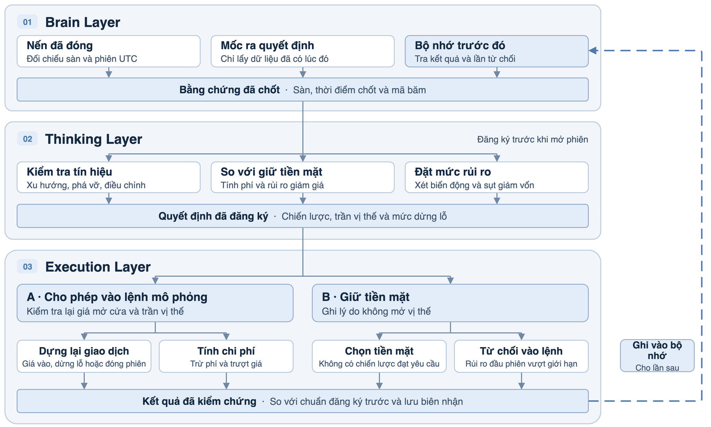
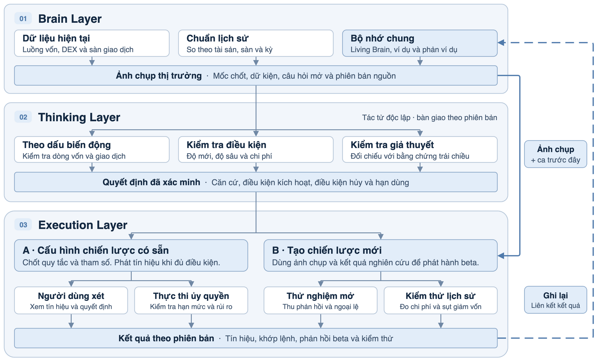

# Astarter tại BNB Bangkok

**Bạn chỉ có một cơ hội ghi lại quyết định giao dịch trước khi thị trường cho biết kết quả.**

[English](README.md) · [简体中文](README.zh-CN.md) · [日本語](README.ja.md) · [한국어](README.ko.md) · **Tiếng Việt** · [Español](README.es.md) · [Français](README.fr.md) · [Русский](README.ru.md)

Astarter là hệ điều hành giao dịch dùng AI. Trước khi phiên UTC tiếp theo mở cửa, hệ thống giao dịch giao ngay mô phỏng ghi lại dữ liệu thị trường, chiến lược đã chọn và quy mô vị thế tối đa. Khi phiên đóng cửa, bạn có thể đối chiếu kết quả với kế hoạch và tính lãi lỗ sau chi phí. Quyết định giữ tiền mặt cũng được ghi nhận.

[Mở Deep Brain](https://dapp.ipfund.art/?page=brain&lang=vi) · [Kiểm chứng trên máy](src/deep-brain) · [BNB Bangkok](https://www.hackquest.io/hackathons/BNB-Bangkok)

## Các tác nhân nghiên cứu RWA như thế nào?

**18 Team agents** chia nhau kiểm tra bằng chứng. A05 xem xét thanh khoản, A10 tìm bằng chứng phản bác giả thuyết và A15 đánh giá phần vốn chịu rủi ro. **18 Strategy agents** xác định thị trường, điều kiện vào lệnh, thoát lệnh và giới hạn rủi ro của từng chiến lược. Bộ máy giao dịch giao ngay mô phỏng so sánh ba phương án theo xu hướng, phá vỡ và điều chỉnh với giữ tiền mặt. Qua **Living Brain**, tác nhân tiếp theo có thể tìm lại kế hoạch hoặc bài học đã lưu và đối chiếu biên nhận với nguồn. Khi giải thích lãi lỗ, mô hình đọc biên nhận đã xác minh. Phần giải thích đi kèm mã biên nhận và hàm băm của dữ liệu đầu vào.

Với cổ phiếu được mã hóa NVDAB, **Astarter CLI** trả về giá USD từ Atlas và thời điểm cập nhật ở dạng JSON. Bộ công cụ **Binance Agent OS** trong trợ lý hỗ trợ nghiên cứu thị trường và đọc thông tin tài khoản khi có quyền. Trong phần cài đặt, **Binance Agentic Wallet** dùng chữ ký BNB Chain có thời hạn ngắn để xác minh quyền kiểm soát địa chỉ. Việc sử dụng tiền cần được cấp quyền riêng.

[Team agents](src/astarter-frontend/simulation.mjs) · [Strategy agents](https://dapp.ipfund.art/agents) · [Astarter CLI](https://demo.astarter.io/cli/astarter.mjs) · [Agentic Wallet](https://demo.astarter.io/settings#ux-local-agent) · [Binance Agent OS](https://www.binance.com/en-ZA/agent-os) · [Living Brain](src/astarter-frontend/living-brain.mjs)

## BNB Bangkok · Bằng chứng kỹ thuật

| Hạng mục | Nội dung có thể kiểm tra |
| --- | --- |
| **Developer Track** | Đọc giá cổ phiếu được mã hóa trên BNB Smart Chain rồi kiểm tra căn cứ, trần vị thế và điều kiện từ chối vào lệnh trong giao dịch giao ngay mô phỏng. Tác tử có thể giải thích lý do chọn và giới hạn rủi ro. [Nguồn trên chuỗi](https://atlasoracle.io/feeds/1005) · [Tóm tắt quyết định](https://dapp.ipfund.art/api/brain/proof?brief=1&asset=coin:bitcoin) |
| **CoinMarketCap × Atlas Challenge** | Market Hub hiển thị quy mô và tâm lý thị trường từ CoinMarketCap cùng giá Atlas có dấu thời gian. Có thể xem phản hồi Pull NVDAB/USD (#934) và tự đọc nguồn Push trên BNB Chain (#1005). [Market Hub](https://dapp.ipfund.art/?page=markets&lang=vi) · [Phản hồi CMC](https://dapp.ipfund.art/api/market-hub?resource=global) · [Phản hồi Atlas](https://dapp.ipfund.art/api/atlas/prices?symbol=NVDAB) · [Tóm tắt kỹ thuật (tiếng Anh)](docs/bnb-bangkok-technical-brief.md) |
| **ChatAndBuild — Build Memory-Powered Agents with Living Brain** | Tác tử sau có thể tìm quy tắc, kế hoạch theo từng ví và bài học của chiến lược. Hệ thống lưu biên nhận mô phỏng qua API Living Brain và đối chiếu mã băm của nội dung truy xuất trước khi đưa cho mô hình. [API bộ nhớ](src/astarter-frontend/living-brain.mjs) · [Xác minh biên nhận](src/deep-brain/paper-replay/connections.mjs) |
| **AWS Credits** | Kế hoạch dùng tín dụng đám mây là chạy tác vụ thu thập và đối soát hằng ngày, lưu bằng chứng theo ngày trong kho đối tượng và đo chi phí mỗi phiên đã xác minh. Đây là phương án mở rộng cho buổi thuyết trình startup. [Tác vụ hằng ngày](src/deep-brain/scripts/brain-proof-forward.mjs) · [Tiêu chí chính thức](https://www.hackquest.io/hackathons/BNB-Bangkok) |

## Khi nào một giao dịch đáng để chấp nhận rủi ro?

| Lớp | Câu hỏi | Bằng chứng có thể kiểm tra |
| --- | --- | --- |
| **[Brain Layer](src/deep-brain/brain-agent-recall.mjs)** | Tại thời điểm đó, tác tử có thể biết điều gì? | Đối chiếu nến đã đóng với dữ liệu của sàn rồi cố định nguồn, thời điểm chốt theo UTC và hàm băm nội dung. Với cùng một tài sản, tác tử có thể truy xuất tối đa ba bản ghi liên quan trong bảy ngày UTC trước đó, kể cả những quyết định bị từ chối. Biên nhận đến muộn chỉ dùng cho lần đánh giá sau. |
| **[Thinking Layer](src/deep-brain/brain-strategy-witness.mjs)** | Vì sao chọn chiến lược và quy mô này hôm nay? | Chiến lược theo xu hướng, phá vỡ và mua khi điều chỉnh được so với giữ tiền mặt. Để được chọn, chiến lược cần có tín hiệu hiện tại, đủ quan sát và điểm dương sau khi tính chi phí mô phỏng và rủi ro giảm giá. Hệ thống đặt trần vị thế và mức dừng lỗ. Biến động cao hoặc vốn sụt giảm sẽ kích hoạt chính sách thận trọng. Giữ nguyên tín hiệu, hệ thống lần lượt bỏ từng ngày trong 60 ngày hiệu chỉnh để xem ngày nào làm thay đổi thứ hạng. |
| **[Execution Layer](src/deep-brain/brain-execution-invariants.mjs)** | Lệnh mô phỏng có tuân thủ quyết định không? | Chỉ thị gắn với mã quyết định. Khoảng trống giá lúc mở cửa có thể khiến hệ thống hủy việc vào lệnh, còn kiểm tra rủi ro có thể giảm vị thế. Sau khi nến đóng và được đối chiếu độc lập, bộ kiểm chứng tính lại giá vào, giá ra, trượt giá, phí và vốn cuối phiên. Lãi lỗ để trống khi chưa quyết toán. |

[](docs/images/vi/decision-proof.drawio.png)

**Làm sao biết hệ thống có ích?** Theo dõi toàn bộ quyết định đăng ký trước, kể cả phiên không giao dịch. Khi có kế hoạch đối chiếu, hệ thống đăng ký hai chuẩn trước giờ mở cửa. Một chuẩn giữ tiền mặt. Chuẩn kia dùng 10% vốn để nắm giữ tài sản từ lúc mở đến lúc đóng phiên, có tính phí và trượt giá. So sánh lợi nhuận ròng, thua lỗ và mức sụt giảm trên cùng các phiên để biết kết quả có xứng với rủi ro đã chịu. Phiên tiếp theo vẫn cần được kiểm chứng. [Bản tóm tắt chỉ đọc](https://dapp.ipfund.art/api/brain/proof?brief=1&asset=coin:bitcoin) · [Cách tính chuẩn so sánh](src/deep-brain/brain-forward-comparison.mjs)

### Kiến trúc bộ nhớ dùng chung

Các tác tử nghiên cứu cùng một ảnh chụp thị trường rồi bàn giao bằng chứng và câu hỏi còn bỏ ngỏ. Chiến lược hiện có thể phát tín hiệu theo chính sách đã cấu hình. Chiến lược đề xuất được đưa vào kiểm thử kèm tham số và căn cứ. Kết quả gắn với từng phiên bản để tác tử sau tra được lý do thay đổi quy tắc.

[](docs/images/vi/shared-brain-flow.drawio.png)

## Có thể kiểm chứng những gì trong bản phát hành này?

- **CoinMarketCap** có [bộ chuyển đổi](src/astarter-frontend/market-source-adapters.mjs) chuẩn hóa dữ liệu thị trường, danh mục và tâm lý từ Pro API cho Market Hub.

- **Atlas trên BNB Chain** liên kết NVDAB với [danh mục nguồn giá](src/astarter-frontend/atlas-feed-master.mjs). Khi được cấu hình, bộ chuyển đổi đọc giá Pull kèm thời gian. Có thể đối chiếu độc lập giá Push công khai trên chuỗi tại [nguồn #1005](https://atlasoracle.io/feeds/1005).

- **Living Brain** lưu và truy xuất kế hoạch giao dịch theo từng ví qua [bộ nhớ](src/astarter-frontend/living-brain.mjs). [Các bài kiểm thử](src/astarter-frontend/living-brain.test.mjs) kiểm tra việc băm định danh và che thông tin nhạy cảm.

- **Mô phỏng và rủi ro** được trình bày trong [tài liệu về bộ máy thực thi](src/astarter-backend/README.en.md), gồm kiểm tra trước lệnh, mô phỏng khớp lệnh và đối chiếu quá trình thực thi.

Bản chạy trên máy dùng chế độ mô phỏng. Điều phối liên tục giữa các tác tử, phát hành bản beta công khai và tự động thu nhận phản hồi là các mục tiêu thiết kế.

## Kiểm chứng quyết định trên máy

Dùng Node.js 24 và chạy các lệnh dưới đây từ thư mục gốc. Bộ kiểm chứng đọc kho dữ liệu thị trường để đối chiếu quyết định và biên nhận.

```sh
cd src/deep-brain
npm run verify
npm test
```

[Thu thập quan sát mới, đăng ký phiên mô phỏng sắp tới hoặc truy vấn bộ nhớ của tác tử](src/deep-brain/paper-replay/README.md).

## Gói giao diện và dữ liệu

Giao diện mặc định bám theo nhánh HACKATHON đã triển khai. Trong Deep Brain, chọn tài sản để xem bằng chứng của từng nút. [Bản trực tuyến](https://dapp.ipfund.art/?page=brain&lang=vi) có thêm ảnh chân dung bằng hạt theo giấy phép. Bản mã nguồn mở bắt đầu bằng đồ thị tương tác. Chọn một giao dịch mô phỏng trong Backtest Review rồi mở Agent Learning để xem biên nhận, điểm chiến lược và quyết định sau đó.

Historical Blocks lưu Bitcoin và Ethereum từ tháng 1 năm 2016, BNB Smart Chain từ khối đầu tiên sau khối khởi nguyên, cùng các mẫu Solana và HyperCore có ngày ghi nhận. Chọn chuỗi và ngày UTC để xem chiều cao khối hoặc slot, thời gian và số giao dịch. Dữ liệu trọn ngày và dữ liệu lấy mẫu được phân biệt rõ. [Phạm vi](src/astarter-frontend/brain-evidence/archive/summary.json) · [Nguồn và mã SHA-256](src/astarter-frontend/brain-evidence/archive/manifest.json)

Traditional Markets v0.8.1 có 219,069,823 quan sát đã kiểm chứng trong 5,170 chuỗi thời gian, gồm cổ phiếu, chỉ số, kim loại quý, ngoại hối, dầu thô và hàng hóa khác từ năm 2016. Mỗi giá giữ nguồn công bố, đơn vị, ngày và tần suất. Dữ liệu Chainlink trên Ethereum, Arbitrum và Avalanche còn ghi nguồn giá, vòng cập nhật, thời gian và khối đọc. Giá dầu WTI giao ngay và giá tham chiếu kỳ hạn được tách riêng. [Nguồn và quyền sử dụng](src/astarter-frontend/docs/brain-tradfi-sources.md) · [Danh mục](src/astarter-frontend/brain-evidence/tradfi/catalog.json) · [Cập nhật hằng ngày](https://github.com/brunopike/astarter-bnb-bangkok/actions/workflows/brain-history.yml)

[Gói giao diện](https://github.com/brunopike/astarter-bnb-bangkok/releases/tag/v0.8.1-frontend) gồm mã nguồn đã kiểm thử và tổng kiểm tra. Nhánh main cập nhật dữ liệu đã kiểm chứng hằng ngày. [Phiên bản tính năng trước](https://github.com/brunopike/astarter-bnb-bangkok/releases/tag/v0.5.0-frontend) cũng có sẵn.

## Chạy trên máy

Node.js 24 · npm

```sh
cd src/astarter-frontend
npm ci
npm start
```

Mở [Astarter trên máy](http://127.0.0.1:4188/). Danh mục Atlas công khai dùng được mà không cần khóa API.

```sh
curl -fsS 'http://127.0.0.1:4188/api/atlas/feeds?symbol=NVDAB'
```

Các kết nối trực tiếp tùy chọn đọc cấu hình phía máy chủ qua `COINMARKETCAP_API_KEY` và `ATLAS_API_KEY`. Living Brain dùng `LIVING_BRAIN_API_KEY`, `LIVING_BRAIN_SUBJECT_ID` và `LIVING_BRAIN_BRAIN_ID`.

<details>
<summary>Đọc lại giá trên BNB Chain và chạy kiểm thử riêng</summary>

Dùng Foundry gọi hàm chỉ đọc để lấy giá Atlas Push cho NVDAB. Giá trị thứ hai là giá với 18 chữ số thập phân. Giá trị thứ tư là thời điểm cập nhật trên chuỗi.

```sh
cast call 0xf25af12920d408baf6211e9e90eda89df3d8ccda \
  'latestRoundData()(uint80,int256,uint256,uint256,uint80)' \
  --rpc-url https://bsc-dataseed.bnbchain.org
```

Từ `src/astarter-frontend`, chạy kiểm thử danh mục, bộ chuyển đổi, bộ nhớ và thanh toán mô phỏng.

```sh
node --check atlas-feed-master.mjs
node --check market-source-adapters.mjs
node --import ./test-locale.mjs --test living-brain.test.mjs commerce.test.mjs
```

[Bản v0.1.0](https://github.com/brunopike/astarter-bnb-bangkok/releases/tag/v0.1.0) chứa mã nguồn của cả giao diện và máy chủ.

</details>
