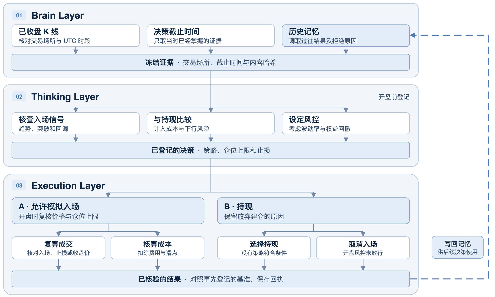
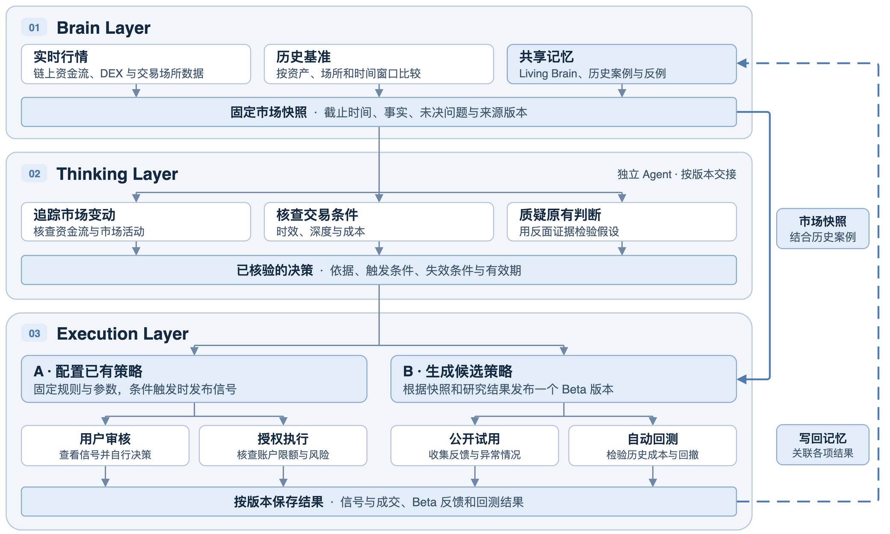

# Astarter · BNB Bangkok 黑客松

**在市场给出答案之前，你只有一次机会把交易决策写下来。**

[English](README.md) · **简体中文** · [日本語](README.ja.md) · [한국어](README.ko.md) · [Tiếng Việt](README.vi.md) · [Español](README.es.md) · [Français](README.fr.md) · [Русский](README.ru.md)

Astarter 是一个 AI 交易操作系统。下一个 UTC 交易日开盘前，现货模拟引擎就记录当时的市场证据、选中的策略和允许的最大仓位。收盘后，你可以核对它是否按计划执行，以及扣除成本后赚了多少或亏了多少。选择持现也会留下记录。

[观看产品 Demo 展示 (2:57)](https://brunopike.github.io/astarter-bnb-bangkok/) · [打开 Deep Brain](https://dapp.ipfund.art/?page=brain&lang=zh) · [在本地验证](src/deep-brain) · [BNB Bangkok 黑客松](https://www.hackquest.io/hackathons/BNB-Bangkok)

**技术文档（英文）**

[36 个 Agent 与 CLI](AI-AGENTS-AND-CLI/README.md) · [币安 Agent OS 与钱包](BINANCE-AGENT-OS/README.md) · [ChatAndBuild 的 Living Brain](CHATANDBUILD-LIVING-BRAIN/README.md) · [BNB Chain 与 RWA](BNB-CHAIN-RWA/README.md) · [CoinMarketCap × Atlas](COINMARKETCAP-ATLAS/README.md) · [AWS 额度使用计划](AWS-CREDITS-PLAN/README.md)

## Agent 如何研究一项 RWA

**18 个 Team agents** 分工审查证据。A05 检查流动性，A10 寻找反证，A15 复核资金风险。**18 个 Strategy agents** 分别定义策略适用的市场、入场、退出和风控规则。当前现货模拟引擎实际比较趋势、突破、回调和持现。借助 **Living Brain**，下一位 Agent 可以找回已保存的计划或教训，并沿回执追到原始记录。需要解释盈亏时，模型读取已核验的回执，解读结果附上回执 ID 和模型输入的哈希。

以代币化股票 NVDAB 为例，**Astarter CLI** 能以 JSON 返回 Atlas 的美元报价和更新时间。助手里的 **Binance Agent OS** 工具组支持行情研究和经授权的账户查询。设置页中的 **Binance Agentic Wallet** 使用短时有效的 BNB Chain 签名验证地址控制权。动用资金需要单独授权。

[Team agents](src/astarter-frontend/simulation.mjs) · [Strategy agents](https://dapp.ipfund.art/agents) · [Astarter CLI](https://demo.astarter.io/cli/astarter.mjs) · [Agentic Wallet](https://demo.astarter.io/settings#ux-local-agent) · [Binance Agent OS](https://www.binance.com/en-ZA/agent-os) · [Living Brain](src/astarter-frontend/living-brain.mjs)

## BNB Bangkok · 技术评审入口

| 参评项目 | 可以核对什么 |
| --- | --- |
| **Developer Track** | 在 BNB Smart Chain 读取代币化股票报价，再查看现货模拟决策的证据、仓位上限和拒绝入场条件。Agent 可以说明交易为何入选，以及风险在哪里受限。 [链上报价源](https://atlasoracle.io/feeds/1005) · [决策简报](https://dapp.ipfund.art/api/brain/proof?brief=1&asset=coin:bitcoin) |
| **CoinMarketCap × Atlas Challenge** | 行情中心结合 CoinMarketCap 的市场规模、市场情绪与 Atlas 的带时间戳报价。可查看 NVDAB/USD 的 Pull 响应（#934），并独立读取 BNB Chain 的 Push 报价源（#1005）。 [行情中心](https://dapp.ipfund.art/?page=markets&lang=zh) · [CMC 响应](https://dapp.ipfund.art/api/market-hub?resource=global) · [Atlas 响应](https://dapp.ipfund.art/api/atlas/prices?symbol=NVDAB) · [一页技术说明](docs/bnb-bangkok-technical-brief.md) |
| **ChatAndBuild — Build Memory-Powered Agents with Living Brain** | 后续 Agent 可按策略检索规则、按钱包隔离的计划与历史教训。模拟回执通过 Living Brain API 存储，读取后核对内容哈希，再交给模型解释。 [记忆 API](src/astarter-frontend/living-brain.mjs) · [回执核验](src/deep-brain/paper-replay/connections.mjs) |
| **AWS Credits** | 拟用云额度扩展每日数据采集与结算核对任务，将带日期的证据存入对象存储，并统计每个已核验交易日的成本。这是路演中的扩容方案。 [每日任务](src/deep-brain/scripts/brain-proof-forward.mjs) · [官方评审规则](https://www.hackquest.io/hackathons/BNB-Bangkok) |

## 一笔交易凭什么值得做？

| 层 | 要回答的问题 | 可以核对的证据 |
| --- | --- | --- |
| **[Brain Layer](src/deep-brain/brain-agent-recall.mjs)** | Agent 在当时能知道什么？ | 向交易场所核对已收盘的 K 线，固定数据来源、UTC 截止时间和内容哈希。对同一资产，可从此前七个 UTC 交易日取回最多三条相关记忆，包括曾被拒绝的决策。后来才收到的回执只能用于后续复盘。 |
| **[Thinking Layer](src/deep-brain/brain-strategy-witness.mjs)** | 为什么今天选这个策略，用这个仓位？ | 趋势、突破和回调策略与持现竞争。策略需要有当期信号、足够的观测，并且扣除模拟成本和下行风险后评分为正。系统为入选策略设置仓位上限和止损，高波动或权益回撤会触发保守风控。保持当前信号不变，逐一剔除 60 个校准日再排名，可查出哪一天会改变结果。 |
| **[Execution Layer](src/deep-brain/brain-execution-invariants.mjs)** | 模拟成交遵守决策了吗？ | 执行指令绑定决策 ID。开盘跳空可能取消入场，风控可以缩仓。K 线收盘并经独立核对后，验证器复算进出场价、滑点、费用和期末权益。尚未结算时，收益留空。 |

[](docs/images/zh-CN/decision-proof.drawio.png)

**怎样判断它有没有帮助？** 跟踪事先登记的决策，把跳过的交易日也算上。具备对照方案时，引擎会在开盘前登记两种基准：全程持现，以及用 10% 的资金从开盘持有该资产至收盘，并计入手续费和滑点。在相同交易日比较净收益、亏损和回撤，就能判断这段时间的收益是否值得承担这些风险。下一期仍要由市场检验。[查看只读决策简报](https://dapp.ipfund.art/api/brain/proof?brief=1&asset=coin:bitcoin) · [核对基准算法](src/deep-brain/brain-forward-comparison.mjs)

### 共享大脑架构

多个 Agent 从同一份市场快照开展研究，交接证据和未决问题。已有策略可在配置的规则内发布信号。候选策略连同参数和依据进入测试。每次结果关联具体版本，后续 Agent 可以追溯规则为何改变。

[](docs/images/zh-CN/shared-brain-flow.drawio.png)

## 这个版本可以验证什么？

- **CoinMarketCap** 的[行情适配器](src/astarter-frontend/market-source-adapters.mjs)将 Pro API 的市场、分类和情绪数据整理到行情中心。

- **BNB Chain 上的 Atlas** 通过[源目录](src/astarter-frontend/atlas-feed-master.mjs)将 NVDAB 映射到报价源。完成配置后可读取带时间戳的 Pull 报价，也可独立核对 [#1005 的链上 Push 报价](https://atlasoracle.io/feeds/1005)。

- **Living Brain** 通过[记忆适配器](src/astarter-frontend/living-brain.mjs)保存和读取按钱包隔离的交易计划。[自动化测试](src/astarter-frontend/living-brain.test.mjs)覆盖身份哈希和敏感信息遮蔽。

- **模拟执行与风控** 的[引擎说明](src/astarter-backend/README.md)涵盖下单前检查、模拟成交及执行记录的复核。

本地演示使用模拟盘。持续的跨 Agent 调度、公开 Beta 发布和自动收集反馈属于后续设计目标。

## 在本地验证一笔决策

在仓库根目录用 Node.js 24 执行以下命令。验证器从行情归档读取输入，核对决策与执行回执。

```sh
cd src/deep-brain
npm run verify
npm test
```

[采集新行情、开盘前登记模拟决策或查询 Agent 记忆](src/deep-brain/paper-replay/README.md)。

## 前端与数据包

默认前端跟随已部署的 HACKATHON 分支。打开 Deep Brain，选择资产即可查看图谱节点背后的证据。[在线演示](https://dapp.ipfund.art/?page=brain&lang=zh)另有授权的粒子人像。本分支使用独立的粒子人像渲染器，点击 **Explore** 可进入证据图谱，也可以前往 [Astarter Lite](https://demo.astarter.io/lite?lang=zh) 查看信号。在 Backtest Review 中选择一笔模拟成交，再到 Agent Learning 核对回执、策略评分和下一次决策。

Historical Blocks 收录自 2016 年 1 月起的比特币和以太坊记录、BNB Smart Chain 的首个非创世区块及后续记录，以及带日期的 Solana 和 HyperCore 原生样本。可按链和 UTC 日期查看区块高度或 slot、时间及交易数。界面区分完整日序列和抽样数据。[覆盖摘要](src/astarter-frontend/brain-evidence/archive/summary.json) · [来源与 SHA-256 清单](src/astarter-frontend/brain-evidence/archive/manifest.json)

Traditional Markets 的 v0.8.1 快照覆盖自 2016 年以来的股票、指数、贵金属、外汇、原油等商品，共 5,170 个序列、219,069,823 条已核验观测。价格保留发布者、单位、日期和频率。Ethereum、Arbitrum 和 Avalanche 的 Chainlink 序列还记录报价源、轮次、更新时间与读取区块。WTI 现货和期货基准分别列示。[来源与使用权](src/astarter-frontend/docs/brain-tradfi-sources.md) · [市场目录](src/astarter-frontend/brain-evidence/tradfi/catalog.json) · [每日更新](https://github.com/brunopike/astarter-bnb-bangkok/actions/workflows/brain-history.yml)

[前端发行包](https://github.com/brunopike/astarter-bnb-bangkok/releases/tag/v0.8.1-frontend)含已测试源码与校验和，main 分支每日更新核验数据。也可下载[历史功能快照](https://github.com/brunopike/astarter-bnb-bangkok/releases/tag/v0.5.0-frontend)。

## 本地运行

Node.js 24 · npm

```sh
cd src/astarter-frontend
npm ci
npm start
```

启动后打开[本地 Astarter](http://127.0.0.1:4188/)。公开的 Atlas 目录无需 API 密钥。

```sh
curl -fsS 'http://127.0.0.1:4188/api/atlas/feeds?symbol=NVDAB'
```

可选实时适配器读取服务端配置。CoinMarketCap 使用 `COINMARKETCAP_API_KEY`，Atlas 使用 `ATLAS_API_KEY`，Living Brain 使用 `LIVING_BRAIN_API_KEY`、`LIVING_BRAIN_SUBJECT_ID` 和 `LIVING_BRAIN_BRAIN_ID`。

<details>
<summary>复核 BNB Chain 报价并运行专项测试</summary>

安装 Foundry 后，通过只读调用查询 NVDAB 的 Atlas Push 报价。第二个返回值是按 18 位小数缩放的价格，第四个是链上更新时间戳。

```sh
cast call 0xf25af12920d408baf6211e9e90eda89df3d8ccda \
  'latestRoundData()(uint80,int256,uint256,uint256,uint80)' \
  --rpc-url https://bsc-dataseed.bnbchain.org
```

在 `src/astarter-frontend` 运行目录、适配器、记忆和模拟结账测试。

```sh
node --check atlas-feed-master.mjs
node --check market-source-adapters.mjs
node --import ./test-locale.mjs --test living-brain.test.mjs commerce.test.mjs
```

[v0.1.0 发行包](https://github.com/brunopike/astarter-bnb-bangkok/releases/tag/v0.1.0)包含前后端合并的源码快照。

</details>
