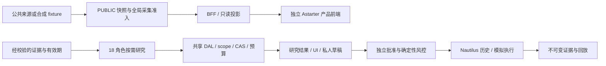

# 当前 Astarter 后端架构

[中文入口](../README.md) · [English overview](../README.en.md)

## 主实现与部署边界

`services/engine/src/stark_trading_os` 保留当前产品的主实现及传递依赖。不是所有模块默认同时启用：PUBLIC-only、推荐读层和其他组合根仍按原代码互斥。低延迟执行不能等待每次完整的 18 角色讨论。

`deployments/public` 和 `deployments/private` 是可独立运行、版本化并已记录来源的分发快照。完整复制其导出闭包是为了能够在一个 checkout 中复现相应入口；它们不是新的并行功能开发副本。通过各自 `source-manifest.json` 检查字节，通过根 `source-index.json` 找实现来源。更新时先在 Core 实现与审查，再显式重新导出和验证。

根目录没有 `vercel.json`；本次未新建 Vercel 项目或执行部署。自动触发还取决于平台现有的 Git 集成与 Root Directory，不能仅由本地文件缺失推断已关闭。发布前须核对实际项目、目标、目录、环境与版本。

## 信任与成本

- PUBLIC 共享以相同来源、完整 instrument、scope、版本、模型/profile/effort 和原始期限为准，不能公开 PRIVATE/BYOK 产物。
- 服务端 principal 是身份来源；用户 JSON 不能声明 owner、付款主体、数据库登录、可信批准或可执行权限。
- owner lease、epoch、CAS、命令回执及预算责任在已有 DAL/事务内校验。未知提交或派发不退款、不换 UUID 盲目重发。
- 来源时刻、首次接收时刻、available 和 expiry 各有语义。历史合法数据兜底只能标 stale，不能夹时钟或改日期伪造 fresh。
- 模拟预算单位、真实 USD 账本、供应商套餐额度和用户积分是不同领域。配置存在、HTTP 200 或 COMMITTED 回执都不是模型质量或真实源可用性的完整证明。
- 研究结果和私人草稿没有交易、付款、钱包签名或资金托管权限；原生执行另有批准和风控门禁。

## 产品前端

当前前端在 `brunopike/astarter-frontend`，不是已经移出的 `apps/web`。本仓库提供其后端合同、持久能力及部署入口；前端的组件、钱包验证器、浏览器构建和视觉验收仍在前端工程维护。

合成 UI 结果、真实数据库验证、部署 READY 和真实交易必须分别报告。当前尚缺的链路见 [状态清单](current-status.md)。
