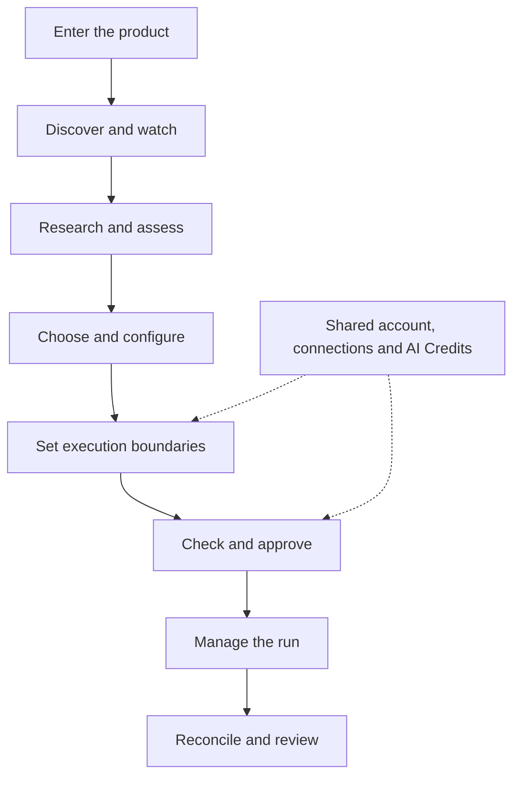
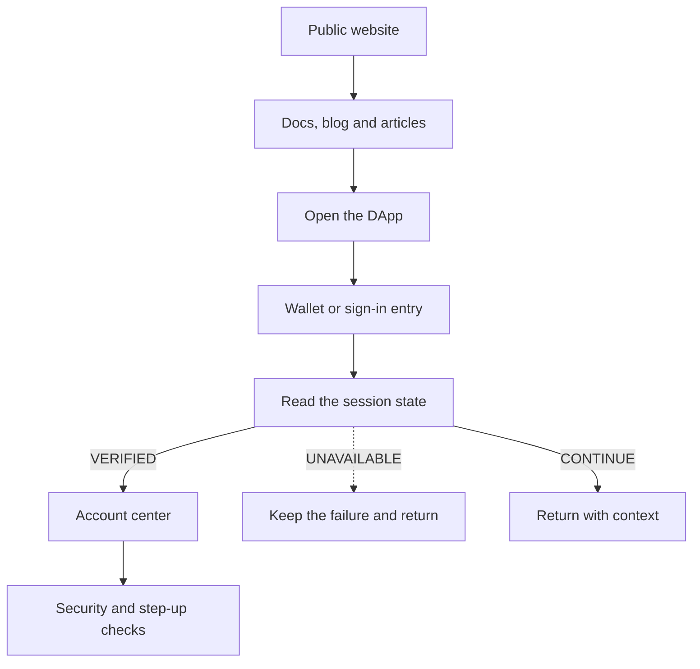
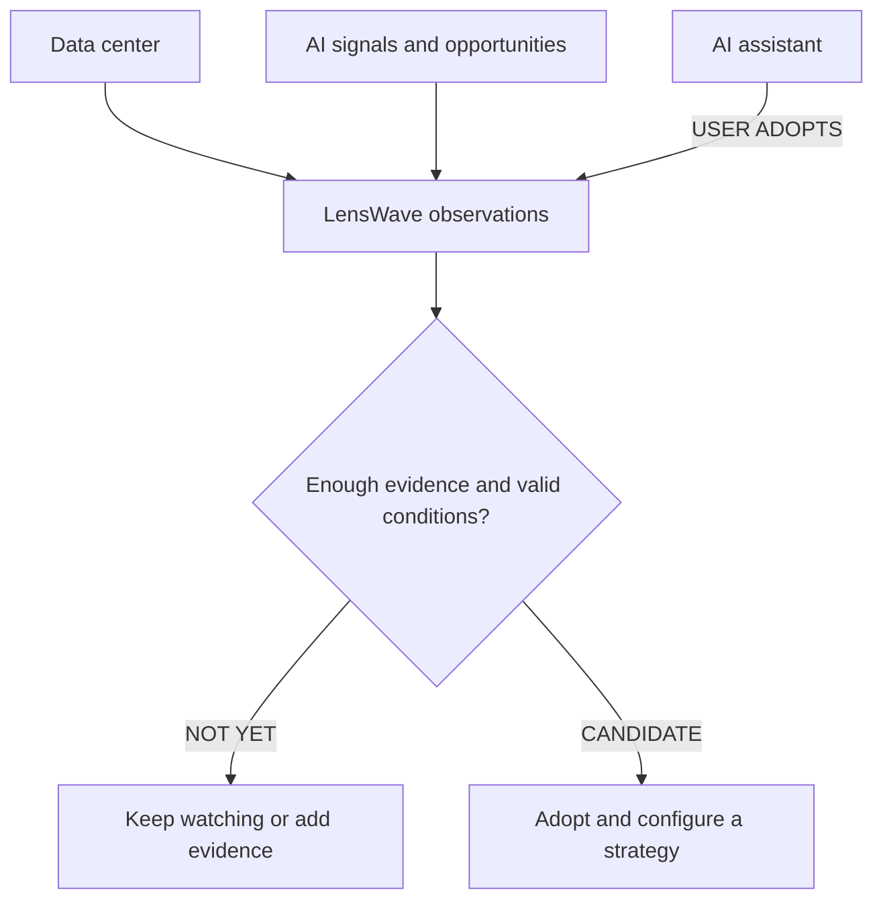
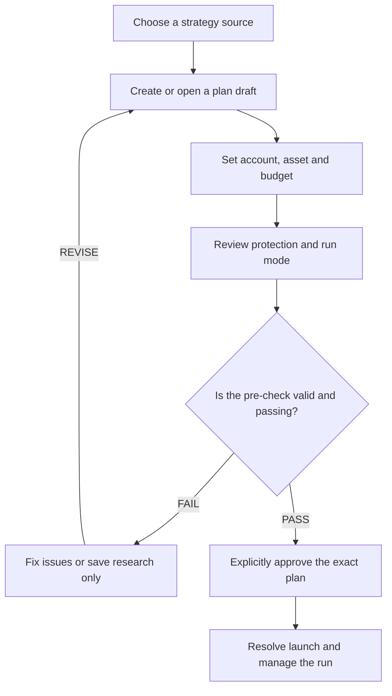
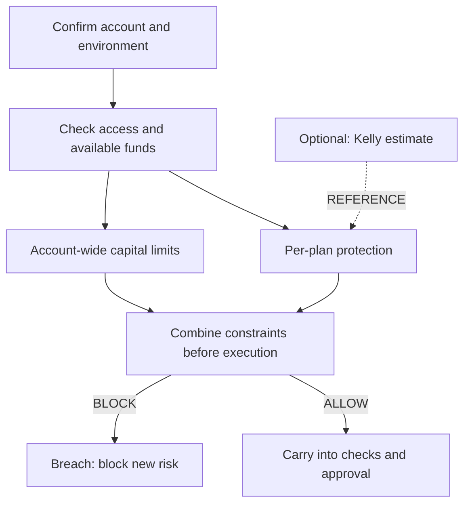
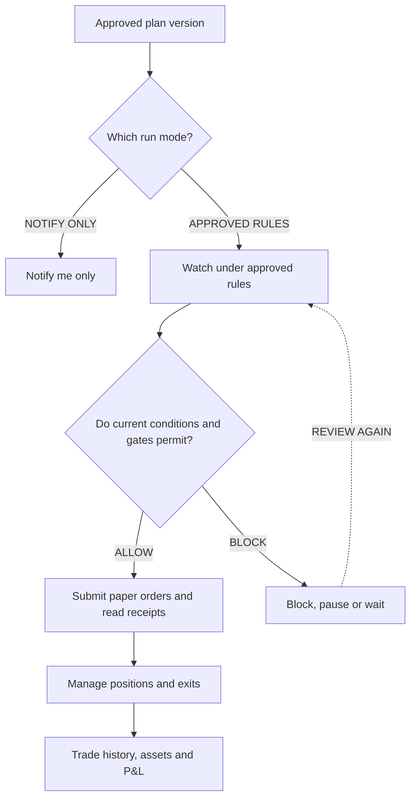
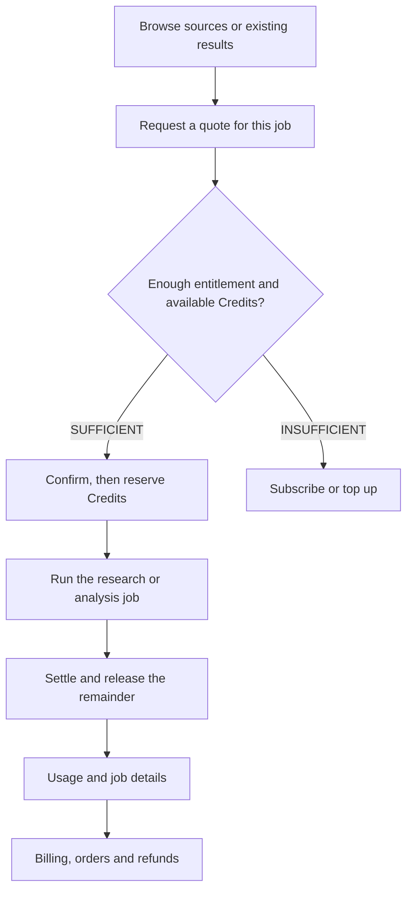
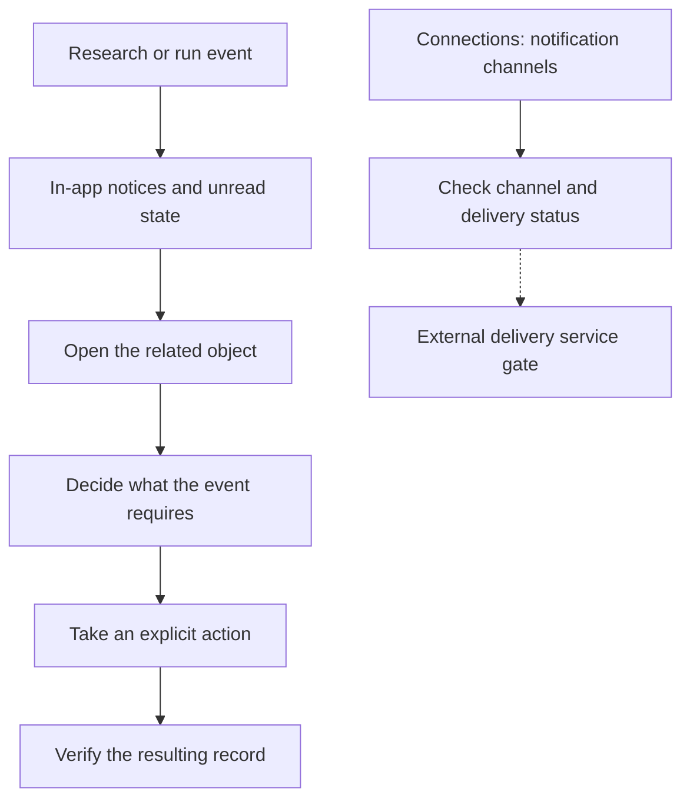
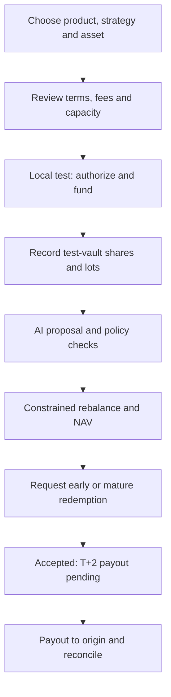

# Astarter Cross-page Business Flows

Updated17 Nov2026 (UTC+8), this R3 incremental snapshot. Production `7dfb27e` is READY. R3 `ab31a0d` is built preview plus LOCAL_UI_ACCEPTED, without cloud activation. All32 routes, eight security views, nine diagrams and historical d461 / N1 / R2 evidence remain. Production, preview/local acceptance and next steps are distinguished; preview is not production availability.

Core journey: discover and watch → research and assess → configure a plan → access and risk checks → pre-check and explicit approval → observe or paper-run → receipts and review.

## 01 · The main journey: discovery to review

**Main app · simulated execution**

Pages cooperate to turn market observations into plans that can be checked, approved and audited.

- Prices, technical charts, scans and AI research are inputs. A visible signal is not an order approval.
- The catalog, signals, LensWave and assistant can lead into the same configuration and checking flow. Visiting every page is not required.
- Reconcile runs, orders, fills and P&L by account, origin, run and plan version. Review can lead back to discovery or a new plan version.

Source: `product-data.mjs`, `product.js`, `business-pages.js`, `strategy-journeys.mjs`

## 02 · Entry, account and security

**Web wallet QA sign-in passed · user wallets and phones unverified**

Public content explains the product. The DApp demo environment and real-account access have different capability boundaries.

- Demo browsing is not shown as requiring a real-wallet signature. Trading permission is checked separately for each plan.
- Wallet connectivity, sign-in, trading access and withdrawal permission are distinct. A connection grants neither trading nor withdrawal authority.
- Production N1/A1 requires an explicit `private-ui-v2` signature for workspace and account-inbox read/write permissions. Legacy v1 sessions are not upgraded automatically. The signature grants no trades, token approvals or transfers.
- account-access.html retains its eight security views. PRIVATE HTTPS is connected to production under a capped, time-limited lease. Sign-in and logout are verified; continuous availability has not been accepted.
- This production HTTP run used two temporary QA EOAs, each with one real v2 signature. A separate temporary QA EOA completed actual web sign-in and logout. Nonce, message, verify and logout returned 200; Secure / HttpOnly / SameSite=Strict cookies, cleared current sessions and revoked old cookies passed. This does not accept real user wallets or all security views.
- Connection, signed sign-in and service failures have separate actions. Identity recovery rechecks the server session before querying the original job; a sign-in outage should not block wallet connection.
- The existing public Reown project ID is included in the build and SDK production-origin checks passed. Actual phone QR pairing and signing remain unverified.

Source: `landing/photonic-source/site-routes.mjs`, `landing/photonic-source/public-page.mjs`, `account-access.mjs`, `account-security.mjs`, `wallet-entry.mjs`, `account-center.mjs`, `vercel.json`, `header-wallet.jsx`, `wallet-session.mjs`, `wallet-private-auth.mjs`, `wallet-runtime.mjs`, `wallet-profile-upgrade.test.mjs`, `wallet-private-auth-v2.test.mjs`

## 03 · How data, signals, watchlists and research meet

**Live technical observations / separate demo research**

Different entry points should preserve asset identity, source, time and the resulting assessment.

- The watchlist is shared across pages. An asset with a research task can reopen it; other entries open asset details. A watchlist is not an execution allowlist or authorization.
- The market quadrant, rotating candles and technical annotations are analytical views. Data timing and tradability differ by market.
- R1 retains closed daily bars for eight assets and adds Binance Spot top-100 depth snapshots for BTC, ETH and SOL. Normal reads are about 15 seconds apart; depth expires 30 seconds after the original request start. Daily bars and depth have independent validity windows.
- Depth shows spread in bps and bid/ask quote notional in USDT within mid ±1%. Each incompletely covered side shows a conservative ≥ lower bound. Complete coverage describes that snapshot only. A 100-level sample is not the full book, traded fund flows or direction; timestamps describe the request observation window, not exchange events.
- When daily bars and depth are both fresh, the three crypto assets count 2/6 source groups and 6/18 fields. The five TradFi assets still have no depth; fresh daily bars count 1/5 applicable source groups and 3/18 fields (on-chain NA is excluded from the source-group denominator; the field denominator stays 18). Expired or unavailable inputs do not count as valid evidence.
- Eight daily sources, three crypto spot-depth sources, source validity / expiry and three shared-context inputs passed within their stated scopes. Shared context is not comprehensive macro-event, sentiment, on-chain or account-risk coverage. Five other assets still lack depth; TradFi on-chain data is inapplicable, and DXY / US10Y prices do not replace macro-event evidence. Technical observations authorize neither model calls nor trades; missing, expired and limited sources remain explicit.
- R2 completed exactly one real canonical BTC / `openai/gpt-4.1-mini` call and persisted362 input +190 output =552 tokens. The original actor exited1 because the public error:null projection was incompatible; its failure is retained. Read-only inspection and RAM validation of that same actual record then passed old-projection RED / fixed-projection GREEN, with unchanged result and strict client and no second model call. This proves backend completion plus same-record decoding, not complete human-wallet UI or18-role model quality.
- Only an explicit Start research action submits a job. Opening, refreshing or returning queries the original requestId. An unknown result or GET 404 cannot create a fresh ID; an explicit retry retains the same ID and request body.
- The eight assets keep separate jobs under the same user identity. Account changes, expiry and leaving cancel the old view and reject late responses. Neither technical observations nor model conclusions authorize trades.
- LensWave provides research and controls; the assistant retains explanation, citations and draft handoff, preserving object and return context across both. Trading and paid research still require their own authorization and confirmation, rather than executing when a page opens.
- R3 private-report-to-strategy drafting reached LOCAL_UI_ACCEPTED in preview/local wiring: explicitly choose S01-SIM or S02-SIM and BTC / ETH / SOL from the canonical private report; amount and unfilled parameters start null. It reuses the existing BOT workspace and MoneyInput, without deriving or inventing amounts from model prose. This new flow adds no real-model or execution evidence.

Source: `data-center.mjs`, `market-hub.mjs`, `watchlist-view.mjs`, `intelligence-experience.mjs`, `trading-assistant.mjs`, `photonic-workbench.mjs`, `workbench-market-analysis.mjs`, `live-research.mjs`, `live-research-workspace.test.mjs`, `research-analysis-service.mjs`, `research-analysis-service.test.mjs`, `research-job-client.mjs`, `research-job-coordinator.mjs`, `research-runtime.mjs`, `private-api-route.mjs`, `spot-depth-client.mjs`, `spot-depth-data.mjs`

## 04 · Strategy selection, configuration and approval

**18 catalog entries · adaptation checked individually**

Every source must resolve to an explicit plan version. Clicking a recommendation does not itself launch execution.

- The catalog has 18 entries; this does not mean every entry can run. Unadapted strategy versions, markets or connections can be saved for research without bypassing launch checks.
- Pre-checks cover the exact connection, account, instrument, mode, budget, protection and service state. The existing five-step setup specifies a five-minute validity window; material changes invalidate it.
- An unresolved launch is reconciled against its original requestId rather than creating another run. Unsaved or submitting drafts require save, discard or wait handling before leaving.
- Templates opened from the workbench return to their original entry. Connection management preserves draft context. Protection preferences for new plans do not silently rewrite existing runs.
- R3 preview/local flow: private report → explicit S01-SIM or S02-SIM and BTC / ETH / SOL → unfilled amount/parameters remain null → server-contract preview of13 diff groups → user confirms adopt with the same draftID, expectedRevision, workspaceRevision and proposal token. Authority remains NONE / DEMO / SIM-01, Binance spot metadata. Draft adoption is not pre-check, trading approval, account opening or trade launch.
- R3 original-ID recovery/readback: unknown results query only the original request; GET null creates no fresh POST. Same-ID GET returns the latest version and matching fields; an older receipt cannot overwrite a concurrently newer GET. The directory contract reopens the same ID. These directory/protocol actions are currently accepted in SYNTHETIC_WIRE_ONLY local wiring, not cloud-PG persistence. Full mobile amount visibility, no assistant-floater obstruction and1440/390 visuals are local scope.
- S03 / Q08 work is paused. Existing finite native checks with synthetic inputs do not establish continuous PAPER operation or live trading.

Source: `strategy-catalog.mjs`, `bot-hub.mjs`, `strategy-journeys.mjs`, `strategy-routing.mjs`, `setup-view.mjs`, `trading-access.mjs`, `business-pages.js`

## 05 · SIM-01, account limits and strategy protection

**Demo account · scoped risk settings**

Account identity, shared capital limits and per-plan exit protection are distinct and jointly constrain execution.

- Account limits govern shared usage and pause thresholds. Plan protection governs strategy risk, position size and exits. They do not replace one another.
- Changing strategies does not reset account limits. Protection preferences and custom parameters apply to new plans; existing runs retain their approved versions.
- Kelly estimates a risk budget using net odds after costs and an applicable risk ceiling. The estimate is not an order notional and submits no order by itself.
- Pausing new entries does not liquidate holdings or guarantee existing orders cannot fill. Orders, positions and protection still require review.

Source: `workbench-console.mjs`, `strategy-protection.mjs`, `risk-strategy.mjs`, `trading-access.mjs`, `workspace-sim.mjs`

## 06 · Runs, notifications, fills and review

**Simulated execution · not a live trading service**

An approved plan still distinguishes observation from execution, and approval does not waive later risk checks.

- My Agents groups current runs, saved plans and ended history. A runId identifies the exact instance; a new run must not inherit an old run’s display state.
- Trade history links plans, orders, fills and fees. Assets and P&L are computed from the matching account ledger. LensWave and Strategy Agent origins remain distinct.
- Each P&L activity point represents a time sub-interval, with four profit and four loss intensities. Daily, weekly, monthly and all-time filters change the view, not the fills.
- Browser simulation and local-service simulation have different continuity limits. A closed browser, stopped service or unreconciled feed is not continuous live protection.

Source: `strategy-journeys.mjs`, `execution-views.mjs`, `execution-stream.mjs`, `execution-records.mjs`, `bot-hub.mjs`, `workbench-charts.mjs`, `local-sim-desk.mjs`

## 07 · Subscription, Credits, usage and billing

**Local commerce flow · cloud charging unavailable**

Service charges and trading capital use separate ledgers. Paid jobs require a quote and confirmation before a hold and settlement.

- The four commerce pages separate entitlements, simulated Credit top-ups, job usage, and orders/refunds. The legacy staking entry redirects to subscription.
- Viewing a quote does not create a purchase order. An explicit confirmation does. Completing a top-up does not auto-start the original research; return to its quote.
- A hold is not a settled charge. An unresolved job is reconciled against the original job rather than assumed successful, refunded or charged again. Balance, usage and billing share ownership.
- The current cloud commerce endpoint is explicitly unavailable. Local simulated purchases, refunds and charging rules do not establish real payments or paid-provider integration.

Source: `membership.mjs`, `membership-account.mjs`, `commerce-ui.mjs`, `commerce-catalog.mjs`, `vercel.json`, `DEPLOYMENT.md`

## 08 · Workbench controls, notifications and resolution

**In-app records and external delivery are distinct**

The Trading, Signals and Notices tabs set execution limits, select plans and handle events respectively.

- Trading configures account boundaries and new-plan protection and leads to selection and management. Signals opens a source or template as a plan. Notices handles existing events.
- Unread indicators, simulated examples and actual records remain distinct. Reading a notice or switching tabs must not launch a trade, change risk settings or charge Credits.
- Global settings groups trading connections, research data, AI models and notifications; wallets use a separate entry. Returns preserve the original object and editing context.
- Production A1 adds an account workspace to the configuration overview: Load cloud, Apply preferences, Save current preferences and Check original request. Loading does not apply state automatically, and applying does not save it; only explicit saving submits a metadata command. Actual saving, rereading and UI application passed.
- The metadata allowlist contains tracked assets, filter/focus, a draft-name directory and its selected entry only. It excludes strategy parameters, risk settings and approvals, trading credentials and funds. The directory is not an executable-strategy backup.
- N1 connects notification settings and the workbench panel to the server-owned account inbox, separate from `?page=inbox`. Explicit responseVersion=2 reads use private-notifications-v2; global reminderUnreadCount is filtered by in-app preferences and categories, separately from historical unreadCount. Muting retains history. Read state and badges await server receipts; unknown commands recover through original-ID GET only, conflicts require fresh state, and immutable v1 receipts remain. R7 accepted five actual commands, preferences, read state and1440 /390 /430 UI; fresh two-account acceptance completed identity switching, isolation and logout, as scoped below.
- A new, changed or renewed verified identity reads notification state once. Opening notifications, mobile return to the console and confirmed writes refresh v2 state; there is no background polling. A pending original request is not overwritten by automatic reading. A separate notification version prevents workspace operations swallowing refreshes; explicit reload synchronizes the settings draft while preserving edits made during that read.
- Existing external-channel polling, close cancellation and local outbox evidence remain separate from non-polling N1 refreshes. R7 notification actions and subsequent independent two-account acceptance have separate actual results. The original R7 overall failure at B login is not rewritten. Email / Telegram remain deferred; subscription services are excluded from this batch, with no external delivery or sending-worker acceptance.

Source: `workbench-console.mjs`, `workbench-console-examples.mjs`, `notification-settings.mjs`, `notification-service.mjs`, `connections.mjs`, `product.js`, `vercel.json`, `notification-settings.test.mjs`, `private-ui-controller.mjs`, `private-workspace-client.mjs`, `private-ui-data.mjs`, `private-ui-service.mjs`, `private-ui-runtime.mjs`

## 09 · AI Wealth: main entry and local tests

**Main route connected · real funding unavailable**

Product browsing and candidate terms first shipped at 9f542e1. Production 8b1f44b adds and verifies four-asset read-only market references. Funding remains gated to local tests.

- wealth is one of the 32 main-app IDs, with primary navigation, mounting and leave cleanup. USDC, USDT, WETH and WBTC show Aave V3 · Ethereum underlying supply reference APR, available-liquidity raw units, block and update time. Reference APR is not the wealth product’s return. Four profiles and terms remain browsable; personal balances and returns stay unknown, and service failures show missing values and retry state.
- Real funding stays disabled. An explicit user action opens the local test vault only on localhost / 127.0.0.1, chain31337 and a valid capability check. A public origin cannot enable funding from a test configuration.
- This describes test assets, test quotes and a local vault loop. It does not establish mainnet assets, real yield, real wallets or production custody.
- Acceptance starts the T+2 pending-payout stage. Maturity, redemption request and final payment are distinct events. Parameters remain subject to the candidate’s current terms and service checks.

Source: `wealth-entry.mjs`, `wealth-entry-catalog.mjs`, `wealth-entry.test.mjs`, `wealth-market-data.mjs`, `wealth-market.mjs`, `wealth-public-market.mjs`, `ai-wealth.mjs`, `wealth-manager-client.mjs`, `wealth-vault-service.mjs`, `wealth-vault-chain.mjs`, `product-data.mjs`, `product.js`, `business-pages.js`

## Complete page and entry index

| Route ID | Page / entry | Purpose and handoff |
|---|---|---|
| `?page=wealth` | AI Wealth | Four product profiles and candidate terms in primary navigation; real funding is disabled and local test vaults require a separate capability gate. |
| `?page=workbench` | LensWave | Multi-asset scanning, research, evidence and workbench controls; opens plans, runs and source details. |
| `?page=strategies` | Strategy Agents | 18-entry catalog, filters and recommendations; ?create=strategyId opens the plan workspace on this page. |
| `?page=execution` | My Agents | Current runs, saved plans, ended history and runId-specific details. |
| `?page=signals` | AI signals | Filter and track leads, inspect evidence, research or adopt a plan; signals are not authorization. |
| `?page=opportunities` | Opportunities | Secondary entry to research opportunities and assessments, then asset research or plan configuration. |
| `?page=markets` | Markets | Public market overview, asset detail, watchlist, rankings and charts; public reads, contract reads and demo modes stay distinct. |
| `?page=tracking` | AI and on-chain tracking | Metric and asset tracking, history and sources; transfers are not automatically trades or returns. |
| `?page=intelligence` | Macro intelligence | News, events and macro context, with public reads and fixtures distinguished by source capability. |
| `?page=social` | Social feed | Views, profiles and historical activity; can supply assistant or research context, not automatic copying. |
| `?page=derivatives` | Derivatives and liquidations | Derivatives observations and details; observing a market does not establish an execution adapter. |
| `?page=etf` | ETF flows | Fund flows, history and details provide research context. |
| `?page=assistant` | AI assistant | Contextual chat, analysis and source returns; paid jobs require quote confirmation, plans require explicit adoption. |
| `?page=watchlist` | Watchlist · overlay entry | Navigation opens the shared watchlist overlay; legacy deep links normalize to the parent page, not a separate trading page. |
| `?page=advisor` | Strategy advisor | Preference-based suggestions lead to a draft, checks and approval; they do not launch on the user’s behalf. |
| `?page=copy-trading` | Smart-money following | Address/trader observation and fixed-event rule replay; not connected real copy trading or a historical-return backtest. |
| `?page=contributions` | Strategy contributions | Save candidate versions, checks and risk notes; saving is not publication, review approval or a reward payment. |
| `?page=setup` | Initial setup · secondary flow | Retained five-step setup for preferences, access, plan/protection, checks and confirmation; the primary journey can start in plan configuration. |
| `?page=validation` | Strategy checks · secondary entry | Checks the saved setup; account, strategy or protection changes require a new check. |
| `?page=mandate` | Trading mode · secondary entry | Retained mode settings; new plans distinguish approved-rule runs and notify-only, while legacy per-entry modes require updating. |
| `?page=inbox` | Action inbox · secondary entry | Pending research or run actions; verify the origin before acting. |
| `?page=risk` | Astarter protection | Protection rules, parameters and plan linkage; not a replacement for account-wide limits. |
| `?page=logs` | Trade history | Orders, fills, fees and context by account, origin and run; separate from commerce billing. |
| `?page=assets` | Assets | Available and reserved funds, holdings and P&L, with run and order drill-down. |
| `?page=my-strategies` | Legacy My Strategies entry | routePage redirects to execution; not an additional independent page. |
| `?page=plans` | Subscription | Plan entitlements and current/next-period activation; purchase uses simulated quoting and confirmation. |
| `?page=topup` | Credit top-up | Choose an amount, confirm a quote and reconcile the original order; return and confirm the original job after delivery. |
| `?page=usage` | Usage | Range filters, jobs, holds/settlement/release and exports; separate from trading capital. |
| `?page=billing` | Billing | Subscription/top-up orders, status, refunds and exports; trading fills belong in logs. |
| `?page=staking` | Legacy staking entry | routePage redirects to plans; no separate available staking-product journey. |
| `?page=profile` | Account center | Identity, account and invitation entries; security uses separate views and depends on its services. |
| `?page=settings` | Connections and settings | Trading access, data, AI and notifications, preserving draft return context. Production A1 exposes four account-metadata actions; cloud HTTP and actual UI load/apply acceptance passed. |

### Standalone security views

`account-access.html?page=…`

| ID | View | Logic |
|---|---|---|
| `login` | Sign in | Choose a method; an unfinished challenge does not establish a session. |
| `security` | Security overview | Review bindings and protection, then initiate a specific security action. |
| `account-social` | Social accounts | View and manage bindings subject to service and verification capability. |
| `email` | Email | Initiate, verify and manage email actions. |
| `two-factor` | Two-factor authentication | Enroll, verify and retain recovery codes without bypassing required checks. |
| `verify` | Step-up verification | Protect sensitive actions and return to the original action after success. |
| `recovery` | Account recovery | Verify recovery conditions; submission is not completed recovery. |
| `sessions` | Sessions | Review sessions and confirm sign-out outcomes. |

### Public-site paths

| Path | Purpose |
|---|---|
| `/` | Website home · English default |
| `/zh` | Chinese website home |
| `/{lang}/docs` | Documentation index |
| `/{lang}/docs/{article}` | Documentation article, neighbors and return |
| `/{lang}/blog` | Blog index, categories and search |
| `/{lang}/blog/{article}` | Blog article and related reading |
| `/{lang}/ecosystem[/{article}]` | Ecosystem overview and entry details |
| `/brand-kit` | Brand resources and visual standards |

## Capability boundaries and verification scope

- Public market and read-only APIs: preserve source quality, timestamps, missing values and errors. Their availability implies neither trading capability nor universal real-time coverage.
- Strategy trading: existing frontend and local paper loops, not exchange live execution, 24-hour custody or mainnet protection.
- Wallet, account-workspace and notification routes connect to production PRIVATE, with actual HTTP, web signatures, isolation and logout using temporary RAM QA identities. One real R2 model call and same-record decoding are established, without accepting complete human-wallet UI or broad model capability. Commerce / subscriptions, external delivery, local-sim, assistant and unsupported /api/v1 capabilities do not become available from this batch.
- Production AI Wealth connects four assets to read-only Aave V3 · Ethereum references, matching API raw units, block, time and displayed values. Anonymous production headless acceptance passed 87 / 87 assertions covering four profiles, asset switching, refresh/loading, controlled network failure/recovery, primary navigation and disabled funding. Independently viewed screenshots at 1440×1000, 390×844 and 430×932 show no horizontal overflow or page errors. Actual supervisor exit was 0; context, browser and the actual Chrome process closed. Recorded elapsed before result I/O: 17.005 seconds. There were zero EOAs, signatures, non-GET requests, private bridges, model or funding operations. The funding loop remains local chain31337; mainnet, personal balances and real returns remain unavailable.
- R1 connects eight daily assets and three crypto spot-depth sources, with accepted source, unit, validity / natural-expiry and three shared-context scopes. Top100 is not the full book; other depth, macro, sentiment, on-chain and risk coverage remains limited. Context is neither complete research nor trade approval.
- The three production depth endpoints returned GET 200 and passed validation. Actual headless checks passed depth display, responsive layout and visible language switching at 1440 desktop in English/Chinese and a 390 compact mobile viewport, with no horizontal overflow or page errors. Mobile shows Liquidity and spread; CSS collapses the details. The harness blocked WebSockets and wallet/session GET, so this does not verify overall feed health, wallets or research. ready=false is supported by source/tests, not direct browser inspection.
- Production is now7dfb27e, retaining LensWave English / AI 星谱 Chinese naming and real single-job UI state. Historical d461 deployment, one actual BTC552-token record, same-record decoding and N1/auth8f28 segments are unchanged. New R3 local wiring adds no real-model call or production acceptance to those totals.
- Production:7dfb27e / `dpl_P4qycHYHfQepMLfceMikKeSrfP7x` READY. R3 candidate: `ab31a0d7f231d4d73fdf344eabd0f143b87064a0` is on GitHub codex/lenswave-private-drafts; Vercel `dpl_GFHUCEcsCG4gxmP5LY5k9QLC75u8` is READY at the [R3 preview](https://astarter-frontend-dkh1pebus-starktrump69-5126s-projects.vercel.app). Actual release and ten public JS/CSS SHAs match; HTML matches apart from a platform feedback script. New-API anonymous probing returns403 ORIGIN_DENIED / NONE: preview Origin/flag is disabled. READY establishes an accessible build, not production or cloud-API availability for R3.
- R3 preview passed2,268 with zero skips. Local F6 r4 reached91 business checks while retaining its original outer FAIL; later tail49 / outer0 completed local v2 A/B wallet UI, logout, owner isolation, concurrent newer GET and1440/390 visuals. All use b682 SYNTHETIC_WIRE_ONLY, not PG/v3, cloud migration or new real-model evidence. The separate segments do not rewrite the original r4 as an overall pass.
- Historical production d461b9d38ad7ce41a875acb522cf828579cb1b4d / dpl_Bd3TW42WpN7z1B9tCdR1MYZjYkHP READY, exact release,16 UI SHAs and anonymous guards remain;2124 / syntax / build15 belong to that version. Previously verified PRIVATE main1b6704b / backend28 / Core0d5347d evidence is not replaced by this local candidate. This round ran no production migration and changed no production flag/Origin.
- R3 backend candidates are local Core d59c318 / PRIVATE551904a, with independently reviewed closed-market-clock and v2-migration-compatibility fixes. The separate Neon QA project floral-flower-28894267 / br-holy-shadow-b3li8mz9 has only15 management-metadata checks. Original create-response parsing UNKNOWN remains, rather than being rewritten as an explicitly successful creation step. No cloud SQL, oracle, production migration, flag or Origin acceptance has occurred. Management readback proves neither database schema/permissions nor drafting functionality; the next bounded provision/oracle package is being prepared.
- R3 budget constraint: services plus models remain under one sharedUSD50 monthly total. QA is at mostUSD1 itemized within the originalUSD24 service reserve, leavingUSD23 for the rest of that service buffer. It adds neither a51st dollar nor another allowance per wallet. Models and existing holds/spending remain subject to the same global budget. An allocation is not incurred cost; this round adds no real-model or funding operation.
- Earlier local Node → Core → PG evidence of 47 RPCs and one budget denial remains. The main task verified LOCAL final04: actual Node → ASGI → owned Unix PG / original triggers completed eight checks and 55 RPCs with actual exit0. It covers cross-owner write rejection, a real mark-read commit followed by deliberately lost client response body and original-ID GET recovery, with one notice confirmed read. This is neither PG COMMIT ACK loss nor cloud-notification acceptance. Cloud, model, external delivery and execution calls were zero. Owned Node, HTTP, pool and PG / PID / alias / fixture cleanup completed.
- Existing schema2, original tables, lease and connection-pool evidence remains. The old8b seven-public-SHA / four-private404 and anonymous401 / no-store / session200-null results are historical guards. Current d461 release,16 UI SHAs and anonymous research denial have a separate readback; they are not one run or whole-site health proof.
- The earlier rc2 nonce-503 failure is retained. After the backend fix and more than five minutes of database inactivity, rc3 completed 30 requests (18 GET / 12 POST), all 200, and 34 assertions. Two temporary EOAs signed twice, with four business writes. Account-isolated reuse of the same ID, original-ID GET recovery after an actual committed response was lost, independent notification-preference readback and cross-account isolation passed. The actual supervisor exit code was 0; both logouts, old-cookie revocations and two closed contexts were confirmed. Recorded elapsed before result I/O: 29.573 seconds.
- Production DOM r2 used a new owned headless Chrome for actual v2 web sign-in, one metadata save, UI reread and Apply preferences, opening the draft directory and web logout. Independent review accepted 31 assertions and screenshots at 1440×1000, 390×844 and 320×740. All 12 recorded key-interface requests returned 200, with four wallet POSTs, one metadata POST and one real signature. Actual supervisor exit was 0; context, browser and Chrome-process closure, current-session clearing and old-cookie revocation were confirmed. Recorded elapsed before result I/O: 29.247 seconds. No horizontal overflow or page errors were found; the directory stayed inside its card, and the notification-overview button moved to a second row at 320.
- Earlier DOM r2 covered workspace actions and the notification overview only, without opening settings or the inbox. The first b882 attempt returned `FAILED_NO_REPLAY` / `QA_ADMISSION_FAILED` in ADMISSION, actual supervisor exit1, close / file_cleanup CLOSED. Its journal never entered run_business; there was no identity or successful ACK. The first error remains generic admission failure, not a proven timeout or product defect. UI execution was zero: no browser, EOA, signature, nonce, POST or run marker. The old attempt is closed with its failure evidence retained; its original requests, once marker and run record must not be replayed. A new independent bounded acceptance run remains authorized within the original environment, budget and call limits and requires precise coordination. The earlier fixture-only READY proof is offline handshake evidence, not a production pass.
- The second bf3e6e63 attempt actually used one parent coordinator for direct startup, recording 1.446ms from READY to UI spawn. The actual coordinator exit code was1; Native and UI children also exited1 and were reaped. Native returned FAILED_NO_REPLAY / ADMISSION with close / file_cleanup CLOSED. UI failed at `QA_MARKET_PROTOCOL` after creating a browser and two RAM EOAs: signatures for A / B were zero, notification commands were zero, only five startup assertions ran, and there were no screenshots or layout acceptance. Six daily-asset records and no depth were captured; this does not pass eight-asset daily / three-depth, switching, pause, expiry or mobile-specific acceptance. Context, browser, actual Chrome process and private-identity-bridge cleanup fields are true, but UI cleanupStatus remains unconfirmed, so overall cleanup is not accepted. Positive production DOM acceptance of settings, inbox, badges, mark-read, account switching and logout remains incomplete. The generic market-protocol failure alone does not establish a product defect.
- Historical evidence stays in place: private-ui-production-7a030896-rc3/evidence, private-ui-dom-production-7a030896-r2/evidence, wealth-readonly-production-8b1f44b/evidence and the first four original failed / prepared attempts with their actual exit receipts. Old held41,780 / spent0 / unreservedUSD25.95822, ui-reserve24-apply-actual.json and neon-monthly-resource-actual.json remain historical snapshots, not a current balance or permanent model shutdown. New R0, R7, R2 and named-wallet policy evidence remains separate.
- Third a5454b44 attempt actually exited1 (Root session18531 / chunk0f1638). A signed v2 SIWE once; the eight-daily / three-depth data gate passed, without accepting all switching, pause, expiry or mobile interactions. Native inserted one policy and committed original research/claim and research/finish, then committed policy blocking. research/get failed generically; the historical cause remains unproven. UI timed out clicking BTC in the old hidden .pw-assets control. The main task verified anonymous diagnostic exit0 and its sole screenshot, confirming the obsolete QA selector. All three failed attempts, once records and committed rows remain preserved and must not be replayed.
- Fourth 7b433b88 attempt was prepared only: three visible-strip selectors, original ACK before marketChecks, safe errors and public3WS package passed offline43 + 34 and two reviews. Only234 seconds remained, below the agreed240; no bridge / GO / once / actor was created and live execution was zero. This is neither a code failure nor production acceptance. New independent bounded acceptance remains subject to precise coordination within the original environment, budget and call authorization.
- Historical R0 fix1 snapshot: session42291 / e9b748, actual exit0; one REPEATABLE READ READ ONLY / three SELECTs / ROLLBACK and closed connection, zero DB mutations / models. At that point known QA contained three policies / requests, unchanged old two-row summaries, a blocked third policy, exact research-complete structure / timing and risk0. The then-current fixed24,000,000 / held62,670 / spent0 / limit50,000,000 micro-USD leftUSD25.93733 unreserved in the model pool. This032135f1… proof is neither all-user inventory nor a current balance and does not explain the historical GET failure.
- The named wallet (0x5b6…d4c3) received an actual current-month shared research-policy INSERT / COMMITTED / verified readback (session92786 / c63f1c, exit0, three closes). The grant made no model call and fabricated no human signature; the wallet owner must still sign and establish a session. Its binding used the sharedUSD50 global limit including fixedUSD24 services and existingUSD0.2089 held, with aUSD25.7911 child-policy limit, not anotherUSD50 per wallet. Unapproved wallets gain no automatic policy. Shared product documents retain only a masked address, without credentials, signatures or private response bodies.
- The real local research handler made 57 actual PRIVATE HTTPS RPCs across two QA owners: both records completed, original-ID replay added no model-stub call, cross-owner lookup returned 404, and the other owner completed the same ID independently.
- Earlier two-owner wiring used source / model / provider-budget stubs twice each, billing=null, blocked QA policies and a retained41,780-micro-USD hold. That evidence does not substitute for the later real model. The real R2 QA policy was also actually BLOCKED / COMMITTED (13939 /7993be, exit0, three closes); its20,890-micro-USD hold remains with spent0, not a paid charge.
- Services and models share oneUSD50 monthly global budget, withUSD24 fixed services and aUSD26 gross model pool, including all existing holds / spending. Wallets and modules do not duplicate it. Existing platform quotas remain compute669,600 / active2,678,400 seconds, written268,435,456 / transfer1,073,741,824 / logical134,217,728 bytes,0.25 CU,300-second suspension and86,400-second history. Lease expiry remains1 Dec2026 08:00 (UTC+8). Quotas are not a strict dollar invoice cap. That historical budget operation made no model calls; the later single real R2 call is recorded separately, rather than overwritten by the old OFF state.
- The actual canonical BTC model completed and persisted362 +190 =552 tokens. Original actor17927 /767ecd exited1 on the public error:null projection, with failure retained. Original-record read-only70491 /1b50e7 and same-record RAM55233 /08e4b4 both actually exited0: old projection RED, f29 fixed projection GREEN, unchanged strict client / result, fresh and executionAuthority=NONE, with zero second model / provider calls. The minimal two-file fix shipped in d461. Provider advisory449 micro-USD is neither a provider invoice nor settled ledger accounting.
- N1 notification-action segment: R7 Native QA_NOTIFICATIONS_VERIFIED / exit0 generated QA research / risk notices through original claim / finish. Five actual notification commands covered category preferences, one risk mark-read, in-app off / on and page-read. The first save lost its response and recovered through original-ID GET without POST replay. Badges / fresh state, v1 compatibility, history retention and form reload passed at1440 /390 /430. Original R7 overall B-login timeout, coordinator / UI exit1 and aggregate cleanup unconfirmed remain; a passed segment is not relabeled as an overall pass.
- N1 fresh-identity / logout segment: independent auth8f28 actually exited supervisor0 (57472 /e56aa3), with35 true assertions, two RAM EOAs, two signatures, eight wallet POSTs, two desktop1440 / mobile390 screenshots and confirmed context / browser / actual-PID cleanup. A / B v2 web signatures, addresses, cookies, logout, current=null, revoked old cookies and disconnected connectors passed. B had a distinct empty scope; cross-owner GET of the known R7 original returned200 with exact-null result. This segment made zero notification commands, Owner, model or funding operations. Together these segments establish coverage, not one actor or one uninterrupted all-pass run.
- Next steps: bounded provision/oracle in the separate R3 QA environment, real cloud PG/v3 wiring and migration checks, then explicit Origin/flag activation for the intended environment. Only after those steps can canonical-report-to-same-privateDraft cloud handoff be accepted. Local acceptance does not remove these gates. Remaining gaps include18 actual-role orchestration, full PUBLIC publish/withdraw X16, real execution, personal NAV and warm-read-load. Local wallet checks also do not replace complete human-wallet production UI or provider-invoice/settled-ledger reconciliation. S03/Q08 stay paused; email/Telegram are deferred and paid subscriptions excluded.
- The research-dialog handoff, return to ETH after wallet cancellation and stable focus are shipped and passed anonymous production headless checks (1440 desktop / 390 mobile viewport). This does not verify physical-phone pairing, real-user wallet signatures or paid models.

### Production, preview/local acceptance and next steps

| Capability / layer | Production or built preview / local acceptance | Next steps |
|---|---|---|
| R1 · live market observations | Eight daily assets, three top100 spot-depth sources, validity / expiry and three shared-context inputs passed within scope. Existing2/6-source and6/18-field definitions remain. | Other depth, macro, social, on-chain and account-risk coverage is limited. Context / top100 is not complete data, trade approval or18-role autonomy. |
| Wallet and identity | Fresh auth8f28 A / B web-v2 signatures, address/cookie, switching/isolation, logout/current-null/old-cookie revocation and connector disconnect passed:35 true, eight wallet POSTs, actual parent exit0 and confirmed cleanup. | RAM QA identity does not accept named-human-wallet UI or physical-phone pairing, nor all eight security views. |
| R2 · production single model | Historical canonical BTC/openai/gpt-4.1-mini completed and persisted552 tokens once; same-record oldRED/fixedGREEN with unchanged strict client/result. Production retains real single-job UI state. | Original actor exit1 remains. R3 local wiring adds no real-model call or18-role proof. Cloud report→same-privateDraft and complete human production UI remain unaccepted;449-micro-USD advisory is not settled cost. |
| PRIVATE wiring QA | Earlier57 HTTPS two-owner wiring and original records remain; R7 Native notices passed. Real-model QA policy was blocked and verified. PRIVATE main synced to1b; reviewed runtime remains backend28 / Core0d. | Historical stubs are not real-model proof. Old holds and new QA held20,890 remain, not charges. Named-wallet policy is separate from blocked QA policy. |
| AI Wealth main entry | wealth route, four profiles and terms; four-asset Aave V3 underlying market references, 87 anonymous production assertions, 1440 / 390 / 430 UI and disabled funding passed. | Reference APR is not product return. Personal balances, returns, mainnet and real funding remain unavailable. |
| AI Wealth test vaults | Existing chain31337 local loop retained behind explicit entry and capability checks. | Test authorization, shares, redemption and payouts are not mainnet fund services. |
| A1 · account workspace | Connected to production. rc3 saving, account isolation and original-ID recovery passed; DOM load/apply and draft-directory expansion passed at three viewports. | Metadata only: no strategy parameters, approvals or funds. The directory is not an executable-strategy backup. |
| R3 · built preview / local acceptance | LOCAL_UI_ACCEPTED: private report→explicit S01-SIM/S02-SIM and BTCETHSOL→unfilled nulls→13-group diff→same draft/revision/workspaceRevision/proposal-token confirmation/adopt→original-ID recovery/latest GET/same-ID directory reopen. Existing BOT workspace/MoneyInput reused. | Entirely b682 SYNTHETIC_WIRE_ONLY, NONE/DEMO/SIM-01 Binance spot metadata; not production, cloud PG, trading approval or a new model. |
| R3 · QA management metadata / next steps | Separate floral-flower-28894267/br-holy-shadow-b3li8mz9 has15 management checks only. Original create parsing UNKNOWN remains; local backend compatibility review passed. | Bounded provision/oracle is being prepared; cloud SQL, database permissions/schema, production migration, Origin/flag and complete cloud drafting handoff remain unaccepted. |
| N1 · in-app notifications | R7 five commands/preferences/badges/read-state/original-GET recovery and1440/390/430 segments passed. Independent auth8f28 completed two identities, B-empty scope/cross-owner exact null, logout/revocation and cleanup with actual supervisor0. | R7 overall B-login failure remains; no invented uninterrupted all-pass run. Later auth did not repeat notification commands. Email/Telegram deferred; subscriptions excluded. |
| External notifications | Existing settings polling, close/scope guards and local outbox remain, separate from N1’s one identity read and entry/confirmed-write refreshes. | Email/Telegram remain deferred; no external delivery or worker acceptance. In-app read state does not establish external delivery. |
| Strategy runtime scope | E1 S01 / S02 are simulation-only; finite native evidence remains. S03 / Q08 stay paused and real orders are zero. | No continuous live trading or custody; mainnet, real funding and around-the-clock execution remain unavailable. |
| Version validation / layers | Production7dfb27e READY; historical d461/N1/R2 retained. R3 preview ab31a0d READY, ten public SHAs match,2268/zero skips, local r4 business91 plus tail49/outer0 accepted as segments. | Original R3 r4 outer FAIL remains. SYNTHETIC_WIRE_ONLY is not cloud PG/v3, production migration or real-model evidence.15 management checks do not accept database functions. |
| Release status / layers | Production7dfb27e/dpl_P4qycHYHfQepMLfceMikKeSrfP7x READY. R3 exists only on codex/lenswave-private-drafts/ab31a0d preview READY, with local backend candidate551904a/Core d59c318. | Preview API403 ORIGIN_DENIED/NONE; Origin/flag disabled. New cloud SQL/oracle/production migration has not run; R3 is not production-connected. SharedUSD50 remains, with QA≤1 inside services24. |

This meaningful snapshot updates only the original four bilingual flow documents, distinguishing production, preview/local acceptance and next steps. Production7dfb27e, R3 preview ab31a0d, LOCAL_UI_ACCEPTED and QA management metadata are separate. Historical d461/N1/R2 and failed results remain; local/management readbacks are not promoted to cloud-database or production capability. All32 routes, eight security views, nine Mermaid/nine SVG diagrams, fonts and table styles remain. No browser, tests or cloud were rerun and no report or diagram was added.
