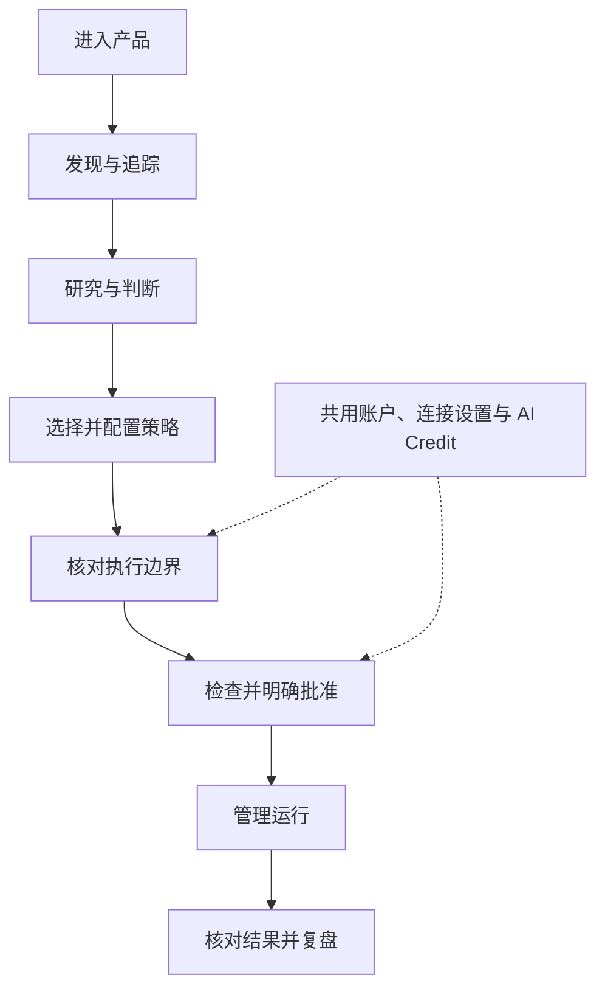
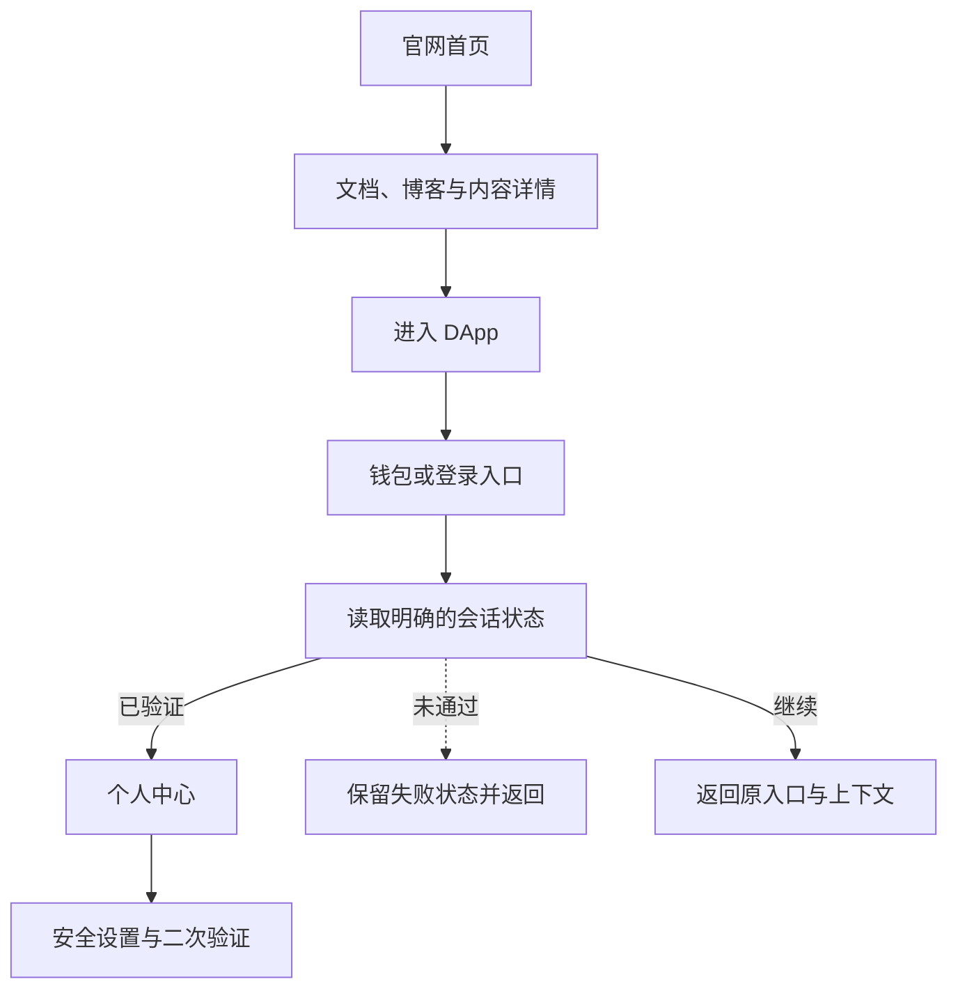
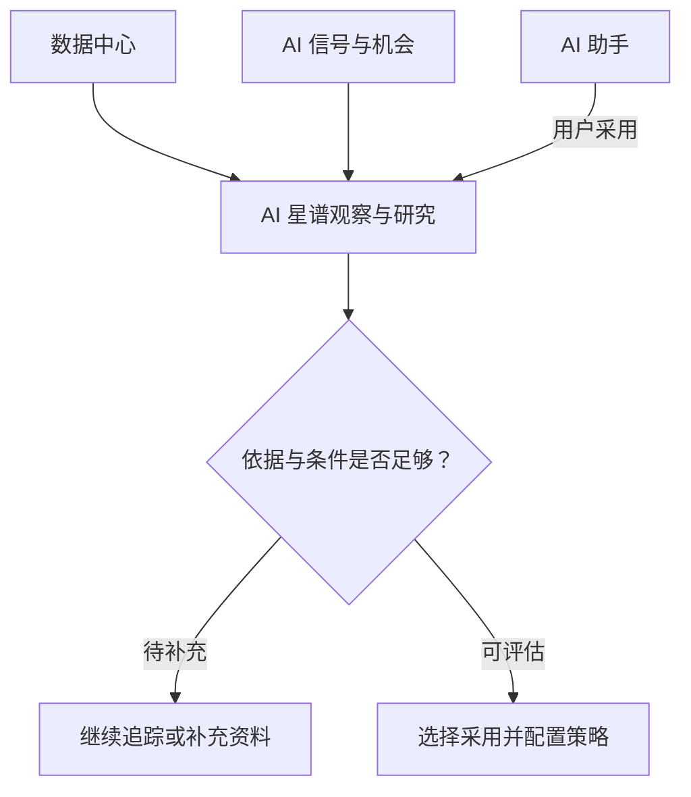
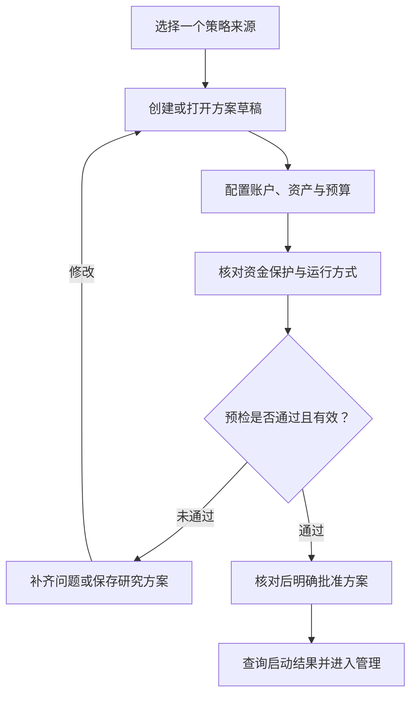
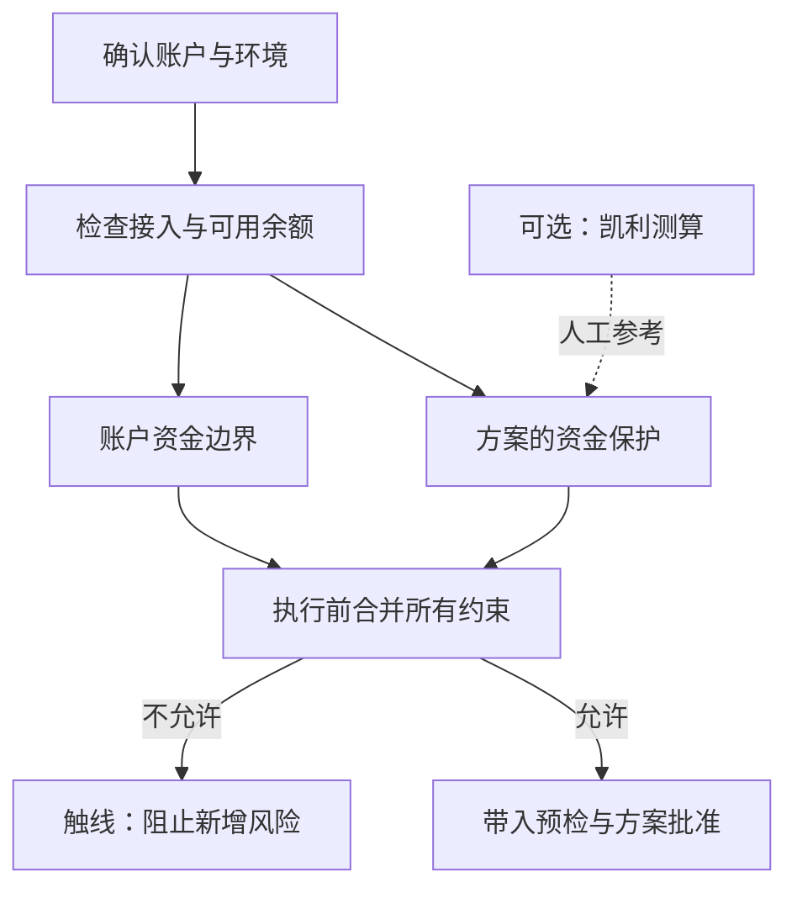
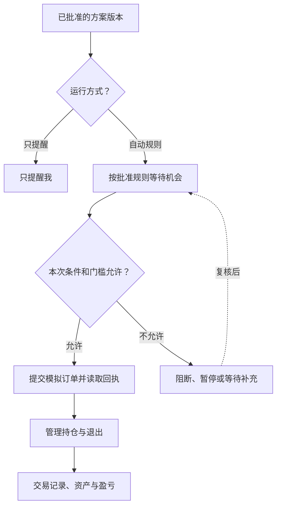
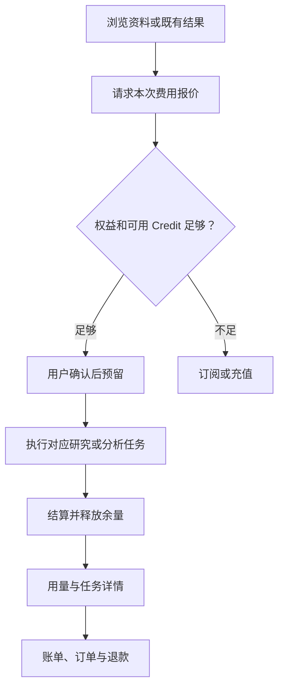
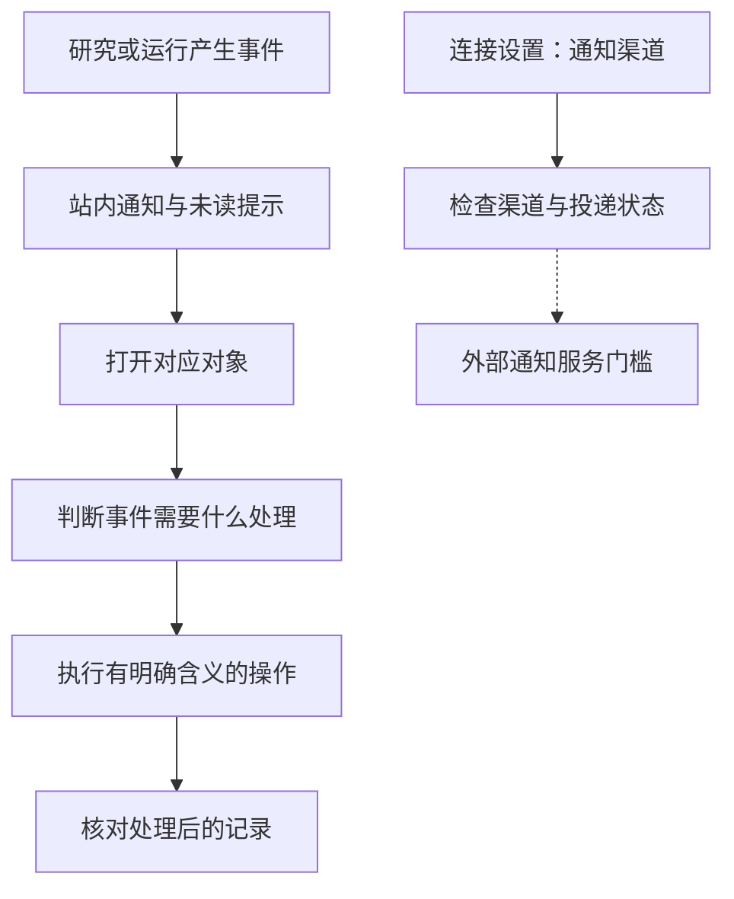
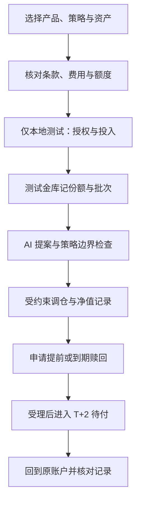

# Astarter 全站跨页面业务流程

更新日期：2026-11-17（UTC+8），R3 本轮增量快照。生产为 `7dfb27e`（READY）；R3 `ab31a0d` 是已构建预览和 LOCAL_UI_ACCEPTED，尚未云端启用。保留 32 主路由、8 安全视图、9 图及历史 d461 / N1 / R2 证据；按生产、预览与本地验收、待接续分层，不把预览当生产可用。

核心逻辑：发现与追踪 → 研究判断 → 策略配置 → 接入和风控 → 预检及明确批准 → 观察或模拟运行 → 回执与复盘。

## 01 · 全站主线：从发现到复盘

**主应用 · 执行为模拟**

页面围绕同一件事协作：把市场线索变成可检查、可批准、可追溯的交易方案。

- 市场价格、技术图表、扫描结果和 AI 研究只提供输入；看见信号不等于批准下单。
- 策略目录、AI 信号、AI 星谱和助手可以进入同一配置与检查流程；不需要先把每个页面走一遍。
- 运行、订单、成交与盈亏应按账户、来源、运行实例和方案版本核对；复盘后可回到发现或修改下一版方案。

依据：`product-data.mjs`, `product.js`, `business-pages.js`, `strategy-journeys.mjs`

## 02 · 入口、账户与安全

**网页钱包 QA 登录通过 · 真实用户与真机待验**

公开内容帮助理解产品；DApp 内的模拟环境与真实账户连接是不同的能力边界。

- 演示浏览不应被画成必须完成真实钱包签名才能进入；交易权限需在具体方案中另行检查。
- 连接钱包、登录身份、交易接入、提款权限彼此不同。连接成功不表示可交易，也不表示授权提币。
- N1/A1 正式版要求显式签名 `private-ui-v2`，新增工作区与站内通知读写权限。旧 v1 不自动提权；该签名不授权交易、代币批准或转账。
- 安全页由 account-access.html 单独承载，8 个视图保持原入口。PRIVATE HTTPS 已接入正式服务；当前采用限额、有期 lease，登录与退出已验，尚未进行全天持续可用性验收。
- 本轮正式 HTTP 验收使用两个临时 QA EOA，各完成一次真实 v2 签名；另一个临时 QA EOA 完成真实页面登录与退出。nonce、message、verify、logout 均为 200，Secure / HttpOnly / SameSite=Strict Cookie、当前会话清空和退出后旧 Cookie 失效均通过；不代表真实用户钱包或全部安全视图已验收。
- 连接、签名登录和服务异常分别处理。研究要求重新验证时先核对服务器会话，再查询原任务；登录异常不应阻断钱包连接入口。
- 现有 Reown 公共项目标识已配入构建，SDK 的生产域名检查通过；手机实际扫码、配对和签名尚未验收。

依据：`landing/photonic-source/site-routes.mjs`, `landing/photonic-source/public-page.mjs`, `account-access.mjs`, `account-security.mjs`, `wallet-entry.mjs`, `account-center.mjs`, `vercel.json`, `header-wallet.jsx`, `wallet-session.mjs`, `wallet-private-auth.mjs`, `wallet-runtime.mjs`, `wallet-profile-upgrade.test.mjs`, `wallet-private-auth-v2.test.mjs`

## 03 · 数据、信号、追踪与研究的汇合

**真实行情技术观察 / 演示研究分开**

入口不同，资产身份、来源、时间和研究结论需要能够接续。

- 我的追踪是共用资产清单；已在研究中的资产可回到对应任务，其余进入资产详情。它不是执行白名单或交易授权。
- 全市场扫描四象限、K 线自动轮换与技术标注属于分析视图；不同市场的数据时点与可交易能力需要分别判断。
- R1 保留八资产的已收盘日线，并接入 BTC、ETH、SOL 的 Binance Spot 前 100 档盘口快照。正常读取间隔约 15 秒，盘口从原请求起点计 30 秒有效，日线与盘口分别判断有效期。
- 盘口显示 spread bps 及中价 ±1% 内的买卖报价金额（USDT notional）。买卖两侧覆盖不足分别显示 ≥ 保守下界；覆盖完整仅描述该次快照，不保证后续覆盖。100 档采样不代表全盘口、成交资金流或方向，时间记录为请求观察窗口，非交易所事件时间。
- 三币的日线和盘口都鲜活时，可计入 2/6 个来源组、6/18 个字段；其他五个 TradFi 标的仍无盘口，鲜活日线仅计 1/5 个适用来源组、3/18 字段（来源组分母排除链上 NA，字段分母仍为 18）。过期或不可用的资料不计为有效依据。
- 八日线、三币现货盘口、来源有效期及三类共享背景已在各自范围验收。共享背景不等于宏观事件、舆情、链上和账户风险全面覆盖；其他五标的盘口仍缺，TradFi 链上资料不适用，DXY 与 US10Y 价格也不替代宏观事件。技术观察不自动授权模型或交易；缺项、过期与来源限制须保留。
- R2 已在正式 canonical 完成恰好一次 BTC / `openai/gpt-4.1-mini` 真实调用并持久化，输入 362、输出 190，共 552 tokens。最初 actor 因公开 error:null 投影不兼容而 exit1，不能改记成功；后续对同一真实记录只读检查及 RAM 内旧投影 RED / 修正投影 GREEN 通过，原结果不变、严格客户端不变，没有第二次模型调用。此证据是后端完成加同记录解码，不是完整用户钱包界面或 18 角色模型质量验收。
- 只有明确点击“开始研究”才提交任务。打开、刷新、返回详情仅查询原 requestId；结果未知或查询 404 时不新建编号，用户明确重试也沿用同一编号和请求内容。
- 八类资产分别保存任务，沿用同一用户身份；切账户、身份过期或离开时取消旧视图并拦截晚到响应。技术观察或模型结论都不直接授权交易。
- AI 星谱是研究与操作台入口，助手保留解释、引用与草稿衔接能力，两者沿用对象和返回上下文。交易或付费研究仍须经过各自授权与确认，不因打开某个页面而执行。
- R3 私有报告到策略草稿已在预览 / 本地接线范围达到 LOCAL_UI_ACCEPTED：从 canonical 私有报告显式选择 S01-SIM 或 S02-SIM 及 BTC / ETH / SOL，金额和未填写参数初始为 null。复用原 BOT workspace 与 MoneyInput，不从模型散文解析或编造金额；这段新流程没有新增真实模型或交易执行证明。

依据：`data-center.mjs`, `market-hub.mjs`, `watchlist-view.mjs`, `intelligence-experience.mjs`, `trading-assistant.mjs`, `photonic-workbench.mjs`, `workbench-market-analysis.mjs`, `live-research.mjs`, `live-research-workspace.test.mjs`, `research-analysis-service.mjs`, `research-analysis-service.test.mjs`, `research-job-client.mjs`, `research-job-coordinator.mjs`, `research-runtime.mjs`, `private-api-route.mjs`, `spot-depth-client.mjs`, `spot-depth-data.mjs`

## 04 · 策略选择、配置与批准

**18 个策略入口 · 适配能力逐项检查**

所有来源都需要落到明确的方案版本，而不是把“点击推荐”直接等同于运行。

- 目录共有 18 项，不代表 18 项都已支持运行。未适配的策略版本、市场或连接可以保存研究方案，但不能绕过启动门槛。
- 有效预检需覆盖具体接入、账户、资产、模式、预算、保护与服务状态。既有五步引导标示检查有效期 5 分钟；关键设置变化会使检查失效。
- 启动结果未确认时查询原 requestId，不重复创建实例；离开未保存或正在提交的草稿，会先处理保存、放弃或等待。
- 模板从操作台打开后返回原入口；配置中的接入管理保留草稿上下文。新方案的保护偏好不自动重写已有运行。
- R3 预览 / 本地流程：私有报告 → 明确选 S01-SIM 或 S02-SIM、BTC / ETH / SOL → 保持未填金额 / 参数 null → 服务端协议预览 13 组差异 → 用户确认同一 draftID、expectedRevision、workspaceRevision 与 proposal token 后 adopt。状态仍为 NONE / DEMO / SIM-01、Binance spot 元数据；草稿采用不等于预检、交易批准、开户或启动交易。
- R3 原 ID 恢复与读回：结果未知只 query 原请求；GET 返回 null 不生成新 POST。同 ID GET 读取当前最新版本并核对字段，并发较新 GET 不能被旧回执覆盖；云目录协议按同一 ID 重新打开。上述目录与协议行为目前只在 SYNTHETIC_WIRE_ONLY 本地接线验收，未称已由云 PG 持久化。手机金额完整显示、无悬浮助手遮挡，桌面1440 / 手机390视觉属于本地范围。
- S03 / Q08 当前暂停推进。既有有限、合成输入的 native 验证不代表连续 PAPER 运行，也不代表真实交易已开放。

依据：`strategy-catalog.mjs`, `bot-hub.mjs`, `strategy-journeys.mjs`, `strategy-routing.mjs`, `setup-view.mjs`, `trading-access.mjs`, `business-pages.js`

## 05 · SIM-01、账户限额与策略风控

**模拟账户 · 风控参数按作用域生效**

账户身份、共用资金边界和每个方案的退出保护分别表达，最后在执行前一起约束。

- 账户限额控制共用额度和暂停线；方案保护控制该策略的单次风险、仓位与退出。它们不是互相替代的两个选项。
- 账户限额不因切换策略而重置。保护偏好及其自定义参数主要用于新建方案；现有运行仍按其获批版本处理。
- 凯利是风险预算测算：使用扣除成本后的盈亏比，并受保护上限约束。测算值不是下单金额，也不会自行提交订单。
- 暂停新增买入不等于清仓，也不保证既有挂单不会成交；须继续核对订单、持仓和保护状态。

依据：`workbench-console.mjs`, `strategy-protection.mjs`, `risk-strategy.mjs`, `trading-access.mjs`, `workspace-sim.mjs`

## 06 · 运行、只提醒、成交与复盘

**模拟执行 · 不代表实盘服务**

批准方案后仍要区分观察与执行，运行中的风险检查也不会因首次批准而跳过。

- 我的 Agent 展示当前运行、保存方案和结束记录；按 runId 定位具体实例，不能让新实例显示上一实例的状态。
- 交易记录可追溯到方案、订单、成交与费用；资产和盈亏由对应账户的账本计算。AI 星谱与策略 Agent 的来源需分开。
- 盈亏活动图每个点对应一个时间子区间，正负各四档；日、周、月、全部只改变查看范围，不制造成交。
- 浏览器模拟与本机服务模拟的持续运行条件不同。浏览器关闭、服务停止或读取未恢复时，不应展示成持续受保护的实盘运行。

依据：`strategy-journeys.mjs`, `execution-views.mjs`, `execution-stream.mjs`, `execution-records.mjs`, `bot-hub.mjs`, `workbench-charts.mjs`, `local-sim-desk.mjs`

## 07 · 订阅、Credit、用量与账单

**本地商业流程 · 云端收费未开通**

服务费用与交易本金分账。涉及付费任务，先报价和确认，再预留与结算。

- 四个商业页面分工：订阅看权益，充值增加模拟 Credit，用量核对任务消耗，账单处理订单及退款。质押旧入口已重定向到订阅。
- 查看报价不创建充值订单；明确确认后才创建。充值完成也不自动启动原研究，需要回到报价确认。
- 预留不等于实扣；未确认任务需要查询原任务，不能直接算作成功、退款或重新扣费。余额、用量和账单使用同一归属。
- 当前云端 commerce 接口明确不可用；本地模拟购买、退款和计费规则不代表真实收款、支付或付费供应商已接通。

依据：`membership.mjs`, `membership-account.mjs`, `commerce-ui.mjs`, `commerce-catalog.mjs`, `vercel.json`, `DEPLOYMENT.md`

## 08 · 操作台、通知与问题处理

**站内记录与外部投递分开**

操作台的交易、信号、通知分别承担配置执行边界、选择方案和处理事件。

- 交易页签配置账户边界及新方案保护，并进入策略选择与运行管理；信号页签从来源或模板打开方案；通知页签处理已有事件。
- 通知红点、模拟消息与真实记录必须分开。查看通知或切换页签，不应启动交易、修改风控或扣 Credit。
- 全局设置聚合交易接入、研究数据、AI 模型及通知；钱包另由钱包入口承载。返回原页面时保留对象与编辑上下文。
- A1 已在正式配置概览提供账户工作区：读取云端、应用偏好、保存当前偏好、查询原请求。读取不会自动应用，应用不会替代保存；只有明确保存才提交元数据命令。真实保存、重新读取及页面应用已验收。
- 元数据白名单仅含追踪标的、筛选与焦点、草稿名称目录和选中项；不包含策略参数、风控与批准、交易凭据或资金。目录不是可执行策略备份。
- N1 将通知设置与右侧操作台接到服务端账户收件箱，不替代 `?page=inbox` 待办页。显式 responseVersion=2 读取 private-notifications-v2；红点用全局 reminderUnreadCount，按站内开关及分类统计，与历史 unreadCount 分开。关闭提醒保留历史；已读与红点等待服务端回执。未知命令仅原 ID GET 恢复，冲突先读新版本，既有 v1 回执不改写。R7 已实际验五次命令及偏好、已读与 1440 / 390 / 430 界面；新双账户验收补齐身份切换、隔离和退出，分段范围见末节。
- 新建、切换或续期后的已验证身份读取一次通知状态；打开通知、手机返回操作台及成功写入后刷新 v2 状态，不做后台轮询。未决原请求不会被自动读取覆盖；独立通知版本防止工作区操作吞掉刷新，显式重新读取同步设置草稿，并保留读取期间新编辑。
- 既有外部渠道轮询、关闭取消与本地 outbox 证据保留，与 N1 非轮询刷新分开。R7 的通知操作段和后续独立双账户段分别有实际结果；原 R7 因 B 登录超时失败的整轮记录不改写。邮件及 Telegram 延期，订阅服务不在本批验收范围，没有真实外部投递或发送 worker 验收。

依据：`workbench-console.mjs`, `workbench-console-examples.mjs`, `notification-settings.mjs`, `notification-service.mjs`, `connections.mjs`, `product.js`, `vercel.json`, `notification-settings.test.mjs`, `private-ui-controller.mjs`, `private-workspace-client.mjs`, `private-ui-data.mjs`, `private-ui-service.mjs`, `private-ui-runtime.mjs`

## 09 · AI 理财：主入口与本地测试

**主路由已接线 · 真实资金未开放**

产品浏览与候选条款从 9f542e1 发布，正式版 8b1f44b 新增并验收四资产只读市场参考；资金闭环仍限本地测试能力门槛。

- wealth 已登记在主应用 32 个路由标识中，并接入主导航、页面装配与离开清理。USDC、USDT、WETH、WBTC 接入 Aave V3 · Ethereum 底层供给参考 APR、可用流动性原始单位、区块和更新时间；参考 APR 不是理财产品收益。四类产品与条款可浏览，账户余额与个人收益保持未知，服务失败显示缺失值与重试状态。
- 真实资金入口保持禁用；仅 localhost / 127.0.0.1、chain31337 且能力检查通过后，用户显式打开本地测试金库。公开域名即使收到测试配置也不能开放资金。
- 此处描述测试资金、测试报价与本地金库闭环，不代表主网资产、真实收益、真实钱包或生产资金托管已接通。
- T+2 从受理后进入待付状态；到期、申请赎回和最终付款是不同事件。具体参数以该候选当前条款及服务检查为准。

依据：`wealth-entry.mjs`, `wealth-entry-catalog.mjs`, `wealth-entry.test.mjs`, `wealth-market-data.mjs`, `wealth-market.mjs`, `wealth-public-market.mjs`, `ai-wealth.mjs`, `wealth-manager-client.mjs`, `wealth-vault-service.mjs`, `wealth-vault-chain.mjs`, `product-data.mjs`, `product.js`, `business-pages.js`

## 全部页面与入口

| 路由标识 | 页面 / 入口 | 业务逻辑 |
|---|---|---|
| `?page=wealth` | AI 理财 | 主导航中的四类产品与候选条款；真实资金禁用，本地测试金库须通过独立能力门槛。 |
| `?page=workbench` | AI 星谱 | 多资产扫描、研究、证据与右侧操作台；衔接策略配置、运行和来源详情。 |
| `?page=strategies` | 策略 Agent | 18 项策略目录、筛选与推荐；?create=策略ID 进入同页方案工作区。 |
| `?page=execution` | 我的 Agent | 当前运行、保存方案、结束记录与按 runId 的实例详情。 |
| `?page=signals` | AI 信号 / 智选信号 | 筛选与追踪线索，查看依据后研究或采用方案；信号不是交易授权。 |
| `?page=opportunities` | 机会发现 | 研究机会与判断结果的辅助入口，进入同资产研究或策略配置。 |
| `?page=markets` | 市场行情 | 公开市场总览、资产详情、自选、排行与图表；实时、只读合同与演示模式分开。 |
| `?page=tracking` | AI 与链上追踪 | 指标与资产追踪、历史和来源；不把转账等同买卖或收益。 |
| `?page=intelligence` | 宏观舆情 | 新闻、事件与宏观资料；按来源能力区分公开只读与样例。 |
| `?page=social` | 社媒动态 | 观点、账户与历史动态；可带入助手或研究，不等于跟单。 |
| `?page=derivatives` | 合约与清算 | 衍生品观察与数据详情；观察到某市场不代表已适配执行。 |
| `?page=etf` | ETF 资金 | 基金流向、历史与详情，为研究提供背景。 |
| `?page=assistant` | AI 助手 | 带上下文对话、分析和来源返回；付费任务需报价确认，方案需明确采用。 |
| `?page=watchlist` | 我的追踪 · 浮层入口 | 导航打开共用追踪浮层；旧直链归一化后返回主页面，不是独立交易页面。 |
| `?page=advisor` | 帮我选策略 | 按偏好生成建议，再落到草稿、检查与批准；不能直接替用户启动。 |
| `?page=copy-trading` | 聪明钱跟随 | 地址/交易者观察与固定样例规则回放；不是已接通的真实跟单或历史收益回测。 |
| `?page=contributions` | 我的贡献 | 保存候选策略版本、检查和风险说明；保存不等于上架、审核通过或奖励到账。 |
| `?page=setup` | 初始设定 · 辅助流程 | 保留五步引导：偏好、接入、方案/保护、预检、确认；主流程也可从策略配置开始。 |
| `?page=validation` | 策略检查 · 辅助入口 | 检查当前保存配置；改账户、策略或保护后需要重检。 |
| `?page=mandate` | 交易方式 · 辅助入口 | 保留运行方式设置；新方案区分批准规则运行与只提醒，旧逐笔设置需更新。 |
| `?page=inbox` | 待办事项 · 辅助入口 | 待处理研究或运行事项；核对来源再执行对应操作。 |
| `?page=risk` | Astarter 风控策略 | 保护规则说明、参数与方案关联；不是账户限额的替代品。 |
| `?page=logs` | 交易记录 | 按账户/来源/运行查看委托、成交、费用与上下文；与商业账单分开。 |
| `?page=assets` | 资产信息 | 可用、占用、持仓与盈亏，钻取运行和订单记录。 |
| `?page=my-strategies` | 旧“我的策略”入口 | routePage 重定向到 execution，不作为额外独立页面。 |
| `?page=plans` | 订阅 | 套餐权益与当前/下期生效；购买经模拟报价与确认。 |
| `?page=topup` | 积分充值 | 选择金额、确认报价、查询原订单；到账后回原任务再确认。 |
| `?page=usage` | 用量 | 范围筛选、任务、预留/实扣/释放与导出，不与交易资金混算。 |
| `?page=billing` | 账单 | 订阅/充值订单、状态、退款和导出；交易成交另在 logs。 |
| `?page=staking` | 旧质押入口 | routePage 重定向到 plans；没有单独可用的质押产品流程。 |
| `?page=profile` | 个人中心 | 身份、账户与邀请等资料入口；安全功能由独立页面承载，依赖对应服务。 |
| `?page=settings` | 连接与设置 | 交易接入、研究数据、AI 模型及通知；保留草稿返回上下文。正式 A1 配置概览提供账户工作区元数据四动作，已完成云端 HTTP 与页面读取、应用验收。 |

### 独立安全页面

`account-access.html?page=…`

| ID | 视图 | 业务逻辑 |
|---|---|---|
| `login` | 登录 | 选择登录方式，未完成挑战不产生会话。 |
| `security` | 安全总览 | 查看绑定与保护状态，发起具体安全操作。 |
| `account-social` | 社交账户 | 查看和管理绑定；受服务与验证能力限制。 |
| `email` | 邮箱 | 发起、验证和管理邮箱操作。 |
| `two-factor` | 双重验证 | 启用、验证与恢复码保管；不跳过必要验证。 |
| `verify` | 二次验证 | 保护敏感操作；成功后回到原操作。 |
| `recovery` | 账户恢复 | 验证恢复条件；已提交不等于已恢复。 |
| `sessions` | 登录会话 | 核对设备会话与退出结果。 |

### 官网路径

| 路径 | 用途 |
|---|---|
| `/` | 官网首页 · 默认英文 |
| `/zh` | 中文官网首页 |
| `/{lang}/docs` | 文档目录 |
| `/{lang}/docs/{article}` | 文档详情、相邻文章与返回 |
| `/{lang}/blog` | 博客列表、分类与搜索 |
| `/{lang}/blog/{article}` | 博客详情及延伸阅读 |
| `/{lang}/ecosystem[/{article}]` | 生态总览与条目详情 |
| `/brand-kit` | 品牌资源与视觉规范 |

## 能力边界与验证范围

- 公开市场与只读接口：按数据源显示质量、时间、缺失和错误；不能推导为交易能力或全市场实时覆盖。
- 策略交易：现有前端与本机模拟闭环，不是交易所实盘执行、24 小时托管或主网保护服务。
- 钱包、账户工作区和站内通知已接正式 PRIVATE；临时 RAM QA 身份的真实 HTTP、页面签名、隔离及退出有实际证据。R2 的一次真实模型调用与同记录解码已证实，尚不代表真实用户钱包整段界面或广泛模型能力。commerce / 订阅、外部通知、local-sim、assistant 与未支持的 /api/v1 能力不因本批结果而开放。
- AI 理财只读市场已正式接通四资产 Aave V3 · Ethereum 参考，API 原始单位与页面区块、时间及参考值一致。匿名 headless 正式点验 87 / 87 断言通过，覆盖四产品、资产切换、刷新与加载、受控网络失败和恢复、主导航及资金禁用；1440×1000、390×844、430×932 无横溢出或页面错误，截图已独立实看。实际父退出码 0，context、浏览器和实际 Chrome 进程均关闭；结果落盘前记录用时 17.005 秒。零 EOA、签名、非 GET 请求、私有桥、模型和资金操作。资金闭环仍为本地 chain31337，主网、个人余额及真实收益未开放。
- R1 已接八资产日线与三币现货盘口，并按既定范围验收来源、单位、有效期 / 自然过期及三类共享背景。100 档不是全盘口，其他五标的盘口及宏观、舆情、链上、风险覆盖仍有限；背景参考不计成全面研究或交易批准。
- 正式站三币盘口 GET 200 且快照校验通过。真实 headless 点验已通过桌面 1440 中英文与手机 390 紧凑视口的盘口显示、响应式布局和语言切换，无横溢出或页面错误。手机仅显示 Liquidity 和价差，细项由 CSS 折叠。测试阻断 WS 及 wallet/session GET，不验证全行情健康、钱包或研究；ready=false 为源码与单测结论，非浏览器内部直读。
- 当前生产为 7dfb27e，LensWave 英文 / AI 星谱中文命名及真实单 job 主界面状态保留。历史 d461 的发布、一次 BTC552 tokens、同记录解码及 N1 / auth8f28 分段证据不重写；R3 新本地接线不增加这些真实模型或生产验收次数。
- 生产：7dfb27e / `dpl_P4qycHYHfQepMLfceMikKeSrfP7x` READY。R3 候选：`ab31a0d7f231d4d73fdf344eabd0f143b87064a0` 已在 GitHub codex/lenswave-private-drafts，Vercel `dpl_GFHUCEcsCG4gxmP5LY5k9QLC75u8` READY，入口 [R3 预览](https://astarter-frontend-dkh1pebus-starktrump69-5126s-projects.vercel.app)。本轮 release 与10个公开 JS / CSS SHA 匹配，HTML本体匹配另有平台 feedback script；新 API 匿名 probe 为403 ORIGIN_DENIED / NONE，preview Origin / flag 未启。READY 证明构建可访问，不证明新 R3 生产或云 API 可用。
- R3 预览全套 2,268 / 0 skip。本地 F6 r4 有91项业务达成但 outer FAIL 的原记录保留，后续 tail49 / outer0 补齐本地 v2 A / B 钱包 UI、退出、owner隔离、并发较新 GET 及1440 /390视觉。全部基于 b682 SYNTHETIC_WIRE_ONLY，不是 PG / v3、云迁移或新的真实模型证据；也不能把两段写成原 r4 单轮通过。
- 历史生产 d461b9d38ad7ce41a875acb522cf828579cb1b4d / dpl_Bd3TW42WpN7z1B9tCdR1MYZjYkHP 的 READY、exact release、16 UI SHA 与匿名门控证明保留；2124 / syntax / build15 属于该版本。已核 PRIVATE main1b6704b / backend28 / Core0d5347d 的记录未被本轮本地候选替代。本轮未执行生产迁移，也未改变生产 flag / Origin。
- R3 后端候选为本地 Core d59c318 / PRIVATE551904a，closed-market clock 与 v2 迁移兼容的本地修复已通过独立审查。独立 Neon QA 项目 floral-flower-28894267 / br-holy-shadow-b3li8mz9 仅经管理元数据15项核对；原 create 响应解析 UNKNOWN 保留，不重写或冒称创建步骤已明确成功。尚无云 SQL、oracle、生产迁移、flag 或 Origin 验收；管理读回不证明数据库 schema、权限或草稿功能通过，下一有限 provision / oracle 包仍在准备。
- R3 本轮预算约束：服务加模型月共享总额仍为50 USD。QA最多1 USD在原服务预留24 USD内部单列，其余服务缓冲23 USD，不新增第51 USD，也不按钱包复制额度；模型及既有 held / spent 仍受原共享预算约束。预算分项不是已发生费用，本轮不新增真实模型或资金操作。
- 既有本地 Node → Core → PG 的 47 次 RPC 与一次预算拒绝证据保留。本轮 LOCAL final04 经主任务核对：真实 Node → ASGI → 自有 Unix PG / 原触发器完成 8 项检查、55 次 RPC，实际退出码 0；覆盖跨 owner 写入拒绝、真实已读提交后客户端响应体被丢弃及原 ID GET 找回，一条通知确认已读。不是 PG COMMIT ACK 丢失，也不是 Cloud 通知验收；云端、模型、外部投递和执行均为 0，自有 Node、HTTP、连接池及 PG / PID / alias / fixture 已清理。
- schema 2 与原有表、lease / 连接池接线的既有证明保留。旧 8b 的 7 公共 SHA / 4 私有 404 及匿名 401 / no-store、钱包 200 / null 是历史门控证据；当前 d461 的 release、16 UI SHA 与匿名研究拒绝另已回读，不混成同一轮或全站健康证明。
- 前次 rc2 在 nonce 收到 503 的失败记录保留。后端修正后，在数据库空闲超过 5 分钟后执行 rc3：30 次请求（18 GET / 12 POST）全部为 200、34 项断言通过、两个临时 EOA 真实签名两次，业务写入四次；同 ID 按账户隔离、真实提交丢响应后的原 ID GET 恢复、通知偏好独立读回与跨账户隔离均通过。父进程实际退出码 0，两个会话退出及旧 Cookie 撤销、两个 context 关闭均确认，结果落盘前的记录用时 29.573 秒。
- 正式 DOM r2 在新建自有 headless Chrome 中完成真实页面 v2 登录、一次元数据保存、页面重新读取、应用偏好、展开草稿目录及页面退出。1440×1000、390×844、320×740 三种视口的 31 项断言与三张截图通过独立复核；12 条关键接口记录均 200、四次钱包 POST 与一次元数据 POST、一次真实签名。父进程实际退出码 0，context、浏览器及 Chrome 进程关闭、当前会话与旧 Cookie 撤销均确认，结果落盘前的记录用时 29.247 秒。无横向溢出或页面错误，目录保持在卡片内，320 宽度的通知概要按钮位于第二行。
- 前版 DOM r2 仅验连接概览的工作区和通知概要，未进入通知设置或收件箱。首轮 b882 实际为 `FAILED_NO_REPLAY` / `QA_ADMISSION_FAILED`（ADMISSION），父退出码 1，close / file_cleanup CLOSED；journal 未进入 run_business，没有 identity 或成功 ACK。首因仍是通用准入错误，不能写成已证实超时或产品失败；该轮页面端为 0 execution，没有浏览器、EOA、签名、nonce、POST 或运行 marker。旧 attempt 已闭合并保留失败记录，不重放其原请求、once 或运行记录。原环境、预算与次数范围内的新独立有界验收仍有授权，需另行精确协调；先前 fixture-only READY 证明仅属离线握手，不是生产通过。
- 第二轮 bf3e6e63 已实际由单父 coordinator 直接衔接：READY 到页面进程启动记录为 1.446 毫秒；实际协调父进程退出码 1，Native / UI 子进程也均为 1，子进程已回收。Native 为 FAILED_NO_REPLAY / ADMISSION，close / file_cleanup CLOSED。页面端在 `QA_MARKET_PROTOCOL` 失败：已启动浏览器并生成 2 个 RAM EOA，A / B 签名均为 0，通知命令为 0，只有 5 项启动断言，没有截图或布局验收。记录中有 6 资产日线、无盘口，不构成八日线 / 三盘口、切换、暂停、过期或手机专项通过。context、浏览器和实际 Chrome 进程关闭及私密身份桥清理字段为 true，但 UI cleanupStatus 仍为 unconfirmed，不写成清理全通过。通知设置、收件箱、红点、已读、切账户与退出的正向生产 DOM 验收仍未完成；通用行情协议错误也不直接定性为产品缺陷。
- 历史证据原位保留：private-ui-production-7a030896-rc3/evidence、private-ui-dom-production-7a030896-r2/evidence、wealth-readonly-production-8b1f44b/evidence，以及前四轮原失败 / 准备记录和各自实际退出收据。旧 snapshot 的 held41,780 / spent0 / 未占用25.95822 USD 及 ui-reserve24-apply-actual.json、neon-monthly-resource-actual.json 仍为当时证明，不表示本批当前余额或模型永久关闭；R0、R7、R2 与指定钱包 policy 的新证据分别记账。
- 第三轮 a5454b44 实际父退出码 1（Root session18531 / chunk0f1638）。A 完成一次 v2 SIWE 签名，8 日线 / 3 盘口数据 gate 通过，不能扩展为切换、暂停、过期和手机交互全部通过。Native 单 policy 插入及原 research/claim、research/finish 已 COMMITTED，随后 policy block COMMITTED；research/get 泛失败，历史原因未证。页面端点击旧隐藏 .pw-assets 的 BTC 控件超时；主任务已核对匿名诊断 exit0 与唯一截图，确认 QA 旧选择器错误。前三轮原失败、once 和已提交行均保留，不重放。
- 第四轮 7b433b88 仅完成准备：真实 visible strip 三处选择器、先原 ACK 后 marketChecks、安全错误与公开 3WS 包通过离线 43 + 34 检查及双审。终窗剩余 234 秒，小于约定 240 秒，未创建 bridge / GO / once / actor，零 live 执行；不能记成代码失败，也不能记成生产验收通过。新的独立有界验收仍按原环境、预算和次数授权精确协调。
- 历史 R0 fix1 只读快照：session42291 / e9b748、exit0，1 次 REPEATABLE READ READ ONLY / 3 SELECT / ROLLBACK、连接关闭，DB mutations / models0。当时已知 QA 为 3 policies / 3 requests，原两行摘要不变，第三 policy blocked、research complete 结构与时序 exact、risk0；当时 fixed24,000,000 / held62,670 / spent0 / limit50,000,000 微美元，未占用模型池25.93733 USD。该 032135f1…证据不是全用户或当前余额快照，不证明历史 GET 失败原因。
- 指定钱包（0x5b6…d4c3）的本月共享研究 policy 已实际 INSERT / COMMITTED / 独立读回 verified（session92786 / c63f1c，exit0，三项关闭）。提交本身零模型调用、未伪造本人签名；仍须该钱包本人完成签名与会话。绑定时 global limit50 USD 包含固定服务24 USD 和既有 held0.2089 USD，子 policy 限额25.7911 USD，不是每钱包另送50 USD；普通未授权钱包不自动获得 policy。公开共享文档仅保留掩码，不包含凭据、签名或私有响应体。
- 本机真实研究 handler 经 57 次真实 PRIVATE HTTPS RPC 跑通双 owner 接线：两条记录 complete，原 ID 重放不增加模型替身调用，跨 owner 查询为 404，另一 owner 使用同 ID 可独立完成。
- 历史双 owner 接线的 source / model / provider-budget stub 各两次、billing=null、旧 QA policy 关闭与 held41,780 微美元证明继续保留，不能冒充后来的真实模型调用。本批真实 R2 QA policy 也已实际 BLOCK / COMMITTED（13939 / 7993be，exit0，三项关闭）；该 QA held20,890 微美元保留，spent0，不当作已付费用。
- 服务与模型共用每月 50 USD 总预算，固定服务预留24 USD，模型毛额26 USD，额度包含各已有 held / spent，不因钱包或模块增加而复制。平台既有资源额度为 compute669,600 / active2,678,400 秒、written268,435,456 / transfer1,073,741,824 / logical134,217,728 字节；0.25 CU、300 秒挂起和86,400秒历史保留不变，lease 仍为2026-12-01 08:00（UTC+8）。资源额度不是严格美元账单硬帽；这项旧预算操作零模型，后续一次真实 R2 单独记录，不能沿用旧 OFF 表述覆盖新事实。
- R2 实际 canonical BTC 模型完成并持久化，362 + 190 = 552 tokens；原 actor17927 / 767ecd 因 error:null 公开投影而 exit1，失败收据保留。原记录只读70491 / 1b50e7 与同记录 RAM55233 / 08e4b4 均实际 exit0：旧投影 RED、f29 修正投影 GREEN，严格客户端及原结果不变，fresh、executionAuthority=NONE，零第二次模型 / provider 调用。最小两文件修复已随 d461 上线；provider advisory449 微美元不是 provider 发票或账本实扣闭环。
- N1 通知操作段：R7 Native QA_NOTIFICATIONS_VERIFIED / exit0，按原 claim / finish 自然生成 QA 研究与风险两条记录。五次实际通知命令覆盖分类偏好、单条风险已读、站内提醒关 / 开和整页已读；首次保存丢响应后只查询原 ID GET，未重发 POST。红点 / 状态刷新、v1 兼容、历史保留和设置重新读取在 1440 / 390 / 430 视口通过。原 R7 整轮在 B 登录超时，coordinator / UI exit1 与 aggregate cleanup unconfirmed 保留；不把分段通过重写成整轮成功。
- N1 新身份与退出段：独立 auth8f28 实际 supervisor exit0（57472 / e56aa3），35 项 true、2 RAM EOA、2 签名、8 钱包 POST、2 张桌面1440 / 手机390截图、context / browser / 实际 PID 清理 confirmed。A / B v2 页面签名、地址、Cookie、退出、current=null、旧 Cookie revoked、connector disconnected 均通过；B 为不同且空的 scope，对已知 R7 原记录跨 owner GET 返回200且结果 exact null。该段零通知命令、Owner、模型或资金操作；与 R7 五次命令段合并说明验收覆盖，不声称同一 actor / 单轮全程通过。
- 待接续：R3 独立 QA 的有限 provision / oracle、真实云 PG / v3 接线和迁移验证，再按明确环境开放 Origin / flag；之后才可验 canonical 报告进入同一 privateDraft 的云端连续交接。本地通过不解除这些门槛。18实际角色编排、PUBLIC发布 / 撤回完整 X16、真执行、个人 NAV 与 warm-read-load 等缺口保留；指定真实用户钱包完整生产 UI、provider发票 / 账本实扣也不由本地钱包验收替代。S03 / Q08暂停，邮件 / Telegram后续，收费订阅排除。
- 研究弹窗让位、取消钱包后返回 ETH 详情及稳定焦点已发布，匿名正式 headless 点验通过（桌面 1440 / 手机视口 390）。这不代表实体手机配对、真实用户钱包签名或付费模型验收。

### 生产、预览及本地验收、待接续

| 能力 / 层级 | 生产或已构建预览 / 本地验收 | 待接续 |
|---|---|---|
| R1 · 真实行情观察 | 八日线、三币现货前100档、来源有效期 / 过期及三类共享背景按既定范围通过；既有2/6来源组、6/18字段口径保持。 | 其他盘口、宏观、舆情、链上、账户风险覆盖有限；背景或100档不是全量资料、交易批准或18角色自主研究。 |
| 钱包与身份 | auth8f28 新 A / B 页面v2签名、地址/Cookie、切换隔离、退出/current null/旧Cookie撤销与connector断开通过；35true、8钱包POST、实际父exit0和清理confirmed。 | QA RAM身份不代表指定真人钱包UI或实体手机配对；不覆盖全部8安全视图。 |
| R2 · 生产单次模型 | 历史 canonical BTC / openai/gpt-4.1-mini 一次完成并持久化552tokens；原记录旧RED / 修正GREEN、严格客户端及结果不变，生产保留真实单job主界面状态。 | 原actor exit1保留；R3本地接线不算新真实模型或18角色。云端报告→同一privateDraft与完整本人生产UI仍待验；449微美元advisory非已结费用。 |
| PRIVATE 接线 QA | 旧57 HTTPS双owner接线与各原记录保留；R7 Native通知通过；真实模型QA policy已BLOCK并验证，PRIVATE main已同步1b，运行仍为审查过的backend28/Core0d。 | 历史stub不等于真实模型；旧holds与新QA held20,890均保留而非费用。指定钱包policy与已关闭QA policy分开。 |
| AI 理财主入口 | wealth 路由、四产品与条款；四资产 Aave V3 底层市场参考接通，正式匿名 87 断言、1440 / 390 / 430 实屏与资金禁用通过。 | 参考 APR 不等于产品收益；账户余额、个人收益、主网和真实资金仍未开放。 |
| AI 理财测试金库 | 保留现有 chain31337 本地测试闭环；显式动作与能力检查后才打开。 | 测试授权、份额、赎回和付款不等于主网资金服务。 |
| A1 · 账户工作区 | 已正式接通；rc3 真实保存、账户隔离与原 ID 恢复通过；DOM 三视口完成读取、应用及草稿目录展开。 | 仅同步元数据，不含策略参数、批准或资金；草稿目录不是可执行策略备份。 |
| R3 · 已构建预览 / 本地验收 | LOCAL_UI_ACCEPTED：私有报告→显式S01-SIM / S02-SIM及BTCETHSOL→未填值null→13组diff→同draft / revision / workspaceRevision / proposal token确认adopt→原ID恢复 / 最新GET / 同ID目录重开；复用BOT workspace / MoneyInput。 | 全部b682 SYNTHETIC_WIRE_ONLY，NONE / DEMO / SIM-01 Binance spot元数据；不是生产、云PG、交易批准或新模型。 |
| R3 · QA管理元数据 / 待接续 | 独立floral-flower-28894267 / br-holy-shadow-b3li8mz9仅管理15项核对；原create解析UNKNOWN留存，本地后端兼容审查通过。 | 有限provision / oracle包准备中；云SQL、数据库权限与schema、生产迁移、Origin / flag及云端完整草稿交接未验。 |
| N1 · 站内通知 | R7五命令/偏好/红点/已读/原GET恢复及1440/390/430分段通过；auth8f28独立补齐双身份、B空scope/跨owner exact null、退出撤销与清理，实际父exit0。 | R7整轮B登录失败仍保留，不伪称单次全程通过；后续auth未重做通知命令。邮件/Telegram延期，订阅排除。 |
| 外部通知 | 既有设置轮询、关闭/作用域门槛与本地 outbox 保留；与 N1 一次身份读取、进入/成功写入刷新分开。 | 邮件/Telegram 延期，无真实外部投递或 worker 验收，不以站内已读代替外部送达。 |
| 策略运行范围 | E1 S01 / S02 仅模拟范围；既有有限native证据保留，S03 / Q08 继续暂停，真实订单0。 | 不称连续实盘或托管，主网、真实资金与全天执行未开放。 |
| 本版验证 / 分层 | 生产7dfb27e READY；历史d461 / N1 / R2证据保留。R3预览ab31a0d READY、10公开SHA匹配、2268 / 0skip，本地r4业务91与tail49 / outer0分段接受。 | R3原r4 outer FAIL保留；SYNTHETIC_WIRE_ONLY不是云PG / v3、生产迁移或真实模型。QA管理15检查不等于数据库功能通过。 |
| 发布状态 / 分层 | 生产7dfb27e / dpl_P4qycHYHfQepMLfceMikKeSrfP7x READY；R3仅在分支codex/lenswave-private-drafts / ab31a0d预览READY，本地后端候选551904a / Core d59c318。 | 预览 API403 ORIGIN_DENIED / NONE，Origin / flag未启；新云SQL / oracle / 生产迁移未做，不能称R3生产已接通。预算仍共享50，QA≤1包含在服务24内。 |

本轮只在原四份双语流程文件中更新生产 / 预览与本地验收 / 待接续快照。生产7dfb27e、R3预览ab31a0d、LOCAL_UI_ACCEPTED及QA管理元数据分别标注；历史d461 / N1 / R2与失败记录保留，不把本地或管理读回升级成云数据库和生产能力。32路由、8安全视图、9Mermaid / 9SVG、字体及表格样式保持；未重跑浏览器、测试或Cloud，也未新建报告或图。
